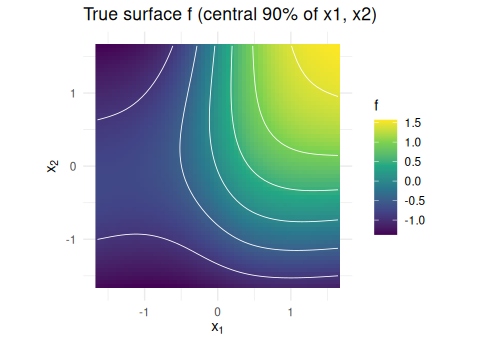
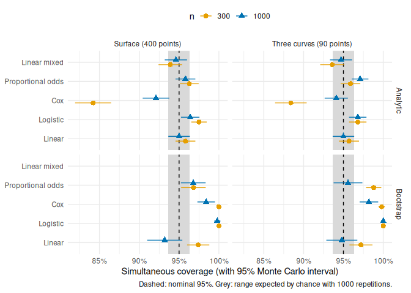

# Do the simultaneous bands cover? A simulation study

termeffects draws **simultaneous confidence bands**: bands that are
meant to contain the *whole* true surface, or all true curves, at once
with 95% probability. Ordinary (pointwise) 95% intervals only cover each
single point with 95% probability; over a surface of hundreds of points,
some of them will almost always miss. This vignette reports a simulation
study that checks whether the bands achieve their nominal coverage, for
the model types and interval methods termeffects offers. It is written
so that it can serve as the simulation section of a publication; it is
structured following Morris, White and Crowther (2019) (“ADEMP”: aims,
data-generating mechanisms, estimands, methods, performance measures).

The study itself runs for about two hours and is not re-run when this
vignette is built: the code is `validation/11_coverage_study.R` in the
package sources, and its results are stored with the vignette
(`coverage_study_results.csv`).

## Aims

To estimate the coverage probability of termeffects’ 95% simultaneous
confidence bands for a non-linear interaction between two continuous
predictors,

- for the main model types: linear regression, logistic regression, Cox
  regression, the proportional odds model (`rms::orm`), and a linear
  mixed model,
- for both interval methods: the analytic band (simulated sup-t critical
  value) and the bootstrap band,
- for a whole prediction surface (heatmap) and for a set of curves
  (cuts),
- at a small and a moderate sample size,

and to show how far pointwise intervals fall short of covering a whole
surface or set of curves.

## Data-generating mechanisms

**Predictors.** Two focal predictors with standard normal distributions
and correlation 0.4, and one adjustment covariate, also standard normal
and correlated 0.3 with the second:

``` math
x_1 \sim N(0, 1), \quad x_2 = 0.4\,x_1 + \sqrt{1 - 0.4^2}\,\varepsilon_2, \quad
w = 0.3\,x_2 + \sqrt{1 - 0.3^2}\,\varepsilon_3.
```

**True surface.** The effect of $`x_1`$ and $`x_2`$ is a non-linear
interaction. Its true form is defined in two steps. First, a smooth
target

``` math
g(x_1, x_2) = 0.8 \tanh(1.5\,x_1) + 0.4\,x_2 + 0.5 \tanh(x_1)\,x_2 - 0.2\,x_2^2,
```

which levels off in $`x_1`$, is curved in $`x_2`$, and in which the
effect of $`x_2`$ depends on $`x_1`$. Second, the true surface
$`f(x_1, x_2)`$ is the best approximation of $`g`$ (least squares over
200,000 draws of the predictors) by the model that is fitted later:
restricted cubic splines with 4 knots in each predictor and their full
tensor-product interaction, `rcs(x1, k) * rcs(x2, k)`, with the knots
fixed at the 5%, 35%, 65% and 95% quantiles of the standard normal (the
default positions of Harrell, 2015). The fitted models are therefore
correctly specified: the study measures the inference, not the error of
approximating a curve by splines.

<!-- -->

**Outcomes.** With linear predictor $`\eta = f(x_1, x_2) + 0.5\,w`$:

| Model | Outcome | Fitted with |
|:---|:---|:---|
| linear | $`y = \eta + \varepsilon`$, $`\varepsilon \sim N(0, 1)`$ | `lm()` |
| logistic | $`y \sim \text{Bernoulli}(\text{logit}^{-1}(\eta - 1))`$ | `glm(family = binomial)` |
| Cox | event time exponential with hazard $`0.1\,e^{\eta}`$, censoring uniform on (0, 15) | `survival::coxph()` |
| proportional odds | $`y = \eta + \varepsilon`$, $`\varepsilon`$ logistic with scale 0.5 (continuous $`y`$) | `rms::orm()` |
| linear mixed | $`y = \eta + u_j + \varepsilon`$, clusters $`j`$ of 10, $`u_j \sim N(0, 0.8^2)`$, $`\varepsilon \sim N(0, 1)`$ | `lme4::lmer()`, random intercept |

All models are fitted with the formula `rcs(x1, k) * rcs(x2, k) + w` (15
coefficients for the interaction surface, plus $`w`$).

**Sample sizes.** $`n`$ = 300 and $`n`$ = 1000. The number of events
(logistic, Cox) is shown with the results.

## Estimands

The true values of the linear predictor (for the proportional odds
model: the mean of $`y`$) at the points of two grids, with $`w`$ held at
its sample median, as termeffects does by default:

- **surface**: a 20 × 20 grid over the central 90% of $`x_1`$ and
  $`x_2`$ (400 points), as shown in a heatmap;
- **curves**: three curves along $`x_1`$ (30 points each, central 90%),
  at $`x_2 = -1, 0, 1`$ (90 points), as shown by `term_curves()`.

For the Cox model the estimand is the log hazard ratio relative to the
sample’s average covariate vector, which is what `coxph` and termeffects
report. Coverage on the link scale equals coverage on the response scale
(probabilities, hazard ratios), because the bands are transformed with
the same monotone function as the estimates.

## Methods

For each simulated data set the model is fitted and `term_predictions()`
is called with the defaults (95% level, `ci_scope = "global"`, i.e. one
band for the whole grid):

- **Analytic band** (`ci_method = "analytic"`, the default). The
  critical value $`c`$ is the 95% quantile of
  $`\max_i |Z_i| / \mathrm{SE}_i`$ over the grid points, where $`Z`$ is
  multivariate normal with the covariance of the estimated linear
  predictors, $`X V X^\top`$ (multivariate $`t`$ for linear models); it
  is estimated from 5000 simulated draws. The band is
  $`\hat\eta_i \pm c\,\mathrm{SE}_i`$. This is the sup-t or
  Working–Hotelling-type band (e.g. Ruppert, Wand and Carroll, 2003;
  Montiel Olea and Plagborg-Møller, 2019).
- **Bootstrap band** (`ci_method = "bootstrap"`; not for the mixed
  model, as clusters would have to be resampled). The model is refitted
  on 500 resamples of the rows (for `orm`, with `rms::bootcov()`), with
  the spline knots fixed at those of the original fit. $`\mathrm{SE}_i`$
  is the standard deviation of the bootstrap predictions, and $`c`$ is
  the 95% quantile of
  $`\max_i |\hat\eta^*_i - \hat\eta_i| / \mathrm{SE}_i`$ over the
  resamples.
- **Pointwise intervals**, for comparison:
  $`\hat\eta_i \pm 1.96\,\mathrm{SE}_i`$ ($`t`$ quantile for linear
  models).

**Number of repetitions.** 1000 data sets per scenario for the analytic
band, and 500 for the bootstrap band (which takes about 500 times
longer). With 1000 repetitions, the Monte Carlo standard error of a
coverage of 95% is 0.7 percentage points; with 500, 1.0.

## Performance measures

- **Simultaneous coverage**: the proportion of data sets in which the
  band contains the true value at *all* grid points. Target: 95%.
  Reported with its Monte Carlo standard error.
- **Joint coverage of pointwise intervals**: the same, for the pointwise
  intervals; shows what is lost without a simultaneous band.
- **Average pointwise coverage**: the proportion of grid points covered
  by the pointwise intervals, averaged over data sets. Target: 95%;
  checks the standard errors themselves.
- **Critical value**: the average simultaneous critical value, compared
  with 1.96, shows how much wider the band is than pointwise intervals.

## Results

<!-- -->

| Method | Estimand | Model | n | Events | Runs | Simultaneous (%) | Pointwise, all points (%) | Pointwise, per point (%) | Critical value |
|:---|:---|:---|---:|:---|---:|:---|:---|:---|:---|
| Analytic | Surface | Linear | 300 |  | 1000 | 95.8 (0.6) | 22.4 | 95.1 | 3.35 |
| Analytic | Surface | Linear | 1000 |  | 1000 | 95.0 (0.7) | 21.4 | 95.1 | 3.32 |
| Analytic | Surface | Logistic | 300 | 88 | 1000 | 97.5 (0.5) | 26.4 | 96.1 | 3.34 |
| Analytic | Surface | Logistic | 1000 | 295 | 1000 | 96.4 (0.6) | 22.1 | 95.5 | 3.33 |
| Analytic | Surface | Cox | 300 | 141 | 1000 | 84.2 (1.2) | 15.0 | 93.3 | 3.32 |
| Analytic | Surface | Cox | 1000 | 471 | 1000 | 92.1 (0.9) | 19.1 | 94.6 | 3.33 |
| Analytic | Surface | Proportional odds | 300 |  | 996 | 96.3 (0.6) | 27.2 | 96.0 | 3.28 |
| Analytic | Surface | Proportional odds | 1000 |  | 999 | 95.8 (0.6) | 33.7 | 96.5 | 3.28 |
| Analytic | Surface | Linear mixed | 300 |  | 1000 | 93.9 (0.8) | 32.5 | 94.5 | 3.21 |
| Analytic | Surface | Linear mixed | 1000 |  | 1000 | 94.6 (0.7) | 32.6 | 94.9 | 3.19 |
| Analytic | Three curves | Linear | 300 |  | 1000 | 95.7 (0.6) | 44.1 | 95.0 | 3.07 |
| Analytic | Three curves | Linear | 1000 |  | 1000 | 95.0 (0.7) | 42.7 | 95.1 | 3.05 |
| Analytic | Three curves | Logistic | 300 | 88 | 1000 | 96.8 (0.6) | 51.1 | 96.1 | 3.05 |
| Analytic | Three curves | Logistic | 1000 | 295 | 1000 | 96.8 (0.6) | 43.7 | 95.5 | 3.05 |
| Analytic | Three curves | Cox | 300 | 141 | 1000 | 88.4 (1.0) | 37.2 | 93.3 | 3.04 |
| Analytic | Three curves | Cox | 1000 | 471 | 1000 | 94.1 (0.7) | 40.4 | 94.8 | 3.05 |
| Analytic | Three curves | Proportional odds | 300 |  | 996 | 95.9 (0.6) | 51.2 | 96.3 | 3.02 |
| Analytic | Three curves | Proportional odds | 1000 |  | 999 | 97.1 (0.5) | 55.9 | 96.6 | 3.02 |
| Analytic | Three curves | Linear mixed | 300 |  | 1000 | 93.6 (0.8) | 55.7 | 94.4 | 2.95 |
| Analytic | Three curves | Linear mixed | 1000 |  | 1000 | 94.7 (0.7) | 54.7 | 94.9 | 2.94 |
| Bootstrap | Surface | Linear | 300 |  | 500 | 97.4 (0.7) | 21.0 | 95.1 | 3.85 |
| Bootstrap | Surface | Linear | 1000 |  | 500 | 93.2 (1.1) | 19.8 | 94.6 | 3.47 |
| Bootstrap | Surface | Logistic | 300 | 88 | 500 | 100.0 (0.0) | 64.4 | 99.0 | 4.85 |
| Bootstrap | Surface | Logistic | 1000 | 295 | 500 | 99.8 (0.2) | 36.6 | 97.1 | 4.13 |
| Bootstrap | Surface | Cox | 300 | 142 | 500 | 100.0 (0.0) | 63.6 | 98.7 | 4.34 |
| Bootstrap | Surface | Cox | 1000 | 471 | 500 | 98.4 (0.6) | 29.0 | 96.1 | 3.78 |
| Bootstrap | Surface | Proportional odds | 300 |  | 500 | 96.8 (0.8) | 30.8 | 96.2 | 3.99 |
| Bootstrap | Surface | Proportional odds | 1000 |  | 497 | 96.8 (0.8) | 27.2 | 95.9 | 3.51 |
| Bootstrap | Three curves | Linear | 300 |  | 500 | 97.2 (0.7) | 41.2 | 94.9 | 3.34 |
| Bootstrap | Three curves | Linear | 1000 |  | 500 | 94.8 (1.0) | 41.8 | 94.6 | 3.13 |
| Bootstrap | Three curves | Logistic | 300 | 88 | 500 | 100.0 (0.0) | 80.4 | 98.8 | 4.21 |
| Bootstrap | Three curves | Logistic | 1000 | 295 | 500 | 100.0 (0.0) | 57.6 | 97.0 | 3.63 |
| Bootstrap | Three curves | Cox | 300 | 142 | 500 | 99.8 (0.2) | 80.0 | 98.8 | 3.79 |
| Bootstrap | Three curves | Cox | 1000 | 471 | 500 | 98.2 (0.6) | 51.0 | 96.0 | 3.35 |
| Bootstrap | Three curves | Proportional odds | 300 |  | 500 | 98.8 (0.5) | 47.4 | 95.9 | 3.42 |
| Bootstrap | Three curves | Proportional odds | 1000 |  | 497 | 95.6 (0.9) | 51.1 | 96.0 | 3.15 |

Coverage of 95% simultaneous bands and pointwise intervals.
Simultaneous: proportion of data sets in which the band covers the true
values at all grid points (Monte Carlo standard error). Pointwise, all
points: the same for pointwise intervals. Pointwise, per point: average
proportion of points covered. Events: average number of events
(logistic, Cox).

### Analytic bands

- **Linear models** reach the nominal level: 95.0–95.8% over both sample
  sizes and estimands. This is the case in which the band is exact apart
  from the simulation of the critical value, so it also confirms the
  implementation.
- **Linear mixed models**: 93.6–94.7%: about one percentage point below
  95% with 30 clusters (n = 300), and at the nominal level with 100
  clusters.
- **Logistic regression** (88–295 events on average) and the
  **proportional odds model** are slightly conservative: 96.4–97.5% and
  95.8–97.1%.
- **Cox regression** covers less than 95%: for the surface 84.2% at n =
  300 and 92.1% at n = 1000, for the curves 88.4% and 94.1%.

The Cox result needed a closer look: is it a property of the Cox model
in small samples, or an error? A follow-up study
(`validation/12_coverage_cox_sample_size.R`, same data-generating
mechanism, surface estimand, 1000 new data sets per sample size) also
recorded the average standardized error
$`(\hat\eta_i - \eta_i)/\mathrm{SE}_i`$ over the grid, which should be
0:

| n | Events | Events per coefficient | Mean standardized error (MCSE) | Simultaneous coverage (MCSE) | Pointwise, per point |
|---:|:---|:---|:---|:---|:---|
| 300 | 141 | 9 | 0.178 (0.006) | 87.3% (1.1) | 93.3% |
| 1000 | 471 | 29 | 0.087 (0.005) | 92.6% (0.8) | 94.5% |
| 4000 | 1885 | 118 | 0.036 (0.004) | 94.1% (0.7) | 94.9% |

Cox model, analytic band for the surface, by sample size (16
coefficients).

The estimates lie systematically above the truth, by 0.18 standard
errors on average at n = 300. This bias shrinks steadily with n (by a
factor of about two from n = 300 to 1000, and again from 1000 to 4000),
as expected for the small-sample bias of maximum likelihood estimates,
which is of order $`1/n`$ and therefore of order $`1/\sqrt{n}`$ in units
of the standard error (Firth, 1993; Heinze and Schemper, 2001). Coverage
rises with it, to 94.1% at n = 4000. An error in the band’s construction
would not disappear with growing n. With about 9 events per coefficient
(n = 300) the Cox band is too narrow; with about 30 it is close to, but
still below, the nominal level. (At n = 300 the two studies estimate the
surface coverage as 84.2% and 87.3%; the difference is about two Monte
Carlo standard errors.)

### Bootstrap bands

The bootstrap bands are **conservative**: for logistic and Cox
regression they covered the truth in 98.2–100.0% of data sets, with
critical values of 3.35–4.85 instead of about 3.0–3.3 for the analytic
bands, and even the pointwise intervals built from the bootstrap
standard errors covered more than 95% of points (96.0–99.0%). In
resamples, sparse regions of the grid occasionally get extreme estimates
(e.g. near-separation in logistic regression), which inflates both the
bootstrap standard errors and the maximum over the grid. The effect is
largest at n = 300 and smaller at n = 1000. For linear and proportional
odds models the bootstrap bands are close to nominal or slightly
conservative (93.2–98.8%). The bootstrap therefore did not give too
narrow bands, but often much wider ones than needed; the analytic band
is preferable, and the bootstrap is useful as a check where the model’s
own standard errors are in doubt.

### Pointwise intervals

Pointwise 95% intervals covered about 95% of the points each (93.3–96.6%
per point for the analytic intervals), but contained the whole true
surface in only 15–34% of data sets, and all three curves in 37–56%.
Reading a heatmap or a set of curves with pointwise intervals therefore
overstates the precision of the shape. The simultaneous critical values
were about 3.2–3.3 for the surface and 2.9–3.1 for the curves, i.e. the
simultaneous bands are about 1.5–1.7 times as wide as pointwise
intervals.

### Failed fits

`rms::orm()` did not converge in 5 of 2000 data sets (analytic
scenarios) and 3 of 1000 (bootstrap scenarios); these data sets are
excluded. All other fits succeeded.

## Conclusions

- termeffects’ analytic simultaneous bands achieve their nominal 95%
  coverage for linear and linear mixed models, and are slightly
  conservative for logistic and proportional odds models, both for whole
  surfaces and for sets of curves.
- For Cox models with few events per coefficient the bands are too
  narrow, because of the small-sample bias of the Cox estimates;
  coverage approaches 95% as the number of events grows. With complex
  spline interactions in Cox models, plan for many events, or read the
  bands as approximate.
- Bootstrap bands never under-covered here but were often much wider
  than needed, especially for logistic and Cox models at n = 300.
- Pointwise intervals cover the whole surface far less often than 95%;
  simultaneous bands are needed to read the shape of a surface or to
  compare curves.

**Limitations.** One data-generating mechanism (one true surface, two
correlated normal predictors), correctly specified models with
prespecified knots (data-driven knot choice and model selection are not
part of the inference), grids restricted to the central 90% of each
predictor, two sample sizes (three for Cox), and random-intercept models
only. Coverage in regions with very few observations, e.g. corners of a
heatmap outside the bulk of the data, may be worse than reported here.

## Reproducing the study

``` r
# from the package source folder; about 2 hours on 7 cores
Sys.setenv(OPENBLAS_NUM_THREADS = 1)   # or set it before starting R
source("validation/11_coverage_study.R")
```

The script writes the per-run results to
`validation/output/11_coverage_runs.csv`, any failed fits to
`validation/output/11_coverage_failures.csv`, the R session information
to `validation/output/11_session_info.txt`, and the summary used here to
`vignettes/coverage_study_results.csv`. The Cox follow-up is
`validation/12_coverage_cox_sample_size.R` (about 15 minutes), which
writes `vignettes/coverage_study_cox.csv`.

## References

Harrell FE (2015). *Regression Modeling Strategies*, 2nd ed. Springer.

Montiel Olea JL, Plagborg-Møller M (2019). Simultaneous confidence
bands: theory, implementation, and an application to SVARs. *Journal of
Applied Econometrics* 34:1–17.

Morris TP, White IR, Crowther MJ (2019). Using simulation studies to
evaluate statistical methods. *Statistics in Medicine* 38:2074–2102.

Ruppert D, Wand MP, Carroll RJ (2003). *Semiparametric Regression*.
Cambridge University Press.

Firth D (1993). Bias reduction of maximum likelihood estimates.
*Biometrika* 80:27–38.

Heinze G, Schemper M (2001). A solution to the problem of monotone
likelihood in Cox regression. *Biometrics* 57:114–119.
