# A tour of every feature

This vignette uses every function in termeffects once, on the
`heartfailure` data. It is meant for trying the package out: open
`vignettes/feature_tour.Rmd` in RStudio and run it chunk by chunk. Each
section ends with **Check:**, saying what you should see. Features that
came from Lukas Bolsinger’s p-ggeffects are marked *(from p-ggeffects)*.

The other vignettes explain the ideas; this one only shows that
everything works.

## 0. Before you start: the automatic checks

These run from the package folder in RStudio:

``` r
devtools::load_all()   # load the current code without installing
devtools::test()       # about 200 automatic tests; all should pass
devtools::check()      # full R CMD check: 0 errors expected
devtools::build_vignettes()   # renders all vignettes, including this one
```

Then install the package (`devtools::install()`) and run this vignette.

## 1. One model to start with

A linear model of ejection fraction (LVEF) with a spline interaction
between creatinine and sodium, adjusted for age, sex and diabetes. It is
quick to fit, so it is used for most of the tour; section 7 repeats the
key steps for other model types.

``` r
library(termeffects)
library(rms)

hf <- heartfailure
fit <- lm(ejection_fraction ~ rcs(creatinine, 4) * rcs(sodium, 4) + rcs(age, 4) + sex + diabetes,
          data = hf)
```

## 2. The prediction grid: `term_grid()`

``` r
grid <- term_grid(fit, c("creatinine", "sodium"), n = 5)
head(grid)
#>   creatinine sodium age  sex diabetes
#> 1      0.500 113.00  60 Male       No
#> 2      2.725 113.00  60 Male       No
#> 3      4.950 113.00  60 Male       No
#> 4      7.175 113.00  60 Male       No
#> 5      9.400 113.00  60 Male       No
#> 6      0.500 121.75  60 Male       No
attr(grid, "held")
#> $age
#> [1] 60
#> 
#> $sex
#> [1] Male
#> Levels: Female Male
#> 
#> $diabetes
#> [1] No
#> Levels: No Yes
attr(grid, "held_rule")
#>           age           sex      diabetes 
#>      "median" "most common" "most common"
```

**Check:** creatinine and sodium vary; age is held at its median (60),
sex and diabetes at their most common value (Male, No).

## 3. Predictions: `term_predictions()`

``` r
set.seed(1)
cr <- seq(0.5, 4, length.out = 40)     # where almost all patients are
na <- seq(125, 148, length.out = 40)
surface <- term_predictions(fit, c("creatinine", "sodium"), values = list(creatinine = cr, sodium = na))
surface
#> Predictions over creatinine, sodium ( 1600 grid points, response scale )
#> Held constant: age = 60 (median), sex = Male (most common), diabetes =
#>   No (most common)
#> Critical values for 95% intervals (analytic): pointwise 1.969, simultaneous 3.347
#> 
#>  creatinine sodium estimate conf.low conf.high band.low band.high
#>      0.5000    125   -1.006   -57.65     55.64  -97.312     95.30
#>      0.5897    125    6.968   -37.11     51.05  -67.974     81.91
#>      0.6795    125   14.942   -17.04     46.92  -39.425     69.31
#>      0.7692    125   22.841     1.61     44.07  -13.254     58.94
#>      0.8590    125   29.972    15.14     44.80    4.759     55.19
#>      0.9487    125   35.348    20.68     50.01   10.419     60.28
#>      1.0385    125   38.009    22.33     53.68   11.357     64.66
#>      1.1282    125   38.088    23.68     52.50   13.594     62.58
#>      1.2179    125   37.033    25.01     49.05   16.596     57.47
#>      1.3077    125   35.933    25.97     45.89   19.002     52.86
#> ... with 1590 more rows
head(as.data.frame(surface))
#>   creatinine sodium age  sex diabetes  estimate std.error   conf.low conf.high
#> 1  0.5000000    125  60 Male       No -1.005912 28.775823 -57.652097  55.64027
#> 2  0.5897436    125  60 Male       No  6.968221 22.392531 -37.112236  51.04868
#> 3  0.6794872    125  60 Male       No 14.942355 16.244855 -17.036194  46.92090
#> 4  0.7692308    125  60 Male       No 22.840636 10.785001   1.609996  44.07128
#> 5  0.8589744    125  60 Male       No 29.972188  7.533734  15.141777  44.80260
#> 6  0.9487179    125  60 Male       No 35.347630  7.448556  20.684895  50.01037
#>     band.low band.high
#> 1 -97.311668  95.29984
#> 2 -67.974190  81.91063
#> 3 -39.425266  69.30998
#> 4 -13.254166  58.93544
#> 5   4.758594  55.18578
#> 6  10.419106  60.27615
```

**Check:** the header names the held values and gives two critical
values, 1.97 for pointwise intervals and a larger one for the
simultaneous band. The columns are `estimate`, `std.error`,
`conf.low`/`conf.high` (pointwise) and `band.low`/`band.high`
(simultaneous).

The covariance matrix of the predictions *(from p-ggeffects)*:

``` r
V <- vcov(surface)
dim(V)
#> [1] 1600 1600
all.equal(sqrt(diag(V)), surface$std.error)
#> [1] TRUE
```

**Check:** a 1600 × 1600 matrix whose diagonal gives the standard errors
(`TRUE`).

## 4. Heatmaps: `term_heatmap()`

``` r
term_heatmap(surface)
```

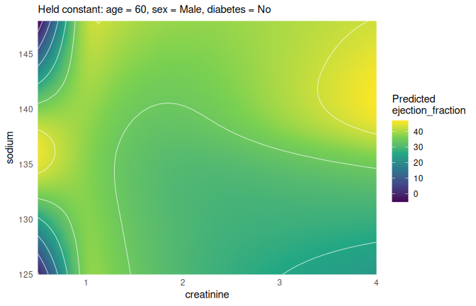<!-- -->

``` r
term_heatmap(surface, contours = FALSE)
```

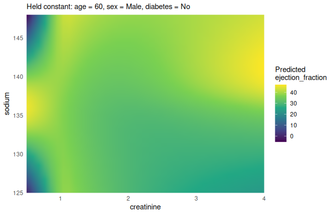<!-- -->

Data points, the region with data (*from p-ggeffects*), and marks for
cuts:

``` r
term_heatmap(surface, show_data = TRUE, show_support = TRUE)
```

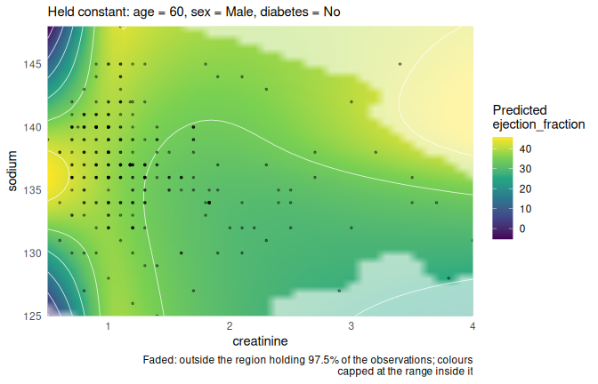<!-- -->

``` r
term_heatmap(surface, show_support = TRUE, support_prob = 0.9)
```

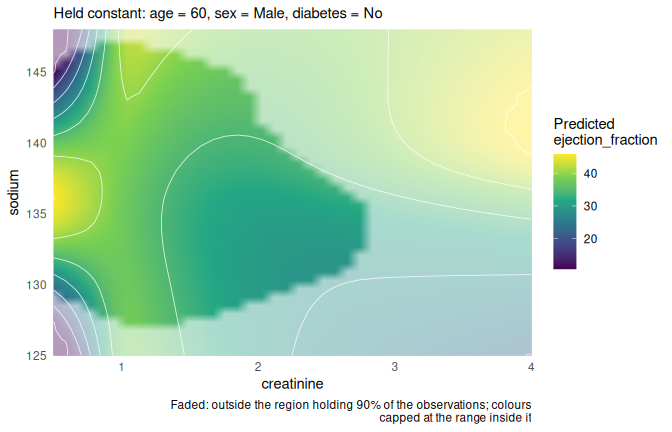<!-- -->

``` r
term_heatmap(surface, cuts = list(sodium = c(130, 137, 142)))
```

<!-- -->

**Check:** the faded area grows when `support_prob` drops from 0.975 to
0.9. The cuts are dashed horizontal lines.

Where is the surface estimated precisely? *(from p-ggeffects)*

``` r
term_heatmap(surface, fill = "band_width")
```

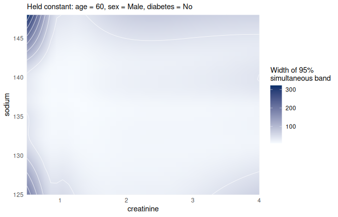<!-- -->

``` r
term_heatmap(surface, fill = "std.error")
```

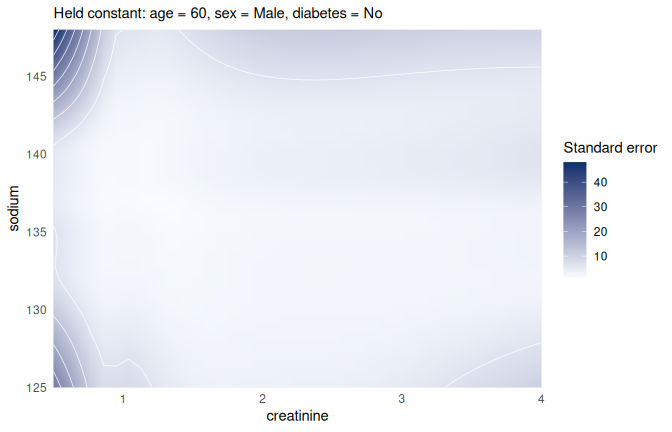<!-- -->

**Check:** both are largest where there are few patients: at low
creatinine (below about 0.8) combined with very high or very low sodium.
At high creatinine they are only moderately larger.

`plot()` picks the right plot for the object:

``` r
plot(surface)
```

<!-- -->

## 5. Cuts: `term_curves()`

``` r
cuts <- term_predictions(fit, c("creatinine", "sodium"),
                         values = list(creatinine = cr, sodium = c(130, 137, 142)))
term_curves(cuts)                        # simultaneous band (default)
```

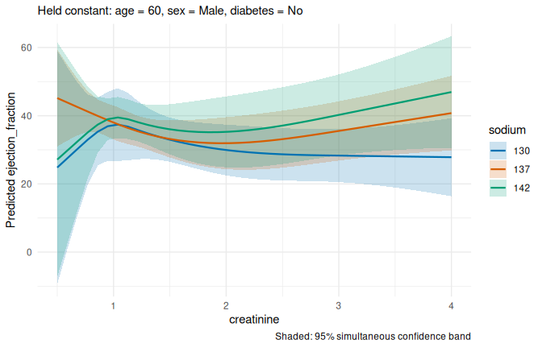<!-- -->

``` r
term_curves(cuts, band = "pointwise")
```

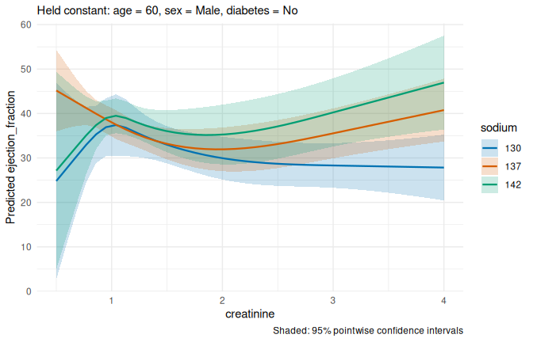<!-- -->

``` r
term_curves(cuts, band = "both")
```

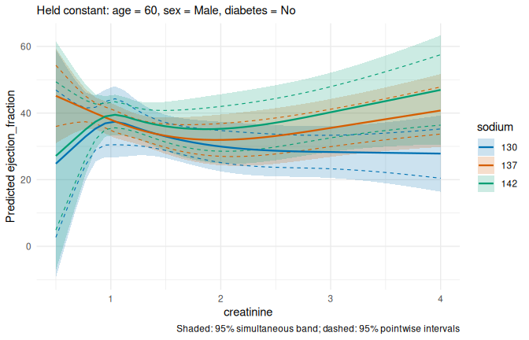<!-- -->

``` r
term_curves(cuts, band = "none")
```

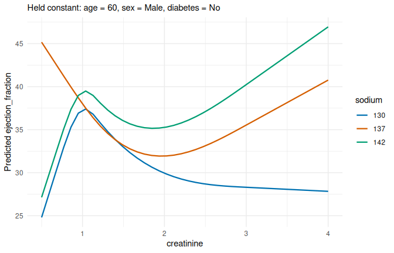<!-- -->

``` r
plot(cuts)
```

<!-- -->

**Check:** with `band = "both"` the simultaneous band is always the
wider one.

### Other held values: `at`

``` r
women <- term_predictions(fit, c("creatinine", "sodium"),
                          values = list(creatinine = cr, sodium = c(130, 137, 142)),
                          at = list(sex = "Female", diabetes = "Yes", age = 75))
women
#> Predictions over creatinine, sodium ( 120 grid points, response scale )
#> Held constant: age = 75 (set by user), sex = Female (set by user),
#>   diabetes = Yes (set by user)
#> Critical values for 95% intervals (analytic): pointwise 1.969, simultaneous 3.011
#> 
#>  creatinine sodium estimate conf.low conf.high band.low band.high
#>      0.5000    130    30.19    7.813     52.56   -4.035     64.41
#>      0.5897    130    32.91   15.394     50.42    6.120     59.69
#>      0.6795    130    35.63   22.732     48.52   15.904     55.35
#>      0.7692    130    38.31   29.384     47.25   24.655     51.97
#>      0.8590    130    40.68   33.920     47.44   30.341     51.02
#>      0.9487    130    42.30   35.546     49.06   31.969     52.64
#>      1.0385    130    42.78   35.722     49.84   31.985     53.58
#>      1.1282    130    42.18   35.650     48.71   32.190     52.17
#>      1.2179    130    41.15   35.476     46.82   32.473     49.82
#>      1.3077    130    40.15   35.138     45.17   32.482     47.82
#> ... with 110 more rows
term_curves(women)
```

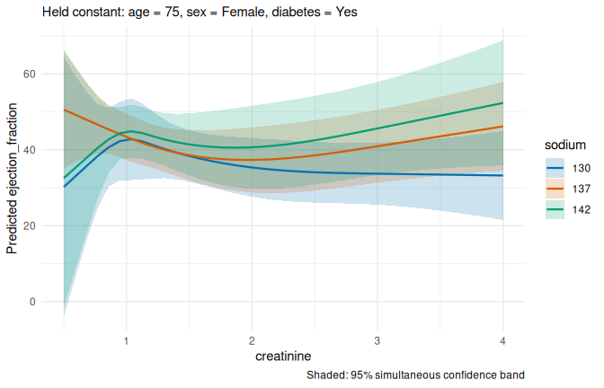<!-- -->

**Check:** the header now says Female, Yes and 75, marked as set by you.

### Panels and the scope of the band *(from p-ggeffects)*

A third focal variable makes panels. `ci_scope` says over what the band
is simultaneous: everything (`"global"`), each panel (`"faceted"`) or
each curve (`"curve"`).

``` r
by_sex <- lapply(c(global = "global", faceted = "faceted", curve = "curve"), function(scope)
  term_predictions(fit, c("creatinine", "sodium", "sex"),
                   values = list(creatinine = cr, sodium = c(130, 137, 142)),
                   ci_scope = scope))
lapply(by_sex, attr, "critical_value")
#> $global
#> [1] 3.172827
#> 
#> $faceted
#>   Female     Male 
#> 3.020792 3.069899 
#> 
#> $curve
#> 130.Female   130.Male 137.Female   137.Male 142.Female   142.Male 
#>   2.655298   2.670327   2.614555   2.636847   2.674407   2.667188
term_curves(by_sex$global)
```

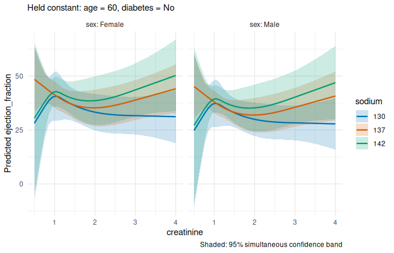<!-- -->

**Check:** one critical value for `"global"`, one per sex for
`"faceted"`, one per curve for `"curve"`, and they get smaller in that
order.

### The link scale

``` r
glm_fit <- glm(death_event ~ rcs(creatinine, 4) * rcs(sodium, 4) + age + sex,
               data = hf, family = binomial)
risk <- term_predictions(glm_fit, c("creatinine", "sodium"),
                         values = list(creatinine = cr, sodium = c(130, 137, 142)))
term_curves(risk)
```

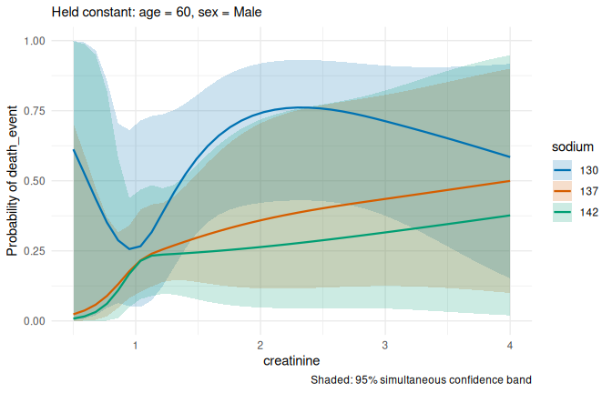<!-- -->

``` r
term_curves(term_predictions(glm_fit, c("creatinine", "sodium"), scale = "link",
                             values = list(creatinine = cr, sodium = c(130, 137, 142))))
```

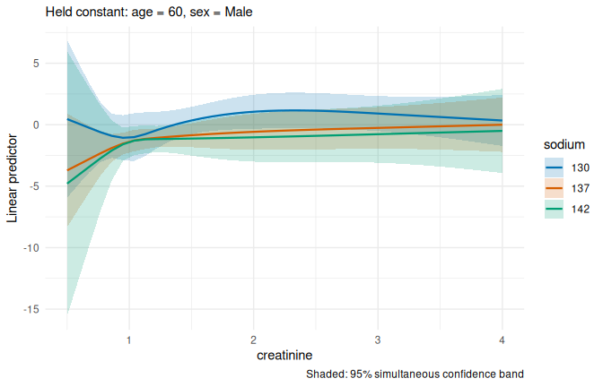<!-- -->

**Check:** the first plot shows probabilities whose bands stay between 0
and 1; the second shows log-odds.

## 6. Interval methods

The bootstrap *(from p-ggeffects)*: the model is refitted on resampled
data.

``` r
set.seed(2)
cuts_boot <- term_predictions(fit, c("creatinine", "sodium"),
                              values = list(creatinine = cr, sodium = c(130, 137, 142)),
                              ci_method = "bootstrap", nboot = 200)
attr(cuts_boot, "critical_value")
#> [1] 3.560245
term_curves(cuts_boot)
```

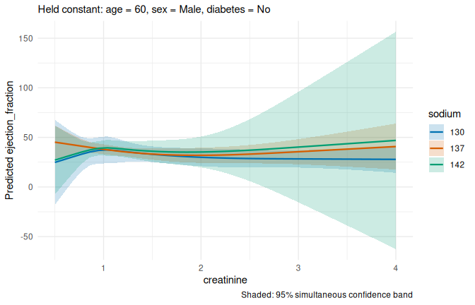<!-- -->

**Check:** near creatinine 1, where most patients are, the bands are
about as wide as the analytic ones in section 5. From creatinine 2
upwards the bootstrap bands are much wider, most of all for sodium 142
(from about -60 to 150 at creatinine 4, far outside any possible LVEF):
few patients have both a high creatinine and a high sodium (14 have
creatinine above 3). The analytic band assumes the model is right and
the spread of LVEF is the same everywhere; the bootstrap refits the
model on resampled patients, and where only a few patients determine the
curve, the refits differ a lot depending on which of them are drawn.
Where the two disagree, trust the curves less.

The bootstrap refits use the knots of the original model: termeffects
writes them into the formula for each refit
(e.g. `rcs(creatinine, parms = c(...))`). Otherwise each resample would
choose its own knots, and the refitted coefficients would belong to
different spline bases. The same applies to multiple imputation
(e.g. mice): give the knots explicitly, e.g.
`rcs(creatinine, c(0.7, 1, 1.2, 3))`, so that all imputed data sets use
the same spline.

For `orm` models there are three methods (see the how-to vignette for
the simulation comparing them):

``` r
hf$platelets <- hf$platelets / 1000
ofit <- orm(ejection_fraction ~ rcs(creatinine, 4) * rcs(sodium, 4) + rcs(age, 4) +
              sex + diabetes + anaemia + hblood_pressure + smoking +
              rcs(platelets, 3) + rcs(log(cpk_enzyme), 3),
            data = hf, x = TRUE, y = TRUE)
orm_cuts <- lapply(c(analytic = "analytic", delta = "delta", bootstrap = "bootstrap"), function(m) {
  set.seed(3)
  term_predictions(ofit, c("creatinine", "sodium"),
                   values = list(creatinine = seq(0.5, 4, length.out = 25), sodium = c(130, 137, 142)),
                   ci_method = m, nboot = 200)
})
sapply(orm_cuts, function(p) mean(p$band.high - p$band.low))   # average band width
#>  analytic     delta bootstrap 
#>  18.67659  19.09745  31.55171
term_curves(orm_cuts$analytic)
```

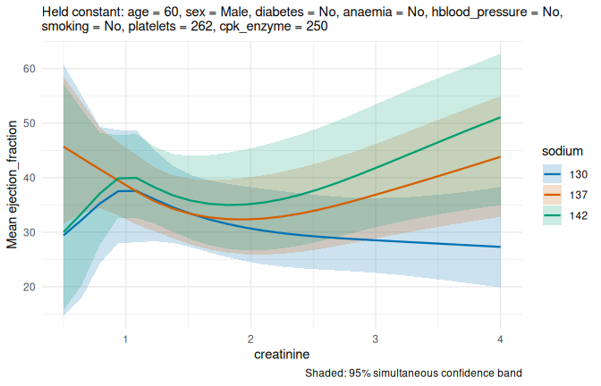<!-- -->

**Check:** the bootstrap bands are clearly wider than the other two.
(Here the delta bands are about as wide as the default ones; in the
simulations they were too narrow, which is why they are not the
default.)

## 7. Other model types

### Survival: a Cox model

A Cox model (`survival::coxph`) describes how the risk of death changes
with the predictors. termeffects shows the **hazard ratio** against an
average patient: 2 means twice the hazard of death at any time, 0.5 half
of it. Ratios are plotted on a log axis, so that 2 and 0.5 are equally
far from 1 (the dotted line, no difference).

``` r
library(survival)
hf$died <- as.numeric(hf$death_event == "Yes")
cox <- coxph(Surv(time, died) ~ rcs(creatinine, 4) * rcs(sodium, 4) + age + sex, data = hf)
term_curves(term_predictions(cox, c("creatinine", "sodium"),
                             values = list(creatinine = cr, sodium = c(130, 137, 142))))
```

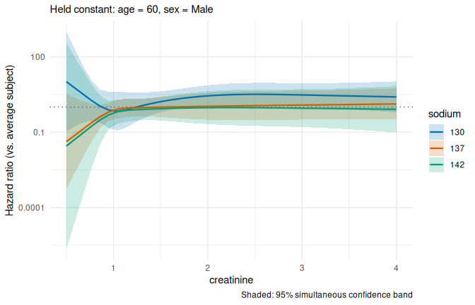<!-- -->

**Check:** the y-axis is logarithmic (1, 10, 100, …). The bands are very
wide below creatinine 0.7, where there are only 5 patients.

### Smooth surfaces: a generalized additive model

A generalized additive model (`mgcv::gam`) does not need knots or
degrees of freedom chosen in advance. Each smooth term is a spline with
many basis functions, and a penalty for wiggliness is estimated from the
data, so the curve is only as flexible as the data support. `s(age)` is
a smooth curve in age. `te(creatinine, sodium)` is a smooth *surface*
over both variables together (a tensor-product spline), the GAM way of
writing a non-linear interaction. GAMs suit exploring a surface; spline
models with a fixed number of knots, as above, are easier to report.

``` r
gam_fit <- mgcv::gam(ejection_fraction ~ te(creatinine, sodium) + s(age) + sex, data = hf)
term_heatmap(term_predictions(gam_fit, c("creatinine", "sodium"), values = list(creatinine = cr, sodium = na)))
```

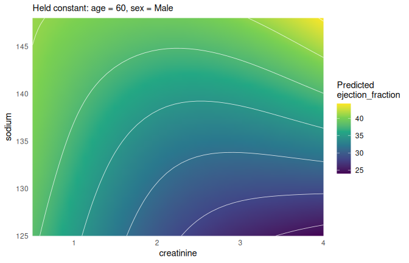<!-- -->

**Check:** a smoother surface than the spline model in section 4. Mixed
models (`lme4`) work the same way; the `heartfailure` data have no
clusters, so they are covered by the automatic tests only.

## 8. A figure with its caption: `term_figure()`

``` r
ofit_surface <- term_predictions(ofit, c("creatinine", "sodium"),
                                 values = list(creatinine = cr, sodium = na))
fig <- term_figure(ofit_surface, cuts = list(sodium = c(130, 137, 142)), show_data = TRUE)
fig
```

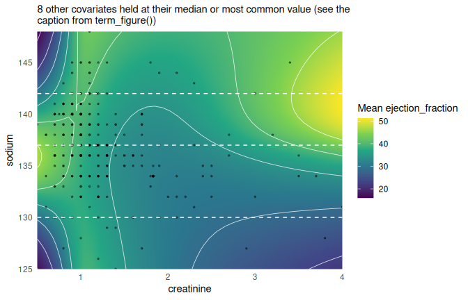<!-- --><!-- -->

    #> Mean ejection_fraction over creatinine and sodium, from a proportional
    #> odds model (rms::orm), n = 299: ejection_fraction ~ rcs(creatinine, 4)
    #> * rcs(sodium, 4) + rcs(age, 4) + sex + diabetes + anaemia +
    #> hblood_pressure + smoking + rcs(platelets, 3) + rcs(log(cpk_enzyme),
    #> 3). In the model, creatinine enters as rcs(creatinine, 4) and sodium as
    #> rcs(sodium, 4). They interact in the model (rcs(creatinine,
    #> 4):rcs(sodium, 4)). All other covariates are held constant: age = 60
    #> (median), sex = Male (most common), diabetes = No (most common),
    #> anaemia = No (most common), hblood_pressure = No (most common), smoking
    #> = No (most common), platelets = 262 (median), cpk_enzyme = 250
    #> (median). Curves: cuts through the surface at sodium = 130, 137, 142.
    #> Shaded: 95% simultaneous confidence band, covering all curves at once
    #> (critical value 2.96).
    fig$heatmap

<!-- -->

``` r
fig$curves
```

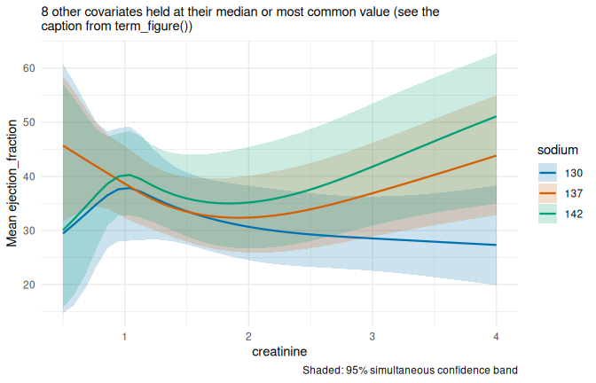<!-- -->

``` r
fig$uncertainty
```

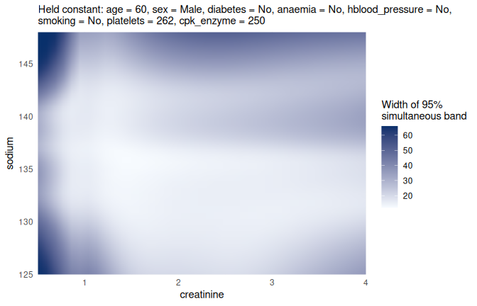<!-- -->

``` r
fig$covariates
#>         covariate value   chosen_as
#> 1             age    60      median
#> 2             sex  Male most common
#> 3        diabetes    No most common
#> 4         anaemia    No most common
#> 5 hblood_pressure    No most common
#> 6         smoking    No most common
#> 7       platelets   262      median
#> 8      cpk_enzyme   250      median
fig$model
#> [1] "proportional odds model (rms::orm), n = 299: ejection_fraction ~ rcs(creatinine, 4) * rcs(sodium, 4) + rcs(age, 4) + sex + diabetes + anaemia + hblood_pressure + smoking + rcs(platelets, 3) + rcs(log(cpk_enzyme), 3)"
```

``` r
cat(fig$caption)
```

Mean ejection_fraction over creatinine and sodium, from a proportional
odds model (rms::orm), n = 299: ejection_fraction ~ rcs(creatinine, 4)
\* rcs(sodium, 4) + rcs(age, 4) + sex + diabetes + anaemia +
hblood_pressure + smoking + rcs(platelets, 3) + rcs(log(cpk_enzyme), 3).
In the model, creatinine enters as rcs(creatinine, 4) and sodium as
rcs(sodium, 4). They interact in the model (rcs(creatinine,
4):rcs(sodium, 4)). All other covariates are held constant: age = 60
(median), sex = Male (most common), diabetes = No (most common), anaemia
= No (most common), hblood_pressure = No (most common), smoking = No
(most common), platelets = 262 (median), cpk_enzyme = 250 (median).
Curves: cuts through the surface at sodium = 130, 137, 142. Shaded: 95%
simultaneous confidence band, covering all curves at once (critical
value 2.96).

**Check:** with eight held covariates, the heatmap subtitle points to
the caption instead of listing them, and `fig$covariates` lists all
eight with how each value was chosen.

## 9. Parameterized models *(from p-ggeffects)*

A parameterized model gives the fitted model new inputs without
refitting it. You say how the model’s variable is computed from the new
one. Here the model uses creatinine, and we want to work with log
creatinine, so creatinine = exp(log_creatinine):

``` r
pfit <- parameterize(fit, list(creatinine = function(log_creatinine) exp(log_creatinine)))
pfit
#> Parameterized model
#> 
#> Model:
#> 
#> Call:
#> lm(formula = ejection_fraction ~ rcs(creatinine, 4) * rcs(sodium, 
#>     4) + rcs(age, 4) + sex + diabetes, data = hf)
#> 
#> Coefficients:
#>                                           (Intercept)  
#>                                            -1.423e+03  
#>                          rcs(creatinine, 4)creatinine  
#>                                             1.552e+03  
#>                         rcs(creatinine, 4)creatinine'  
#>                                            -1.868e+04  
#>                        rcs(creatinine, 4)creatinine''  
#>                                             4.656e+04  
#>                                  rcs(sodium, 4)sodium  
#>                                             1.102e+01  
#>                                 rcs(sodium, 4)sodium'  
#>                                            -1.973e+01  
#>                                rcs(sodium, 4)sodium''  
#>                                             4.413e+01  
#>                                        rcs(age, 4)age  
#>                                             6.284e-02  
#>                                       rcs(age, 4)age'  
#>                                            -3.520e-03  
#>                                      rcs(age, 4)age''  
#>                                             3.109e-01  
#>                                               sexMale  
#>                                            -3.336e+00  
#>                                           diabetesYes  
#>                                            -1.194e-01  
#>     rcs(creatinine, 4)creatinine:rcs(sodium, 4)sodium  
#>                                            -1.171e+01  
#>    rcs(creatinine, 4)creatinine':rcs(sodium, 4)sodium  
#>                                             1.398e+02  
#>   rcs(creatinine, 4)creatinine'':rcs(sodium, 4)sodium  
#>                                            -3.479e+02  
#>    rcs(creatinine, 4)creatinine:rcs(sodium, 4)sodium'  
#>                                             2.131e+01  
#>   rcs(creatinine, 4)creatinine':rcs(sodium, 4)sodium'  
#>                                            -2.537e+02  
#>  rcs(creatinine, 4)creatinine'':rcs(sodium, 4)sodium'  
#>                                             6.407e+02  
#>   rcs(creatinine, 4)creatinine:rcs(sodium, 4)sodium''  
#>                                            -4.783e+01  
#>  rcs(creatinine, 4)creatinine':rcs(sodium, 4)sodium''  
#>                                             5.819e+02  
#> rcs(creatinine, 4)creatinine'':rcs(sodium, 4)sodium''  
#>                                            -1.520e+03  
#> 
#> 
#> Parameters:
#> [1] "log_creatinine"
#> 
#> Parameterizations:
#> $creatinine <- (exp(log_creatinine)); (log_creatinine)
is.parameterized_model(pfit)
#> [1] TRUE
parameter_variables(pfit)
#> [1] "log_creatinine"
parameterizations(pfit)
#> $creatinine
#> function (log_creatinine) 
#> (exp(log_creatinine))
#> <environment: 0x599a9b2b8d40>
class(original_model(pfit))
#> [1] "lm"

nd <- data.frame(log_creatinine = log(c(0.5, 1, 2, 4)), sodium = 137, age = 60,
                 sex = "Male", diabetes = "No")
parameterize_data(pfit, nd)
#>   log_creatinine sodium age  sex diabetes creatinine
#> 1     -0.6931472    137  60 Male       No        0.5
#> 2      0.0000000    137  60 Male       No        1.0
#> 3      0.6931472    137  60 Male       No        2.0
#> 4      1.3862944    137  60 Male       No        4.0
predict(pfit, nd)
#>        1        2        3        4 
#> 45.16930 38.00592 31.93800 40.76583
predict(fit, transform(nd, creatinine = exp(log_creatinine)))
#>        1        2        3        4 
#> 45.16930 38.00592 31.93800 40.76583
```

**Check:** `parameterize_data()` adds `creatinine` = 0.5, 1, 2, 4, and
the two `predict()` calls give the same numbers. (A parameterized model
can be parameterized again; the steps are then combined. See
`vignette("parameterized_models")`.)

Predictions and plots work as for an ordinary model, with log creatinine
on the x-axis. Without `values`, the range of a new variable is found by
a search: a range centred at 0 within which creatinine stays inside its
observed range.

``` r
p_surface <- term_predictions(pfit, c("log_creatinine", "sodium"))
range(p_surface$log_creatinine)
#> [1] -0.6191736  0.6191736
term_heatmap(p_surface, show_support = TRUE)
```

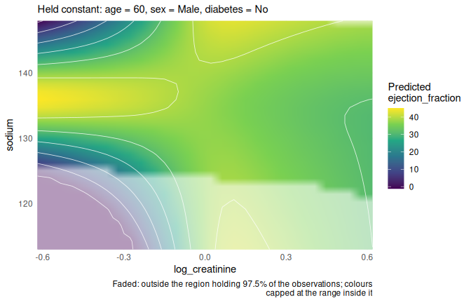<!-- -->

``` r
term_curves(term_predictions(pfit, c("log_creatinine", "sodium"),
                             values = list(log_creatinine = seq(log(0.6), log(4), length.out = 30),
                                           sodium = c(130, 137, 142))))
```

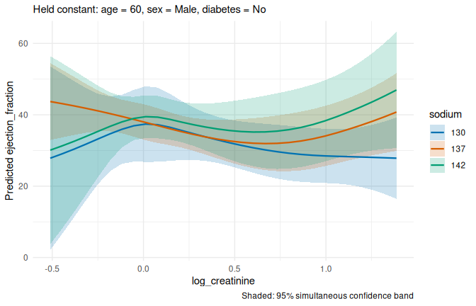<!-- -->

**Check:** without `values`, `log_creatinine` runs from about −0.6 to
0.6, i.e. creatinine from about 0.54 to 1.86 mg/dL: the search is
centred at 0 (creatinine 1), so it stops where the lower end leaves the
data, although creatinine goes up to 9.4. It is usually clearer to give
the range with `values`, as in the second plot (creatinine 0.6 to 4).

## 10. Curves through a heatmap: `term_layer()` *(from p-ggeffects)*

A layer follows paths through the heatmap and predicts along them. One
path, a patient whose creatinine rises while sodium falls:

``` r
worsening <- term_layer(surface,
                        parameterization = list(creatinine = function(w) 1 + w,
                                                sodium = function(w) 140 - 5 * w),
                        terms = "w", values = list(w = seq(0, 1.5, by = 0.05)))
head(worsening)
#> Predictions over w ( 6 grid points, response scale )
#> Held constant: age = 60 (median), sex = Male (most common), diabetes =
#>   No (most common)
#> Critical values for 95% intervals (analytic): pointwise 1.969, simultaneous 2.594
#> 
#>     w estimate conf.low conf.high band.low band.high
#>  0.00    38.80    35.11     42.50    33.94     43.67
#>  0.05    38.38    34.70     42.06    33.53     43.23
#>  0.10    37.78    34.22     41.35    33.09     42.48
#>  0.15    37.12    33.68     40.56    32.59     41.65
#>  0.20    36.46    33.07     39.85    31.99     40.92
#>  0.25    35.84    32.40     39.28    31.30     40.37
term_heatmap(surface, layers = worsening)
```

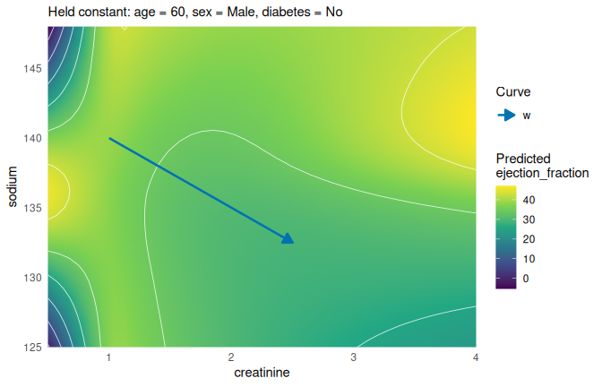<!-- -->

``` r
term_curves(worsening, show_direction = TRUE)
```

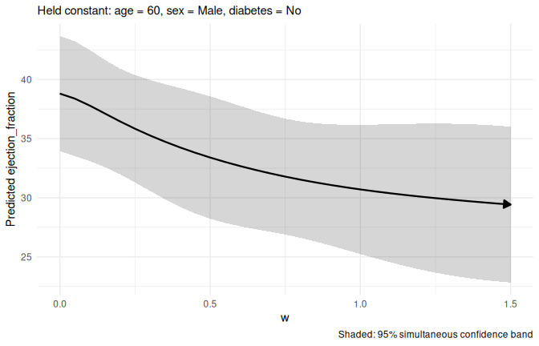<!-- -->

``` r
plot(worsening)
```

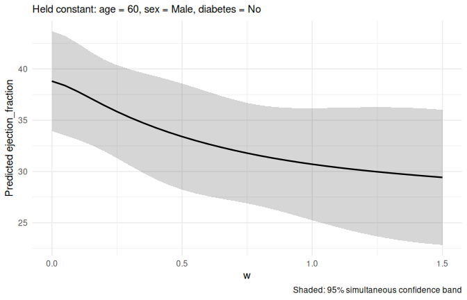<!-- -->

A family of paths, starting from different creatinine values:

``` r
paths <- term_layer(surface,
                    parameterization = list(creatinine = function(w, start) start + w,
                                            sodium = function(w) 140 - 5 * w),
                    terms = c("w", "start"),
                    values = list(w = seq(0, 1.5, by = 0.05), start = c(0.8, 1.2, 1.6)))
term_heatmap(surface, layers = paths)
```

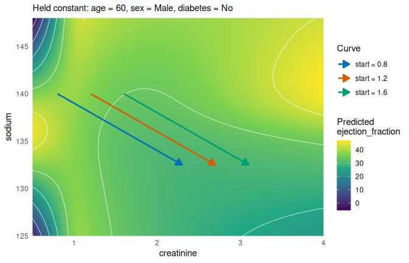<!-- -->

``` r
term_heatmap(surface, layers = list(worsening, paths), show_direction = FALSE)
```

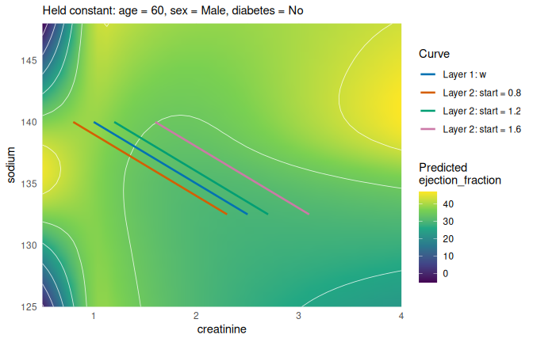<!-- -->

``` r
term_curves(paths)
```

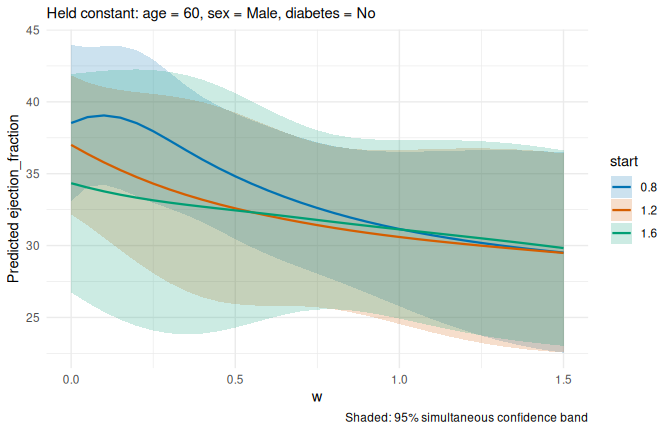<!-- -->

**Check:** the paths run from upper left to lower right, with arrows in
the first heatmap and without in the second; `term_curves()` shows LVEF
along each path.

## 11. Testing a reference curve: `test_simultaneous_predictions()` *(from p-ggeffects)*

Is a flat LVEF of 38% compatible with the curves, i.e. does it lie
inside all the simultaneous bands?

``` r
flat <- test_simultaneous_predictions(cuts, f = function(creatinine, sodium) 38 + 0 * creatinine)
flat
#> Simultaneous test: does the reference function fit inside the 95% band?
#> Held constant: age = 60 (median), sex = Male (most common), diabetes =
#>   No (most common)
#> max |t| = 3.83, p = 0.0043
#> The reference lies inside the band at 98 of 120 grid points.
#> 
#>  creatinine sodium estimate reference band.low band.high inside
#>      0.5000    130    24.81        38  -9.4039     59.02   TRUE
#>      0.5897    130    27.53        38   0.8687     54.19   TRUE
#>      0.6795    130    30.25        38  10.7810     49.72   TRUE
#>      0.7692    130    32.94        38  19.6573     46.22   TRUE
#>      0.8590    130    35.30        38  25.3553     45.25   TRUE
#>      0.9487    130    36.92        38  26.8189     47.03   TRUE
#>      1.0385    130    37.40        38  26.7236     48.08   TRUE
#>      1.1282    130    36.80        38  26.9289     46.68   TRUE
#>      1.2179    130    35.77        38  27.2645     44.27   TRUE
#>      1.3077    130    34.77        38  27.3289     42.22   TRUE
attr(flat, "all_inside")
#> [1] FALSE
attr(flat, "p_value")
#> [1] 0.00429957
plot(flat)
```

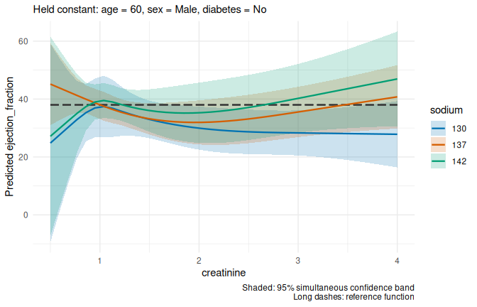<!-- -->

``` r
plot(flat, type = "difference")
```

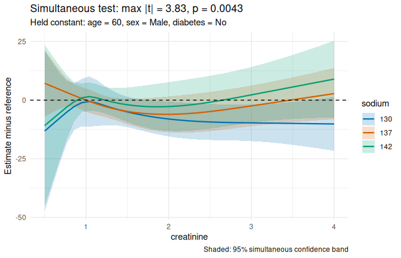<!-- -->

``` r
plot(test_simultaneous_predictions(surface, f = function(creatinine, sodium) 38 + 0 * creatinine))
```

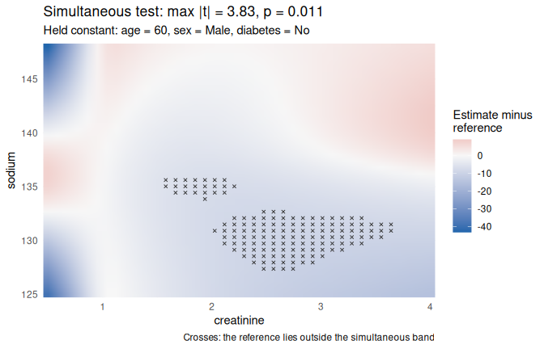<!-- -->

**Check:** the p-value is below 0.05 exactly when `all_inside` is
`FALSE`. The difference plot of a surface is a heatmap in blue and red,
white where the prediction equals the reference.

## 12. Errors you should get

These calls are wrong on purpose; each should stop with a clear message.

``` r
term_heatmap(term_predictions(fit, "creatinine"))                        # one focal variable
#> Error: A heatmap needs two continuous focal variables.
term_predictions(fit, c("creatinine", "sodium"), ci_method = "delta")      # delta is for orm
#> Error: ci_method = "delta" is only for rms::orm models; for other models the analytic intervals already are delta-method intervals.
parameterize(fit, list(weight = function(t) t))                          # not in the model
#> Error: Cannot parameterize weight: not a predictor of the model.
term_layer(surface, list(age = function(t) t))                           # age is not on the heatmap
#> Error: `parameterization` may only give the heatmap variables creatinine, sodium.
test_simultaneous_predictions(cuts, f = function(cyl) cyl)               # unknown variable
#> Error: `f` uses cyl, which is not a variable of the predictions. Available: creatinine, sodium, age, sex, diabetes.
```
