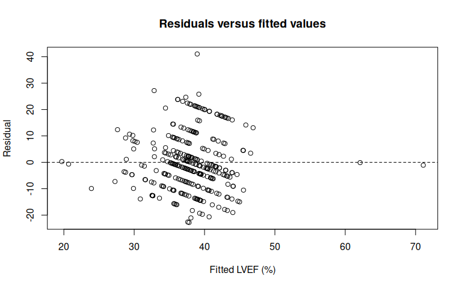
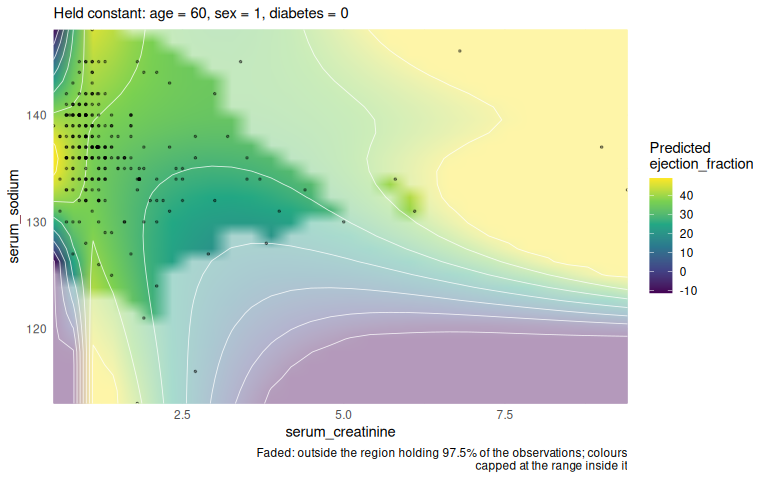
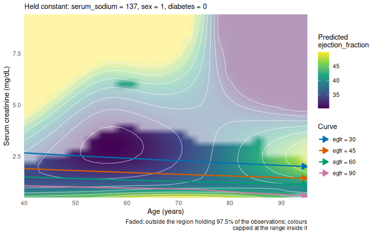
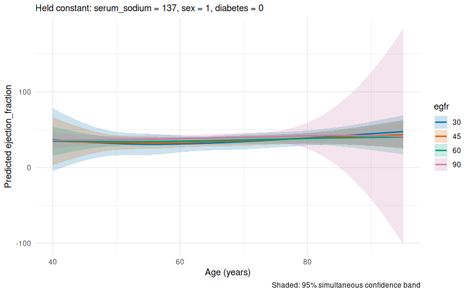
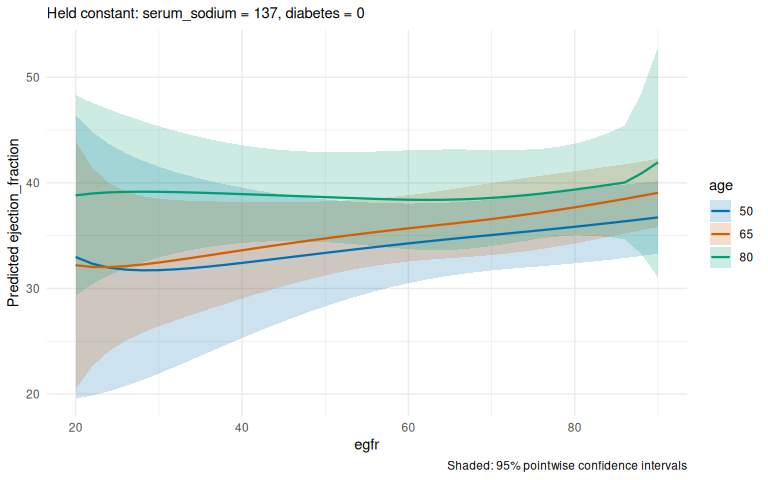
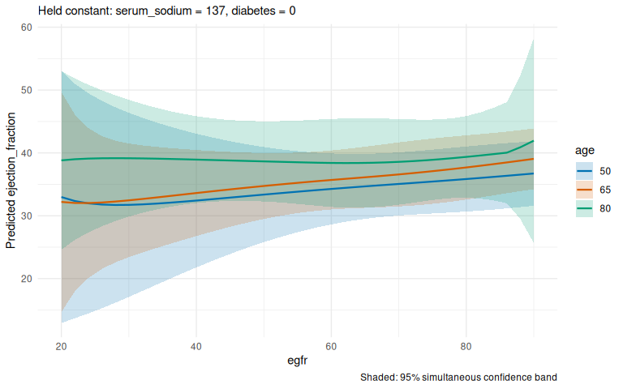
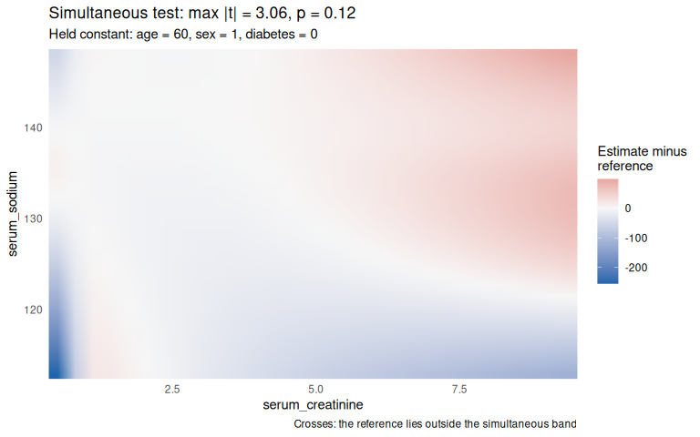

# termeffects feature demonstration: Cardiac systolic function and renal health

> **About this vignette.** Written by Lukas Bolsinger for p-ggeffects
> (original file `p_ggeffects_demonstration.Rmd`) and ported to
> termeffects by Brigitte Mueller. His text is kept; the code now uses
> the termeffects functions (`ggpredict()` became `term_predictions()`,
> `plot(..., "heatmap")` became `term_heatmap()`, layers became
> `term_layer()`), and held covariates are at their median or most
> common value. Also corrected: the eGFR formula is now the 2021 CKD-EPI
> equation (it said so before, but used a made-up linear formula);
> Figure 3 now plots eGFR (it plotted creatinine); the constant-eGFR
> curves in Figure 2 are now a `term_layer()` instead of hand-drawn
> contours; outdated limitations are updated. Every change is marked in
> `validation/output/vignette_track_changes.html` (struck through:
> removed; underlined: added), or run
> `git diff 2de18bc -- vignettes/heart_failure_egfr.Rmd`.

# Introduction

This case study demonstrates a workflow for **termeffects** in which
fitting a regression model is deliberately separated from specifying
prediction domains and drawing figures. We analyze the `heartfailure`
dataset distributed with termeffects (originally from `dlookr`),
treating **left ventricular ejection fraction (LVEF)** as a continuous
outcome. We ask how its *adjusted association* with renal markers varies
across creatinine, serum sodium, and age.

The example illustrates six tools:

1.  **Spline interactions** allow a flexible two-variable response
    surface.
2.  **`term_predictions()`** produces adjusted predictions on regular
    grids for heatmaps.
3.  **`parameterize()`** transforms a *fitted* model into clinically
    meaningful prediction coordinates without refitting it.
4.  **Heatmaps and parameterized overlays** (`term_heatmap()`,
    `term_layer()`) display both the fitted surface and nonlinear
    constant-eGFR trajectories in the original predictor coordinates.
5.  **`term_curves(..., band = "simultaneous")`** demonstrates
    simultaneous uncertainty over a *specified prediction grid*.
6.  **`test_simultaneous_predictions(..., f = f0)`** demonstrates
    simultaneous comparison with a specified reference function,
    including a linear reference surface. This is not a general test of
    linearity.

**Scope.** Every plot has at most two continuous focal coordinates (or
one continuous coordinate and age strata). All other predictors are held
at stated reference values. In the model-fitting stage, no plotting
decisions are made. The resulting analysis is associative, not causal.
The data are observational and small (299 patients); apparent nonlinear
patterns may be unstable.

# Part I — Data and model (no plotting)

## 1. Load packages and inspect the dataset

``` r
knitr::opts_chunk$set(fig.width = 8, fig.height = 5, collapse = TRUE,
                      comment = "#>")

library(termeffects)
library(ggplot2)
library(splines)
```

``` r
data("heartfailure", package = "termeffects")
raw <- as.data.frame(heartfailure)
names(raw)
#>  [1] "age"               "anaemia"           "cpk_enzyme"       
#>  [4] "diabetes"          "ejection_fraction" "hblood_pressure"  
#>  [7] "platelets"         "creatinine"        "sodium"           
#> [10] "sex"               "smoking"           "time"             
#> [13] "death_event"
str(raw)
#> 'data.frame':    299 obs. of  13 variables:
#>  $ age              : int  75 55 65 50 65 90 75 60 65 80 ...
#>  $ anaemia          : Factor w/ 2 levels "No","Yes": 1 1 1 2 2 2 2 2 1 2 ...
#>  $ cpk_enzyme       : num  582 7861 146 111 160 ...
#>  $ diabetes         : Factor w/ 2 levels "No","Yes": 1 1 1 1 2 1 1 2 1 1 ...
#>  $ ejection_fraction: num  20 38 20 20 20 40 15 60 65 35 ...
#>  $ hblood_pressure  : Factor w/ 2 levels "No","Yes": 2 1 1 1 1 2 1 1 1 2 ...
#>  $ platelets        : num  265000 263358 162000 210000 327000 ...
#>  $ creatinine       : num  1.9 1.1 1.3 1.9 2.7 2.1 1.2 1.1 1.5 9.4 ...
#>  $ sodium           : num  130 136 129 137 116 132 137 131 138 133 ...
#>  $ sex              : Factor w/ 2 levels "Female","Male": 2 2 2 2 1 2 2 2 1 2 ...
#>  $ smoking          : Factor w/ 2 levels "No","Yes": 1 1 2 1 1 2 1 2 1 2 ...
#>  $ time             : int  4 6 7 7 8 8 10 10 10 10 ...
#>  $ death_event      : Factor w/ 2 levels "No","Yes": 2 2 2 2 2 2 2 2 2 2 ...
```

We use the conventional column names in the public heart-failure
clinical-records dataset.

``` r
required <- c("ejection_fraction", "creatinine", "sodium",
              "age", "sex", "diabetes")
stopifnot(all(required %in% names(raw)))
dat <- raw[stats::complete.cases(raw[, required]), required]
# Normalize the public dataset to the conventional names used below,
# and encode the categorical predictors as 0/1 for easy fixed-value
# conditioning in the parameterized predictions.
dat <- stats::setNames(dat, c("ejection_fraction", "serum_creatinine",
                              "serum_sodium", "age", "sex", "diabetes"))
dat$sex <- as.integer(dat$sex == "Male")
dat$diabetes <- as.integer(dat$diabetes == "Yes")
stopifnot(all(dat$sex %in% c(0, 1)))
stopifnot(all(dat$diabetes %in% c(0, 1)))
summary(dat)
#>  ejection_fraction serum_creatinine  serum_sodium        age       
#>  Min.   :14.00     Min.   :0.500    Min.   :113.0   Min.   :40.00  
#>  1st Qu.:30.00     1st Qu.:0.900    1st Qu.:134.0   1st Qu.:51.00  
#>  Median :38.00     Median :1.100    Median :137.0   Median :60.00  
#>  Mean   :38.08     Mean   :1.394    Mean   :136.6   Mean   :60.83  
#>  3rd Qu.:45.00     3rd Qu.:1.400    3rd Qu.:140.0   3rd Qu.:70.00  
#>  Max.   :80.00     Max.   :9.400    Max.   :148.0   Max.   :95.00  
#>       sex            diabetes     
#>  Min.   :0.0000   Min.   :0.0000  
#>  1st Qu.:0.0000   1st Qu.:0.0000  
#>  Median :1.0000   Median :0.0000  
#>  Mean   :0.6488   Mean   :0.4181  
#>  3rd Qu.:1.0000   3rd Qu.:1.0000  
#>  Max.   :1.0000   Max.   :1.0000
```

## 2. Fit one regression model

The outcome is LVEF (%). We allow a nonlinear creatinine–sodium
interaction and a nonlinear creatinine–age interaction, with modest
spline degrees of freedom. Sex and diabetes are adjustment variables.
This model is intentionally illustrative; its adequacy should be
assessed before substantive clinical interpretation.

``` r
model <- lm(
  ejection_fraction ~
    ns(serum_creatinine, df = 3) +
    ns(serum_sodium, df = 3) +
    ns(age, df = 3) +
    ns(serum_creatinine, df = 3) * ns(serum_sodium, df = 3) +
    ns(serum_creatinine, df = 3) * ns(age, df = 3) +
    sex + diabetes,
  data = dat
)
summary(model)
#> 
#> Call:
#> lm(formula = ejection_fraction ~ ns(serum_creatinine, df = 3) + 
#>     ns(serum_sodium, df = 3) + ns(age, df = 3) + ns(serum_creatinine, 
#>     df = 3) * ns(serum_sodium, df = 3) + ns(serum_creatinine, 
#>     df = 3) * ns(age, df = 3) + sex + diabetes, data = dat)
#> 
#> Residuals:
#>     Min      1Q  Median      3Q     Max 
#> -22.799  -7.233  -1.236   7.121  41.041 
#> 
#> Coefficients:
#>                                                          Estimate Std. Error
#> (Intercept)                                             -218.6982   161.9265
#> ns(serum_creatinine, df = 3)1                             81.7148   153.3684
#> ns(serum_creatinine, df = 3)2                            436.6925   590.3834
#> ns(serum_creatinine, df = 3)3                             39.6153   906.3640
#> ns(serum_sodium, df = 3)1                                143.9680    80.6660
#> ns(serum_sodium, df = 3)2                                485.3087   342.5573
#> ns(serum_sodium, df = 3)3                                 69.6076   106.4562
#> ns(age, df = 3)1                                           8.9458    22.0079
#> ns(age, df = 3)2                                           4.0609    51.4754
#> ns(age, df = 3)3                                          -2.6394    56.0441
#> sex                                                       -3.5136     1.4713
#> diabetes                                                  -0.2865     1.4212
#> ns(serum_creatinine, df = 3)1:ns(serum_sodium, df = 3)1  -22.8787    78.4312
#> ns(serum_creatinine, df = 3)2:ns(serum_sodium, df = 3)1 -233.3908   300.3540
#> ns(serum_creatinine, df = 3)3:ns(serum_sodium, df = 3)1  -26.0683   468.3683
#> ns(serum_creatinine, df = 3)1:ns(serum_sodium, df = 3)2 -194.7700   312.3687
#> ns(serum_creatinine, df = 3)2:ns(serum_sodium, df = 3)2 -716.2526  1282.0524
#> ns(serum_creatinine, df = 3)3:ns(serum_sodium, df = 3)2  159.0141  1992.6299
#> ns(serum_creatinine, df = 3)1:ns(serum_sodium, df = 3)3  -12.8937    83.9749
#> ns(serum_creatinine, df = 3)2:ns(serum_sodium, df = 3)3  -66.9487   324.1241
#> ns(serum_creatinine, df = 3)3:ns(serum_sodium, df = 3)3   64.9744   450.2457
#> ns(serum_creatinine, df = 3)1:ns(age, df = 3)1            -8.1186    38.4406
#> ns(serum_creatinine, df = 3)2:ns(age, df = 3)1           -22.2740   122.1475
#> ns(serum_creatinine, df = 3)3:ns(age, df = 3)1           -17.6235   232.1689
#> ns(serum_creatinine, df = 3)1:ns(age, df = 3)2             9.5225   108.7402
#> ns(serum_creatinine, df = 3)2:ns(age, df = 3)2           -93.7327   301.2797
#> ns(serum_creatinine, df = 3)3:ns(age, df = 3)2          -189.5386   579.3444
#> ns(serum_creatinine, df = 3)1:ns(age, df = 3)3            52.6029    44.9687
#> ns(serum_creatinine, df = 3)2:ns(age, df = 3)3           -57.4170   196.7409
#> ns(serum_creatinine, df = 3)3:ns(age, df = 3)3          -173.2903   311.4624
#>                                                         t value Pr(>|t|)  
#> (Intercept)                                              -1.351   0.1780  
#> ns(serum_creatinine, df = 3)1                             0.533   0.5946  
#> ns(serum_creatinine, df = 3)2                             0.740   0.4601  
#> ns(serum_creatinine, df = 3)3                             0.044   0.9652  
#> ns(serum_sodium, df = 3)1                                 1.785   0.0754 .
#> ns(serum_sodium, df = 3)2                                 1.417   0.1577  
#> ns(serum_sodium, df = 3)3                                 0.654   0.5138  
#> ns(age, df = 3)1                                          0.406   0.6847  
#> ns(age, df = 3)2                                          0.079   0.9372  
#> ns(age, df = 3)3                                         -0.047   0.9625  
#> sex                                                      -2.388   0.0176 *
#> diabetes                                                 -0.202   0.8404  
#> ns(serum_creatinine, df = 3)1:ns(serum_sodium, df = 3)1  -0.292   0.7707  
#> ns(serum_creatinine, df = 3)2:ns(serum_sodium, df = 3)1  -0.777   0.4378  
#> ns(serum_creatinine, df = 3)3:ns(serum_sodium, df = 3)1  -0.056   0.9557  
#> ns(serum_creatinine, df = 3)1:ns(serum_sodium, df = 3)2  -0.624   0.5335  
#> ns(serum_creatinine, df = 3)2:ns(serum_sodium, df = 3)2  -0.559   0.5768  
#> ns(serum_creatinine, df = 3)3:ns(serum_sodium, df = 3)2   0.080   0.9365  
#> ns(serum_creatinine, df = 3)1:ns(serum_sodium, df = 3)3  -0.154   0.8781  
#> ns(serum_creatinine, df = 3)2:ns(serum_sodium, df = 3)3  -0.207   0.8365  
#> ns(serum_creatinine, df = 3)3:ns(serum_sodium, df = 3)3   0.144   0.8854  
#> ns(serum_creatinine, df = 3)1:ns(age, df = 3)1           -0.211   0.8329  
#> ns(serum_creatinine, df = 3)2:ns(age, df = 3)1           -0.182   0.8554  
#> ns(serum_creatinine, df = 3)3:ns(age, df = 3)1           -0.076   0.9395  
#> ns(serum_creatinine, df = 3)1:ns(age, df = 3)2            0.088   0.9303  
#> ns(serum_creatinine, df = 3)2:ns(age, df = 3)2           -0.311   0.7560  
#> ns(serum_creatinine, df = 3)3:ns(age, df = 3)2           -0.327   0.7438  
#> ns(serum_creatinine, df = 3)1:ns(age, df = 3)3            1.170   0.2431  
#> ns(serum_creatinine, df = 3)2:ns(age, df = 3)3           -0.292   0.7706  
#> ns(serum_creatinine, df = 3)3:ns(age, df = 3)3           -0.556   0.5784  
#> ---
#> Signif. codes:  0 '***' 0.001 '**' 0.01 '*' 0.05 '.' 0.1 ' ' 1
#> 
#> Residual standard error: 11.43 on 269 degrees of freedom
#> Multiple R-squared:  0.158,  Adjusted R-squared:  0.06722 
#> F-statistic: 1.741 on 29 and 269 DF,  p-value: 0.01295
```

**Modeling caveat:** Two 3-by-3 interactions can still be ambitious for
299 observations. Inspect residuals, collinearity, and prediction
uncertainty; if necessary, remove one interaction or reduce basis
dimensions. Do not choose the model merely to produce visually
interesting heatmaps.

``` r
plot(fitted(model), resid(model),
     xlab = "Fitted LVEF (%)", ylab = "Residual",
     main = "Residuals versus fitted values")
abline(h = 0, lty = 2)
```

<!-- -->

# Part II — Prediction definitions (no plotting)

## 3. Choose explicit adjustment values

All non-focal predictors are **fixed at a common reference profile**,
rather than averaged over the patient distribution. The reference
profile is descriptive, not necessarily a typical individual.

``` r
ref_age <- median(dat$age)
ref_sodium <- median(dat$serum_sodium)
ref_creatinine <- median(dat$serum_creatinine)
ref_sex <- 1                 # Male for eGFR illustrations
ref_diabetes <- 0
```

**Prediction API note:** `term_predictions()` holds non-focal predictors
at their median (numeric) or most common value (categorical) unless they
are given in `at`. Below, sex and diabetes are passed explicitly in
`at`, so every prediction uses the same reference profile; each result
prints the values it used.

## 4. Predictions on the original coordinates

``` r
# The output objects are data frames containing predicted values,
# pointwise confidence limits, simultaneous band limits, and the
# focal-variable grid coordinates.
reference_profile <- list(sex = ref_sex, diabetes = ref_diabetes)

pred_creat_sodium <- term_predictions(
  model,
  terms = c("serum_creatinine", "serum_sodium"),
  at = c(reference_profile, list(age = ref_age))
)

pred_age_creat <- term_predictions(
  model,
  terms = c("age", "serum_creatinine"),
  at = c(reference_profile, list(serum_sodium = ref_sodium))
)
```

## 5. Define the nonlinear eGFR transformation

For demonstration we use the **2021 CKD-EPI creatinine equation**, which
depends on serum creatinine (mg/dL), age (years), and sex. This is an
estimated kidney-function measure, not a direct measurement. Its
application to these historical records is retrospective.

``` math
\text{eGFR} = 142 \cdot \min(C/\kappa, 1)^{\alpha} \cdot \max(C/\kappa, 1)^{-1.200} \cdot 0.9938^{A} \cdot (1.012 \text{ if female}),
```
with $`\kappa = 0.7`$, $`\alpha = -0.241`$ for women and
$`\kappa = 0.9`$, $`\alpha = -0.302`$ for men.

``` r
# 2021 CKD-EPI creatinine equation (sex: 1 = male, 0 = female).
egfr_ckdepi <- function(creatinine, age, sex) {
  kappa <- ifelse(sex == 1, 0.9, 0.7)
  alpha <- ifelse(sex == 1, -0.302, -0.241)
  142 * pmin(creatinine / kappa, 1)^alpha * pmax(creatinine / kappa, 1)^-1.200 *
    0.9938^age * ifelse(sex == 1, 1, 1.012)
}

# Inverse transformation used to define the parameterized model: the
# creatinine at which a patient of this age and sex has the given eGFR.
creatinine_from_egfr <- function(egfr, age, sex) {
  kappa <- ifelse(sex == 1, 0.9, 0.7)
  alpha <- ifelse(sex == 1, -0.302, -0.241)
  ratio <- egfr / (142 * 0.9938^age * ifelse(sex == 1, 1, 1.012))
  kappa * ifelse(ratio >= 1, ratio^(1 / alpha), ratio^(1 / -1.200))
}

# check: the inverse undoes the equation
creatinine_from_egfr(egfr_ckdepi(c(0.6, 1, 2.5), age = 65, sex = 1), age = 65, sex = 1)
#> [1] 0.6 1.0 2.5
```

The sex-dependent transformation is **not** obtained by averaging sex
first. For clarity, all eGFR plots below use a fixed male reference
profile. The original model still includes sex as an adjustment
variable.

## 6. Parameterize the already-fitted model

This is the central termeffects step. We do **not** refit `model`: we
change only the inputs used for prediction. For a given eGFR and age,
the parameterization computes the corresponding serum creatinine.

``` r
pmodel_egfr <- parameterize(
  model,
  parameterizations = list(
    serum_creatinine = function(egfr, age) {
      creatinine_from_egfr(egfr, age, sex = ref_sex)
    },
    sex = function(egfr, age) {
      rep(ref_sex, length.out = max(length(egfr), length(age)))
    }
  )
)

print(pmodel_egfr, show_history = TRUE)
#> Parameterized model
#> 
#> Model:
#> 
#> Call:
#> lm(formula = ejection_fraction ~ ns(serum_creatinine, df = 3) + 
#>     ns(serum_sodium, df = 3) + ns(age, df = 3) + ns(serum_creatinine, 
#>     df = 3) * ns(serum_sodium, df = 3) + ns(serum_creatinine, 
#>     df = 3) * ns(age, df = 3) + sex + diabetes, data = dat)
#> 
#> Coefficients:
#>                                             (Intercept)  
#>                                               -218.6982  
#>                           ns(serum_creatinine, df = 3)1  
#>                                                 81.7148  
#>                           ns(serum_creatinine, df = 3)2  
#>                                                436.6925  
#>                           ns(serum_creatinine, df = 3)3  
#>                                                 39.6153  
#>                               ns(serum_sodium, df = 3)1  
#>                                                143.9680  
#>                               ns(serum_sodium, df = 3)2  
#>                                                485.3087  
#>                               ns(serum_sodium, df = 3)3  
#>                                                 69.6076  
#>                                        ns(age, df = 3)1  
#>                                                  8.9458  
#>                                        ns(age, df = 3)2  
#>                                                  4.0609  
#>                                        ns(age, df = 3)3  
#>                                                 -2.6394  
#>                                                     sex  
#>                                                 -3.5136  
#>                                                diabetes  
#>                                                 -0.2865  
#> ns(serum_creatinine, df = 3)1:ns(serum_sodium, df = 3)1  
#>                                                -22.8787  
#> ns(serum_creatinine, df = 3)2:ns(serum_sodium, df = 3)1  
#>                                               -233.3908  
#> ns(serum_creatinine, df = 3)3:ns(serum_sodium, df = 3)1  
#>                                                -26.0683  
#> ns(serum_creatinine, df = 3)1:ns(serum_sodium, df = 3)2  
#>                                               -194.7700  
#> ns(serum_creatinine, df = 3)2:ns(serum_sodium, df = 3)2  
#>                                               -716.2526  
#> ns(serum_creatinine, df = 3)3:ns(serum_sodium, df = 3)2  
#>                                                159.0141  
#> ns(serum_creatinine, df = 3)1:ns(serum_sodium, df = 3)3  
#>                                                -12.8937  
#> ns(serum_creatinine, df = 3)2:ns(serum_sodium, df = 3)3  
#>                                                -66.9487  
#> ns(serum_creatinine, df = 3)3:ns(serum_sodium, df = 3)3  
#>                                                 64.9744  
#>          ns(serum_creatinine, df = 3)1:ns(age, df = 3)1  
#>                                                 -8.1186  
#>          ns(serum_creatinine, df = 3)2:ns(age, df = 3)1  
#>                                                -22.2740  
#>          ns(serum_creatinine, df = 3)3:ns(age, df = 3)1  
#>                                                -17.6235  
#>          ns(serum_creatinine, df = 3)1:ns(age, df = 3)2  
#>                                                  9.5225  
#>          ns(serum_creatinine, df = 3)2:ns(age, df = 3)2  
#>                                                -93.7327  
#>          ns(serum_creatinine, df = 3)3:ns(age, df = 3)2  
#>                                               -189.5386  
#>          ns(serum_creatinine, df = 3)1:ns(age, df = 3)3  
#>                                                 52.6029  
#>          ns(serum_creatinine, df = 3)2:ns(age, df = 3)3  
#>                                                -57.4170  
#>          ns(serum_creatinine, df = 3)3:ns(age, df = 3)3  
#>                                               -173.2903  
#> 
#> 
#> Parameters:
#> [1] "egfr" "age" 
#> 
#> Parameterizations:
#> $serum_creatinine <- ({     creatinine_from_egfr(egfr, age, sex = ref_sex) }); (egfr, age)
#> $sex <- ({     rep(ref_sex, length.out = max(length(egfr), length(age))) }); (egfr, age)
#> 
#> 
#> Parameterization history:
#> 
#> Stage 1                                                                    
#> ---------------------------------------------------------------------------
#> 
#> serum_creatinine [{    creatinine_from_egfr(egfr, age, sex = ref_sex)}] <── egfr, age
#> sex [{    rep(ref_sex, length.out = max(length(egfr), length(age)))}] <── egfr, age
parameter_variables(pmodel_egfr)
#> [1] "egfr" "age"
```

The transformed model depends on `egfr` and `age`, in addition to the
original untransformed predictors such as sodium and diabetes. Its
fitted coefficients remain those of `model`.

``` r
pred_egfr <- term_predictions(
  pmodel_egfr,
  terms = c("egfr", "age"),
  values = list(egfr = seq(20, 90, by = 2), age = c(50, 65, 80)),
  at = list(serum_sodium = ref_sodium, diabetes = ref_diabetes)
)
pred_egfr
#> Predictions over egfr, age ( 108 grid points, response scale )
#> Held constant: serum_sodium = 137 (set by user), diabetes = 0 (set by
#>   user)
#> Critical values for 95% intervals (analytic): pointwise 1.969, simultaneous 2.943
#> 
#>  egfr age estimate conf.low conf.high band.low band.high
#>    20  50    32.98    19.57     46.39    12.93     53.02
#>    22  50    32.34    19.86     44.82    13.69     50.99
#>    24  50    31.97    20.26     43.69    14.46     49.48
#>    26  50    31.78    20.74     42.82    15.28     48.28
#>    28  50    31.71    21.31     42.12    16.16     47.27
#>    30  50    31.73    21.93     41.53    17.08     46.38
#>    32  50    31.81    22.59     41.03    18.03     45.59
#>    34  50    31.93    23.27     40.59    18.98     44.87
#>    36  50    32.07    23.95     40.19    19.93     44.21
#>    38  50    32.24    24.63     39.85    20.87     43.61
#> ... with 98 more rows
```

# Part III — Visualization

## Figure 1 — Nonlinear creatinine × sodium heatmap

**Focal variables:** creatinine and sodium. **Other predictors:**
adjusted at reference values. **Question:** Does the adjusted
association of creatinine with LVEF vary by sodium concentration?

``` r
term_heatmap(pred_creat_sodium, show_support = TRUE, show_data = TRUE)
```

<figure>

<figcaption aria-hidden="true">Adjusted LVEF surface in original
predictor coordinates. Faded: outside the region holding 97.5% of the
patients.</figcaption>
</figure>

The density overlay is important: a smooth model can extrapolate into
combinations of creatinine and sodium that are poorly represented in the
sample. Interpret those regions cautiously.

## Figure 2 — Creatinine × age heatmap with constant-eGFR curves

**Focal variables:** creatinine and age. **Overlay:** constant eGFR at
30, 45, 60, and 90 mL/min/1.73 m². **Other predictors:** adjusted; sex
fixed to male.

This is an annotated original-coordinate heatmap. The curves are **not**
extra axes or extra facets: each curve is a one-dimensional path in the
same two-dimensional predictor plane.

``` r
# A layer follows curves through the heatmap: age runs along each curve
# (t), and creatinine is the value giving that curve's eGFR at that age.
egfr_layer <- term_layer(
  pred_age_creat,
  parameterization = list(
    age = function(t) t,
    serum_creatinine = function(t, egfr) creatinine_from_egfr(egfr, age = t, sex = ref_sex)
  ),
  terms = c("t", "egfr"),
  values = list(t = seq(min(dat$age), max(dat$age), by = 1), egfr = c(30, 45, 60, 90))
)
```

``` r
term_heatmap(pred_age_creat, layers = egfr_layer, show_support = TRUE) +
  labs(x = "Age (years)", y = "Serum creatinine (mg/dL)")
```

<figure>

<figcaption aria-hidden="true">Original-coordinate prediction heatmap
with nonlinear constant-eGFR curves.</figcaption>
</figure>

**How this connects to termeffects layers:** The overlaid curves are
level sets of a nonlinear parameterization of the original predictors,
computed by `term_layer()`. The layer also holds the predictions along
each curve, with a band that is simultaneous over the curves:

``` r
term_curves(egfr_layer) + labs(x = "Age (years)")
```

<figure>

<figcaption aria-hidden="true">Predicted LVEF along the constant-eGFR
curves, by age.</figcaption>
</figure>

## Figure 3 — LVEF versus eGFR with simultaneous confidence bands

**Focal variables:** eGFR and age (three representative ages). **Other
predictors:** adjusted; sex fixed to male. **Question:** How do adjusted
predictions vary over kidney-function values, and how does simultaneous
uncertainty differ from pointwise uncertainty?

``` r
term_curves(pred_egfr, band = "pointwise")
```

<figure>

<figcaption aria-hidden="true">Pointwise confidence intervals for
age-stratified eGFR predictions.</figcaption>
</figure>

``` r
term_curves(pred_egfr, band = "simultaneous")
```

<figure>

<figcaption aria-hidden="true">Simultaneous confidence bands over the
specified eGFR-by-age prediction grid.</figcaption>
</figure>

The simultaneous band is calibrated for the **finite generated
prediction grid**, not automatically for every point in a continuous
domain. The `ci_scope` setting controls whether uncertainty is
simultaneous across the full set of age curves (`"global"`, the default)
or separately within each age group (`"curve"`). State that choice
explicitly in any published figure.

## Figure 4 — Simultaneous test against a specified linear surface

We test the **fixed, prespecified** linear reference surface
``` math
f_0(C,S) = 40 - 3(C-1) + 0.2(S-137),
```
with LVEF measured in percentage points. The test is simultaneous over
the **creatinine–sodium grid**, with other predictors adjusted as in
Figure 1. This is a test of equality to this *particular* linear
function, not a general test that the response is linear.

``` r
f0 <- function(serum_creatinine, serum_sodium) {
  40 - 3 * (serum_creatinine - 1) + 0.2 * (serum_sodium - 137)
}

sim_test <- test_simultaneous_predictions(
  pred_creat_sodium,
  f = f0
)
sim_test
#> Simultaneous test: does the reference function fit inside the 95% band?
#> Held constant: age = 60 (set by user), sex = 1 (set by user), diabetes
#>   = 0 (set by user)
#> max |t| = 3.06, p = 0.12
#> The reference lies inside the band at 900 of 900 grid points.
#> 
#>  serum_creatinine serum_sodium estimate reference  band.low band.high inside
#>            0.5000          113 -217.978     36.70 -768.8916    332.94   TRUE
#>            0.8069          113  -33.422     35.78 -207.5451    140.70   TRUE
#>            1.1138          113   54.162     34.86  -43.0946    151.42   TRUE
#>            1.4207          113   50.871     33.94   -5.8975    107.64   TRUE
#>            1.7276          113   41.778     33.02    7.9291     75.63   TRUE
#>            2.0345          113   33.040     32.10   -0.7412     66.82   TRUE
#>            2.3414          113   24.644     31.18  -12.5749     61.86   TRUE
#>            2.6483          113   16.576     30.26  -27.9375     61.09   TRUE
#>            2.9552          113    8.819     29.33  -59.7706     77.41   TRUE
#>            3.2621          113    1.362     28.41 -111.5832    114.31   TRUE
plot(sim_test)
```

<!-- -->

The reference function’s argument names match the **original
predictors**. The plotted deviations and simultaneous band are only for
the grid that was generated.

## 7. Limits of simultaneous inference after marginalization

The `test_simultaneous_predictions()` implementation works on a
`term_predictions` or `term_layer` object, **not on the entire original
regression function**. These objects store predictions on a chosen focal
grid after the remaining model predictors have been fixed at
representative values. This imposes important limitations:

- **Restricted domain.** The simultaneous test concerns only the
  generated grid of focal terms, not all combinations of predictors in
  the original model. A conclusion for the creatinine–sodium surface
  does not establish a corresponding conclusion for every age, sex, or
  diabetes status.
- **Marginalization is baked in.** The non-focal variables have already
  been fixed at the prediction object’s reference values. The test
  cannot recover their full variation, interactions, or the original
  higher-dimensional domain from that object.
- **Scope depends on the prediction object.** A `term_layer` can
  restrict the domain further to selected parameterized curves. A
  simultaneous band over such a layer does not provide simultaneous
  coverage over the entire background heatmap or over unplotted curves.
- **Finite-grid inference.** The critical value is computed for the
  generated prediction points; it is not automatically valid uniformly
  over a continuous region between those points.
- **A specified reference is not a general shape test.** Comparing
  against one linear `f0` only assesses that particular surface, at the
  chosen adjustment values. Rejecting it does not prove nonlinearity,
  and failing to reject it does not establish linearity. A fully general
  test of linearity would need to account for the family of possible
  linear functions and any uncertainty in estimated reference
  coefficients.

Thus, the demonstration above is intentionally a **simultaneous test
against a fixed reference function on a marginalized grid**, rather than
a global test of linearity of the fitted multivariable regression. The
marginalization choices and grid must be reported alongside the result.

# Part IV — Interpretation and reproducibility

## 8. Questions to answer after rendering

- **Figure 1:** Is there evidence of a nonlinear creatinine–sodium
  interaction? Which regions have adequate observational support?
- **Figure 2:** Along a constant-eGFR curve, does predicted LVEF change
  appreciably with age? If so, eGFR alone does not capture the fitted
  age–creatinine association.
- **Figure 3:** How much wider are simultaneous bands than pointwise
  intervals? Which portions of the prediction domain are too uncertain
  for strong conclusions?
- **Figure 4:** Is the specified linear reference surface compatible
  with the fitted predictions over the grid? What does the test
  establish—and what does it not establish—about linearity?

## 9. Important qualifications

1.  **No causal interpretation.** These are conditional associations in
    an observational dataset.
2.  **Small sample.** Nonlinear interactions may be weakly identified.
    Consider reduced splines, bootstrap stability checks, and
    out-of-sample validation.
3.  **Sparse support.** Limit grids and overlays to observed or
    well-supported regions; not all constant-eGFR curves are represented
    in the data.
4.  **LVEF is the response.** The example does not use death or
    follow-up time, even though those fields are available.
5.  **Consistent adjustment.** Verify the adjustment profile printed
    with each `term_predictions()` result, particularly for sex and
    diabetes. Fix sex before interpreting sex-specific eGFR contours.
6.  **Separate fitting from presentation.** To change the grid, eGFR
    transformation, or plotting style, update Parts II–III. The fitted
    `model` in Part I remains unchanged.

## 10. Optional extension

If a later dataset includes **height and weight**, the *same conceptual
workflow* can be extended to a height × weight heatmap with constant-BMI
and constant-body-surface-area curves. Do not add those variables to
this dataset: they are not recorded in `heartfailure`.
