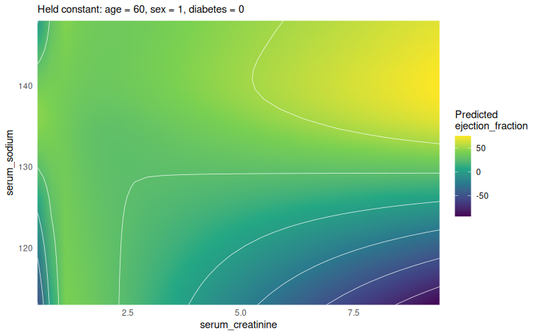
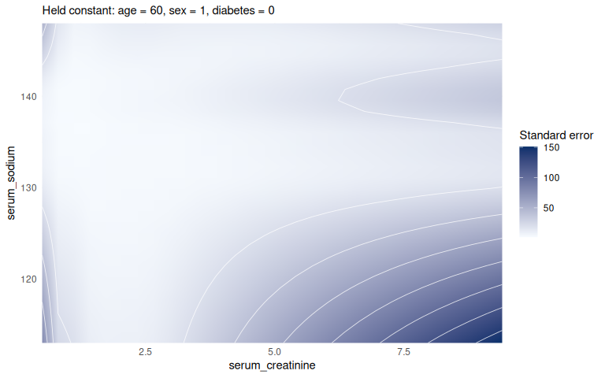
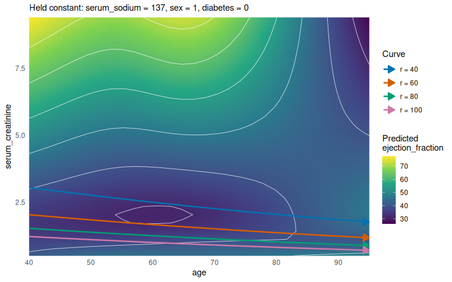
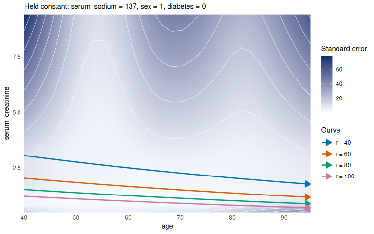
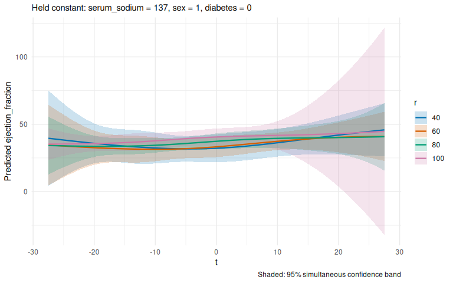
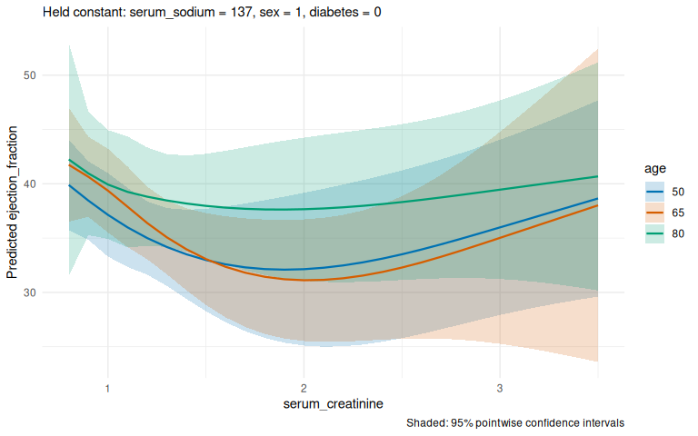
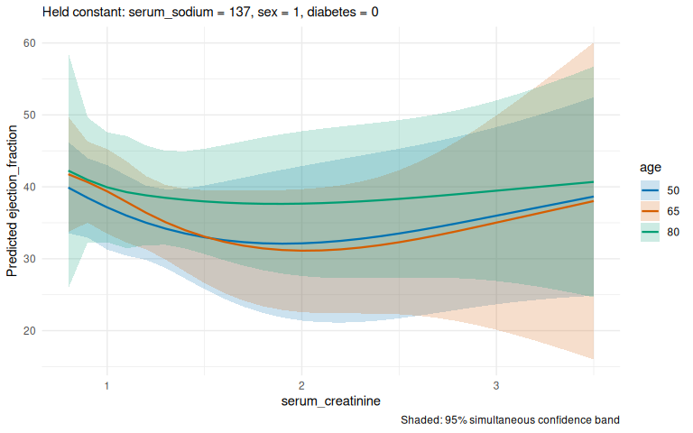
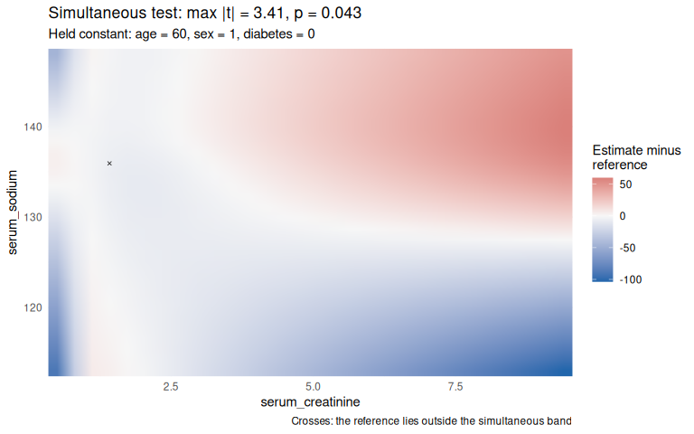

# termeffects: nonlinear predictions and parameterizations

> **About this vignette.** Written by Lukas Bolsinger for p-ggeffects
> (original file `p_ggeffects_heart_failure.Rmd`) and ported to
> termeffects by Brigitte Mueller. His text is kept; the code now uses
> the termeffects functions (`ggpredict()` became `term_predictions()`,
> `plot(..., "heatmap")` became `term_heatmap()`, layers became
> `term_layer()`), and held covariates are at their median or most
> common value. The data now come with termeffects instead of dlookr,
> and the standard-error heatmap is a separate plot instead of a stacked
> panel. Natural splines (`ns()`) are replaced by restricted cubic
> splines (`rcs()`), as used in our team. Every change is marked in
> `validation/output/vignette_track_changes.html` (struck through:
> removed; underlined: added), or run
> `git diff 2de18bc -- vignettes/heart_failure_renal_index.Rmd`.

# Introduction

This example uses the `heartfailure` data (distributed with termeffects,
originally from `dlookr`) to demonstrate how **termeffects separates
model fitting, prediction, parameterization, and presentation**. The
response is left ventricular ejection fraction (LVEF); the analysis is
illustrative and associative, not causal.

| Feature | Demonstration |
|:---|:---|
| Nonlinear interactions | Restricted cubic spline interactions in a single fitted model |
| `term_predictions()` | Adjusted prediction surfaces on original predictor coordinates |
| `term_heatmap()` | Visualize a two-dimensional response surface |
| `parameterize()` | Predict using a derived renal-function coordinate without refitting |
| `term_layer()` | Evaluate a prediction surface along parameterized curves |
| Simultaneous inference | Compare pointwise and simultaneous bands; test against a specified function |

**Plotting rule:** No more than two continuous focal coordinates are
shown at once. Other variables are held at the reference profile chosen
by `term_predictions()` (median or most common value), or fixed
explicitly with `at`.

# Part I — Fit the model

The response is modeled using ordinary least squares. Restricted cubic
splines with four knots (three degrees of freedom) allow nonlinear main
effects; their interactions allow the association with one predictor to
vary across another. Two interactions are included to provide two
distinct prediction surfaces. Sex and diabetes enter as additive
adjustment terms. No prediction grid is specified during fitting.

``` r
knitr::opts_chunk$set(fig.width = 8, fig.height = 5,
                      collapse = TRUE, comment = "#>")

library(termeffects)
library(rms)
library(ggplot2)
```

``` r
data("heartfailure", package = "termeffects")
raw <- as.data.frame(heartfailure)

dat <- raw[c("ejection_fraction", "creatinine", "sodium",
             "age", "sex", "diabetes")]
names(dat) <- c("ejection_fraction", "serum_creatinine",
                "serum_sodium", "age", "sex", "diabetes")
dat <- na.omit(dat)
dat$sex <- as.integer(dat$sex == "Male")
dat$diabetes <- as.integer(dat$diabetes == "Yes")

model <- lm(
  ejection_fraction ~
    rcs(serum_creatinine, 4) * rcs(serum_sodium, 4) +
    rcs(serum_creatinine, 4) * rcs(age, 4) +
    sex + diabetes,
  data = dat
)
summary(model)
#> 
#> Call:
#> lm(formula = ejection_fraction ~ rcs(serum_creatinine, 4) * rcs(serum_sodium, 
#>     4) + rcs(serum_creatinine, 4) * rcs(age, 4) + sex + diabetes, 
#>     data = dat)
#> 
#> Residuals:
#>     Min      1Q  Median      3Q     Max 
#> -22.999  -7.121  -1.660   6.816  41.268 
#> 
#> Coefficients:
#>                                                                                 Estimate
#> (Intercept)                                                                   -1.294e+03
#> rcs(serum_creatinine, 4)serum_creatinine                                       1.399e+03
#> rcs(serum_creatinine, 4)serum_creatinine'                                     -1.549e+04
#> rcs(serum_creatinine, 4)serum_creatinine''                                     3.781e+04
#> rcs(serum_sodium, 4)serum_sodium                                               9.755e+00
#> rcs(serum_sodium, 4)serum_sodium'                                             -1.588e+01
#> rcs(serum_sodium, 4)serum_sodium''                                             2.357e+01
#> rcs(age, 4)age                                                                 8.325e-01
#> rcs(age, 4)age'                                                               -3.019e+00
#> rcs(age, 4)age''                                                               9.188e+00
#> sex                                                                           -3.435e+00
#> diabetes                                                                      -2.704e-01
#> rcs(serum_creatinine, 4)serum_creatinine:rcs(serum_sodium, 4)serum_sodium     -1.024e+01
#> rcs(serum_creatinine, 4)serum_creatinine':rcs(serum_sodium, 4)serum_sodium     1.135e+02
#> rcs(serum_creatinine, 4)serum_creatinine'':rcs(serum_sodium, 4)serum_sodium   -2.766e+02
#> rcs(serum_creatinine, 4)serum_creatinine:rcs(serum_sodium, 4)serum_sodium'     1.647e+01
#> rcs(serum_creatinine, 4)serum_creatinine':rcs(serum_sodium, 4)serum_sodium'   -1.432e+02
#> rcs(serum_creatinine, 4)serum_creatinine'':rcs(serum_sodium, 4)serum_sodium'   3.335e+02
#> rcs(serum_creatinine, 4)serum_creatinine:rcs(serum_sodium, 4)serum_sodium''   -2.031e+01
#> rcs(serum_creatinine, 4)serum_creatinine':rcs(serum_sodium, 4)serum_sodium''  -1.403e+02
#> rcs(serum_creatinine, 4)serum_creatinine'':rcs(serum_sodium, 4)serum_sodium''  5.109e+02
#> rcs(serum_creatinine, 4)serum_creatinine:rcs(age, 4)age                       -8.199e-01
#> rcs(serum_creatinine, 4)serum_creatinine':rcs(age, 4)age                       5.176e+00
#> rcs(serum_creatinine, 4)serum_creatinine'':rcs(age, 4)age                     -1.160e+01
#> rcs(serum_creatinine, 4)serum_creatinine:rcs(age, 4)age'                       3.628e+00
#> rcs(serum_creatinine, 4)serum_creatinine':rcs(age, 4)age'                     -4.812e+01
#> rcs(serum_creatinine, 4)serum_creatinine'':rcs(age, 4)age'                     1.243e+02
#> rcs(serum_creatinine, 4)serum_creatinine:rcs(age, 4)age''                     -1.142e+01
#> rcs(serum_creatinine, 4)serum_creatinine':rcs(age, 4)age''                     1.878e+02
#> rcs(serum_creatinine, 4)serum_creatinine'':rcs(age, 4)age''                   -4.983e+02
#>                                                                               Std. Error
#> (Intercept)                                                                    1.175e+03
#> rcs(serum_creatinine, 4)serum_creatinine                                       1.336e+03
#> rcs(serum_creatinine, 4)serum_creatinine'                                      1.861e+04
#> rcs(serum_creatinine, 4)serum_creatinine''                                     4.796e+04
#> rcs(serum_sodium, 4)serum_sodium                                               8.954e+00
#> rcs(serum_sodium, 4)serum_sodium'                                              2.337e+01
#> rcs(serum_sodium, 4)serum_sodium''                                             1.721e+02
#> rcs(age, 4)age                                                                 3.877e+00
#> rcs(age, 4)age'                                                                1.441e+01
#> rcs(age, 4)age''                                                               4.579e+01
#> sex                                                                            1.483e+00
#> diabetes                                                                       1.429e+00
#> rcs(serum_creatinine, 4)serum_creatinine:rcs(serum_sodium, 4)serum_sodium      1.015e+01
#> rcs(serum_creatinine, 4)serum_creatinine':rcs(serum_sodium, 4)serum_sodium     1.412e+02
#> rcs(serum_creatinine, 4)serum_creatinine'':rcs(serum_sodium, 4)serum_sodium    3.640e+02
#> rcs(serum_creatinine, 4)serum_creatinine:rcs(serum_sodium, 4)serum_sodium'     2.637e+01
#> rcs(serum_creatinine, 4)serum_creatinine':rcs(serum_sodium, 4)serum_sodium'    3.706e+02
#> rcs(serum_creatinine, 4)serum_creatinine'':rcs(serum_sodium, 4)serum_sodium'   9.592e+02
#> rcs(serum_creatinine, 4)serum_creatinine:rcs(serum_sodium, 4)serum_sodium''    1.915e+02
#> rcs(serum_creatinine, 4)serum_creatinine':rcs(serum_sodium, 4)serum_sodium''   2.658e+03
#> rcs(serum_creatinine, 4)serum_creatinine'':rcs(serum_sodium, 4)serum_sodium''  6.867e+03
#> rcs(serum_creatinine, 4)serum_creatinine:rcs(age, 4)age                        4.445e+00
#> rcs(serum_creatinine, 4)serum_creatinine':rcs(age, 4)age                       7.083e+01
#> rcs(serum_creatinine, 4)serum_creatinine'':rcs(age, 4)age                      1.872e+02
#> rcs(serum_creatinine, 4)serum_creatinine:rcs(age, 4)age'                       1.635e+01
#> rcs(serum_creatinine, 4)serum_creatinine':rcs(age, 4)age'                      2.482e+02
#> rcs(serum_creatinine, 4)serum_creatinine'':rcs(age, 4)age'                     6.514e+02
#> rcs(serum_creatinine, 4)serum_creatinine:rcs(age, 4)age''                      5.154e+01
#> rcs(serum_creatinine, 4)serum_creatinine':rcs(age, 4)age''                     7.588e+02
#> rcs(serum_creatinine, 4)serum_creatinine'':rcs(age, 4)age''                    1.982e+03
#>                                                                               t value
#> (Intercept)                                                                    -1.102
#> rcs(serum_creatinine, 4)serum_creatinine                                        1.047
#> rcs(serum_creatinine, 4)serum_creatinine'                                      -0.833
#> rcs(serum_creatinine, 4)serum_creatinine''                                      0.788
#> rcs(serum_sodium, 4)serum_sodium                                                1.089
#> rcs(serum_sodium, 4)serum_sodium'                                              -0.679
#> rcs(serum_sodium, 4)serum_sodium''                                              0.137
#> rcs(age, 4)age                                                                  0.215
#> rcs(age, 4)age'                                                                -0.209
#> rcs(age, 4)age''                                                                0.201
#> sex                                                                            -2.316
#> diabetes                                                                       -0.189
#> rcs(serum_creatinine, 4)serum_creatinine:rcs(serum_sodium, 4)serum_sodium      -1.008
#> rcs(serum_creatinine, 4)serum_creatinine':rcs(serum_sodium, 4)serum_sodium      0.804
#> rcs(serum_creatinine, 4)serum_creatinine'':rcs(serum_sodium, 4)serum_sodium    -0.760
#> rcs(serum_creatinine, 4)serum_creatinine:rcs(serum_sodium, 4)serum_sodium'      0.625
#> rcs(serum_creatinine, 4)serum_creatinine':rcs(serum_sodium, 4)serum_sodium'    -0.386
#> rcs(serum_creatinine, 4)serum_creatinine'':rcs(serum_sodium, 4)serum_sodium'    0.348
#> rcs(serum_creatinine, 4)serum_creatinine:rcs(serum_sodium, 4)serum_sodium''    -0.106
#> rcs(serum_creatinine, 4)serum_creatinine':rcs(serum_sodium, 4)serum_sodium''   -0.053
#> rcs(serum_creatinine, 4)serum_creatinine'':rcs(serum_sodium, 4)serum_sodium''   0.074
#> rcs(serum_creatinine, 4)serum_creatinine:rcs(age, 4)age                        -0.184
#> rcs(serum_creatinine, 4)serum_creatinine':rcs(age, 4)age                        0.073
#> rcs(serum_creatinine, 4)serum_creatinine'':rcs(age, 4)age                      -0.062
#> rcs(serum_creatinine, 4)serum_creatinine:rcs(age, 4)age'                        0.222
#> rcs(serum_creatinine, 4)serum_creatinine':rcs(age, 4)age'                      -0.194
#> rcs(serum_creatinine, 4)serum_creatinine'':rcs(age, 4)age'                      0.191
#> rcs(serum_creatinine, 4)serum_creatinine:rcs(age, 4)age''                      -0.222
#> rcs(serum_creatinine, 4)serum_creatinine':rcs(age, 4)age''                      0.248
#> rcs(serum_creatinine, 4)serum_creatinine'':rcs(age, 4)age''                    -0.251
#>                                                                               Pr(>|t|)
#> (Intercept)                                                                     0.2715
#> rcs(serum_creatinine, 4)serum_creatinine                                        0.2959
#> rcs(serum_creatinine, 4)serum_creatinine'                                       0.4058
#> rcs(serum_creatinine, 4)serum_creatinine''                                      0.4313
#> rcs(serum_sodium, 4)serum_sodium                                                0.2769
#> rcs(serum_sodium, 4)serum_sodium'                                               0.4974
#> rcs(serum_sodium, 4)serum_sodium''                                              0.8912
#> rcs(age, 4)age                                                                  0.8301
#> rcs(age, 4)age'                                                                 0.8342
#> rcs(age, 4)age''                                                                0.8411
#> sex                                                                             0.0213
#> diabetes                                                                        0.8501
#> rcs(serum_creatinine, 4)serum_creatinine:rcs(serum_sodium, 4)serum_sodium       0.3143
#> rcs(serum_creatinine, 4)serum_creatinine':rcs(serum_sodium, 4)serum_sodium      0.4221
#> rcs(serum_creatinine, 4)serum_creatinine'':rcs(serum_sodium, 4)serum_sodium     0.4479
#> rcs(serum_creatinine, 4)serum_creatinine:rcs(serum_sodium, 4)serum_sodium'      0.5328
#> rcs(serum_creatinine, 4)serum_creatinine':rcs(serum_sodium, 4)serum_sodium'     0.6995
#> rcs(serum_creatinine, 4)serum_creatinine'':rcs(serum_sodium, 4)serum_sodium'    0.7284
#> rcs(serum_creatinine, 4)serum_creatinine:rcs(serum_sodium, 4)serum_sodium''     0.9156
#> rcs(serum_creatinine, 4)serum_creatinine':rcs(serum_sodium, 4)serum_sodium''    0.9579
#> rcs(serum_creatinine, 4)serum_creatinine'':rcs(serum_sodium, 4)serum_sodium''   0.9407
#> rcs(serum_creatinine, 4)serum_creatinine:rcs(age, 4)age                         0.8538
#> rcs(serum_creatinine, 4)serum_creatinine':rcs(age, 4)age                        0.9418
#> rcs(serum_creatinine, 4)serum_creatinine'':rcs(age, 4)age                       0.9506
#> rcs(serum_creatinine, 4)serum_creatinine:rcs(age, 4)age'                        0.8246
#> rcs(serum_creatinine, 4)serum_creatinine':rcs(age, 4)age'                       0.8464
#> rcs(serum_creatinine, 4)serum_creatinine'':rcs(age, 4)age'                      0.8488
#> rcs(serum_creatinine, 4)serum_creatinine:rcs(age, 4)age''                       0.8247
#> rcs(serum_creatinine, 4)serum_creatinine':rcs(age, 4)age''                      0.8047
#> rcs(serum_creatinine, 4)serum_creatinine'':rcs(age, 4)age''                     0.8016
#>                                                                                
#> (Intercept)                                                                    
#> rcs(serum_creatinine, 4)serum_creatinine                                       
#> rcs(serum_creatinine, 4)serum_creatinine'                                      
#> rcs(serum_creatinine, 4)serum_creatinine''                                     
#> rcs(serum_sodium, 4)serum_sodium                                               
#> rcs(serum_sodium, 4)serum_sodium'                                              
#> rcs(serum_sodium, 4)serum_sodium''                                             
#> rcs(age, 4)age                                                                 
#> rcs(age, 4)age'                                                                
#> rcs(age, 4)age''                                                               
#> sex                                                                           *
#> diabetes                                                                       
#> rcs(serum_creatinine, 4)serum_creatinine:rcs(serum_sodium, 4)serum_sodium      
#> rcs(serum_creatinine, 4)serum_creatinine':rcs(serum_sodium, 4)serum_sodium     
#> rcs(serum_creatinine, 4)serum_creatinine'':rcs(serum_sodium, 4)serum_sodium    
#> rcs(serum_creatinine, 4)serum_creatinine:rcs(serum_sodium, 4)serum_sodium'     
#> rcs(serum_creatinine, 4)serum_creatinine':rcs(serum_sodium, 4)serum_sodium'    
#> rcs(serum_creatinine, 4)serum_creatinine'':rcs(serum_sodium, 4)serum_sodium'   
#> rcs(serum_creatinine, 4)serum_creatinine:rcs(serum_sodium, 4)serum_sodium''    
#> rcs(serum_creatinine, 4)serum_creatinine':rcs(serum_sodium, 4)serum_sodium''   
#> rcs(serum_creatinine, 4)serum_creatinine'':rcs(serum_sodium, 4)serum_sodium''  
#> rcs(serum_creatinine, 4)serum_creatinine:rcs(age, 4)age                        
#> rcs(serum_creatinine, 4)serum_creatinine':rcs(age, 4)age                       
#> rcs(serum_creatinine, 4)serum_creatinine'':rcs(age, 4)age                      
#> rcs(serum_creatinine, 4)serum_creatinine:rcs(age, 4)age'                       
#> rcs(serum_creatinine, 4)serum_creatinine':rcs(age, 4)age'                      
#> rcs(serum_creatinine, 4)serum_creatinine'':rcs(age, 4)age'                     
#> rcs(serum_creatinine, 4)serum_creatinine:rcs(age, 4)age''                      
#> rcs(serum_creatinine, 4)serum_creatinine':rcs(age, 4)age''                     
#> rcs(serum_creatinine, 4)serum_creatinine'':rcs(age, 4)age''                    
#> ---
#> Signif. codes:  0 '***' 0.001 '**' 0.01 '*' 0.05 '.' 0.1 ' ' 1
#> 
#> Residual standard error: 11.48 on 269 degrees of freedom
#> Multiple R-squared:  0.1504, Adjusted R-squared:  0.0588 
#> F-statistic: 1.642 on 29 and 269 DF,  p-value: 0.0235
```

# Part II — Specify predictions

Here we choose the prediction domains, **without refitting** the
regression.

## Feature 1 — Original-coordinate prediction surfaces

`term_predictions()` evaluates the fitted model on a grid of focal
predictors and returns adjusted predictions with pointwise confidence
intervals and simultaneous confidence bands. The `terms` argument
specifies the displayed coordinates. Predictors omitted from `terms` are
held at their median (numeric) or most common value (categorical),
reducing the original multivariable model to a two-dimensional surface.
The intervals use the uncertainty in the fitted regression coefficients,
which is also used in the simultaneous-inference examples.

Creatinine–sodium and age–creatinine grids are generated separately to
examine the two fitted interactions. Both use the same regression model.

``` r
pred_creat_sodium <- term_predictions(
  model,
  terms = c("serum_creatinine", "serum_sodium")
)

pred_age_creat <- term_predictions(
  model,
  terms = c("age", "serum_creatinine")
)
```

## Feature 2 — Parameterize a fitted model

`parameterize()` constructs a prediction model by expressing one or more
original predictors as functions of new coordinates. It reuses the
coefficients of the fitted model; the transformation affects prediction
inputs rather than estimation.

For a simple demonstration, define a **synthetic renal-function index**
as a function of creatinine and age. This is *not* clinical eGFR or the
CKD-EPI equation; its sole purpose is to illustrate a nonlinear change
of prediction coordinates. A validated eGFR equation could replace it in
an applied analysis (see the vignette “termeffects feature
demonstration”, which uses the 2021 CKD-EPI equation).

``` math
R = \frac{100\exp[-0.01(A-60)]}{C}, \qquad
C = \frac{100\exp[-0.01(A-60)]}{R}.
```

``` r
renal_index <- function(creatinine, age) {
  100 * exp(-0.01 * (age - 60)) / creatinine
}

creatinine_from_index <- function(index, age) {
  100 * exp(-0.01 * (age - 60)) / index
}

pmodel <- parameterize(
  model,
  parameterizations = list(
    serum_creatinine = function(index, age) {
      100 * exp(-0.01 * (age - 60)) / index
    }
  )
)

parameter_variables(pmodel)
#> [1] "index" "age"
```

The index is inversely related to creatinine and decreases with age at
fixed creatinine. The inverse expression is used because prediction
requires reconstructing the original creatinine value from the index and
age. The original regression coefficients remain unchanged.

``` r
ref_sodium <- median(dat$serum_sodium)
index_data <- expand.grid(
  index = seq(40, 120, by = 2),
  age = c(50, 65, 80),
  serum_sodium = ref_sodium,
  sex = 1,
  diabetes = 0
)
index_data$predicted <- predict(pmodel, newdata = index_data)
head(index_data)
#>   index age serum_sodium sex diabetes predicted
#> 1    40  50          137   1        0  34.74582
#> 2    42  50          137   1        0  34.09945
#> 3    44  50          137   1        0  33.56033
#> 4    46  50          137   1        0  33.12169
#> 5    48  50          137   1        0  32.77472
#> 6    50  50          137   1        0  32.50993
```

## Feature 3 — Parameterized curves on a surface

A layer (`term_layer()`) represents predictions along a parameterized
subset of an existing prediction surface. This permits comparisons along
curves defined by relationships among focal variables, without adding
another plot axis. Layers are generated by calling `term_layer()` with a
`parameterization` on an existing prediction object.

Here, constant-index trajectories are curves in the age–creatinine
plane. The parameterized age coordinate `t` is centered at zero, with
zero corresponding to the midpoint of the observed age range. The
parameterization maps this centered coordinate back to age and
creatinine, keeping the overlay in the heatmap domain while following
the centered-coordinate convention of parameterized models.

``` r
age_center <- mean(range(dat$age))
age_deviation <- range(dat$age) - age_center

layer_index <- term_layer(
  pred_age_creat,
  parameterization = list(
    age = sprintf("t + %.1f", age_center),
    serum_creatinine = sprintf(
      "100 * exp(-0.01 * (t + %.1f - 60)) / r",
      age_center
    )
  ),
  terms = c("t", "r"),
  values = list(t = seq(age_deviation[1], age_deviation[2], by = 1),
                r = c(40, 60, 80, 100))
)
head(as.data.frame(layer_index))
#>       t  r serum_sodium sex diabetes age serum_creatinine estimate std.error
#> 1 -27.5 40          137   1        0  40         3.053507 39.60151 11.253733
#> 2 -26.5 40          137   1        0  41         3.023124 39.07264 10.142179
#> 3 -25.5 40          137   1        0  42         2.993043 38.55008  9.084605
#> 4 -24.5 40          137   1        0  43         2.963262 38.03380  8.085315
#> 5 -23.5 40          137   1        0  44         2.933777 37.52450  7.153641
#> 6 -22.5 40          137   1        0  45         2.904586 37.02453  6.307773
#>   conf.low conf.high  band.low band.high
#> 1 17.44491  61.75810  4.198051  75.00496
#> 2 19.10449  59.04078  7.166053  70.97923
#> 3 20.66411  56.43605  9.970547  67.12961
#> 4 22.11526  53.95235 12.597970  63.46964
#> 5 23.44026  51.60874 15.019648  60.02935
#> 6 24.60565  49.44342 17.180722  56.86835
```

# Part III — Plot the predictions

This part consumes the objects defined above; it does **not** fit
models.

## Figure 1 — Nonlinear interaction heatmap

`term_heatmap(pred_creat_sodium)` displays the adjusted prediction
surface, and `term_heatmap(pred_creat_sodium, fill = "std.error")` a
heatmap of prediction standard errors. The uncertainty heatmap shows
where predictions are more or less precise across the creatinine–sodium
grid; `fill = "band_width"` shows the width of the simultaneous band
instead.

``` r
term_heatmap(pred_creat_sodium)
```

<!-- -->

``` r
term_heatmap(pred_creat_sodium, fill = "std.error")
```

<!-- -->

## Figure 2 — Original-coordinate heatmap with parameterized curves

`term_heatmap(..., layers = )` displays the original age–creatinine
heatmap with the parameterized index trajectories overlaid, here also on
its standard-error heatmap. These are deterministic transformations, not
additional fitted models or confidence regions.

``` r
term_heatmap(pred_age_creat, layers = layer_index)
```

<!-- -->

``` r
term_heatmap(pred_age_creat, layers = layer_index, fill = "std.error")
```

<!-- -->

## Figure 3 — Predictions in parameterized coordinates

`term_curves()` displays the parameterized predictions along the
selected index trajectories. These predictions use the adjustment
profile from the original prediction surface.

``` r
term_curves(layer_index)
```

<!-- -->

## Figure 4 — Pointwise versus simultaneous confidence intervals

Here the focal coordinates are serum creatinine and three fixed ages.
The intervals use the uncertainty in the fitted regression coefficients
on the prediction grid. Both confidence-interval plots use the same
prediction object.

``` r
pred_curves <- term_predictions(
  model,
  terms = c("serum_creatinine", "age"),
  values = list(serum_creatinine = seq(0.8, 3.5, by = 0.1), age = c(50, 65, 80))
)
```

`term_curves(..., band = "pointwise")` displays pointwise confidence
intervals, which apply separately at each prediction point.
`term_curves(..., band = "simultaneous")` displays simultaneous
confidence bands calibrated over the generated prediction grid.
Simultaneous bands are generally wider because they account for the
joint collection of predictions.

``` r
term_curves(pred_curves, band = "pointwise")
```

<figure>

<figcaption aria-hidden="true">Pointwise confidence intervals for LVEF
predictions by creatinine and age.</figcaption>
</figure>

``` r
term_curves(pred_curves, band = "simultaneous")
```

<figure>

<figcaption aria-hidden="true">Simultaneous confidence bands over the
same creatinine-by-age grid.</figcaption>
</figure>

## Figure 5 — Simultaneous comparison with a reference function

`test_simultaneous_predictions()` compares the predicted function with a
supplied reference function `f` over the focal grid. The reference below
is a fixed linear surface chosen to illustrate the interface. The test
concerns equality to this particular surface, not the composite
hypothesis that the association is linear with unspecified coefficients.

``` r
f0 <- function(serum_creatinine, serum_sodium) {
  40 - 3 * (serum_creatinine - 1) + 0.2 * (serum_sodium - 137)
}

sim_test <- test_simultaneous_predictions(pred_creat_sodium, f = f0)
plot(sim_test)
```

<!-- -->

# Part IV — Limitations of plotting, inference, and parameterization

## Plotting and dimensionality

- **Heatmaps show only two continuous focal variables at a time.** They
  cannot display the full predictor space of a higher-dimensional model.
  Other predictors are held constant. A `term_layer()` also requires a
  base surface with two continuous focal variables; its
  parameterizations map back to those primary variables and use at most
  two new coordinates. Layers therefore support curves or families of
  curves on that surface, not arbitrary high-dimensional overlays.
- **Heatmaps do not show residuals.** Raw-data points
  (`show_data = TRUE`) and kernel-density shading
  (`show_support = TRUE`) indicate regions with sparse predictor
  support, but they do not exclude those regions or prevent
  extrapolation.
- **Heatmap uncertainty can be displayed as a standard-error surface or
  as the width of the simultaneous band** (`fill = "std.error"` or
  `fill = "band_width"`).

## Simultaneous inference and marginalization

- **Inference applies to the generated grid and its adjustment
  profile.** Non-focal predictors have already been fixed at selected
  values. The simultaneous bands and reference-function test therefore
  concern predictions at those conditional values; they do not establish
  simultaneous coverage over omitted predictors or their interactions.
  Changing the adjustment profile can change the function being
  assessed.
- **The critical value is estimated using a finite grid.** The grid
  approximates the supremum over the prediction domain; it is a
  numerical method for estimating the simultaneous critical value, not a
  restriction of the intended band to sample or grid points. The band is
  simultaneous over the generated grid points; it is approximately valid
  between them only if the grid is fine.
- **The scope can be chosen.** `ci_scope = "global"` (default) makes the
  band simultaneous over the whole grid; `"faceted"` and `"curve"` give
  separate simultaneous adjustments by facet or by curve.
- **The reference-function test is not a general shape or linearity
  test.** It compares predictions with one supplied function. For
  non-standard models and parameterizations, defining the relevant
  reference function in the original predictor coordinates may not be
  straightforward; it must return one numeric value at each evaluation
  point and use argument names matching variables of the predictions.
  Standard hypotheses such as linearity also generally require fitting
  an additional constrained or reference model, with its estimation
  uncertainty accounted for, rather than simply supplying one fixed
  function.
- **Two ways to compute the uncertainty.** By default
  (`ci_method = "analytic"`) it comes from the coefficients’ covariance
  matrix; `ci_method = "bootstrap"` refits the model on resampled data
  instead, which is slower.

The inferential scope is determined by both the prediction grid and its
adjustment rules. Changing the grid or parameterization does not require
refitting the model, but it changes the function and domain represented
by the plots and tests. In this demonstration, Figure 4 concerns the
creatinine–age surface at the selected adjustment values, while Figure 5
tests a fixed reference function against the creatinine–sodium
predictions at their selected adjustment values.

## Parameterization and default prediction domains

- **Parameterization inputs are treated as numeric.** This makes
  categorical transformations unsuitable and can remove the meaning of
  factor levels. The implementation does not generally verify that
  transformed predictors are finite or scientifically plausible.
- **Unknown parameterization names are an error.** Only names matching
  model predictors (or variables of an existing parameterization) are
  accepted, so a typo stops with a message rather than leaving the model
  unparameterized.
- **Default parameter-coordinate bounds are heuristic, centered
  rectangular boxes.** The range-generation code searches symmetric
  boxes around zero, shrinking them until their sampled and optimized
  image fits within the observed range of the original predictor, then
  expanding dimensions individually. This follows the zero-centered
  parameter-coordinate convention.
- **The bounding-box heuristic may not suit compact or irregular
  parameterizations.** For bounded, periodic, many-to-one, or
  non-rectangular mappings, a single centered rectangle may omit valid
  regions or include combinations that map outside the original
  predictor’s observed range. Its image bounds are estimated using
  random samples and local optimization, which can miss extrema. If the
  search cannot find a suitable box, it warns and returns the last box,
  so downstream grids can still contain out-of-range or invalid
  transformed values. Giving the ranges with `values` avoids the search.
