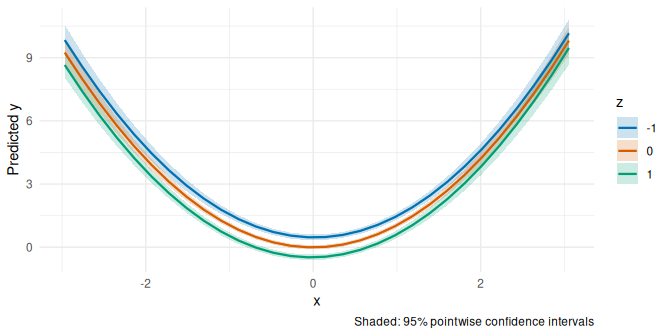
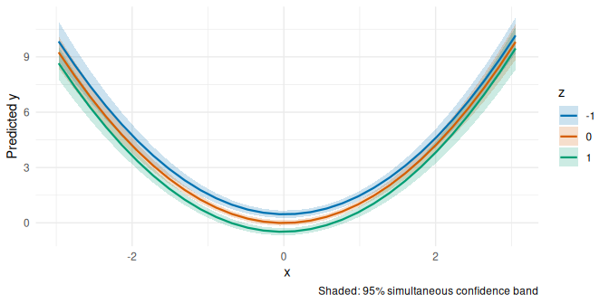
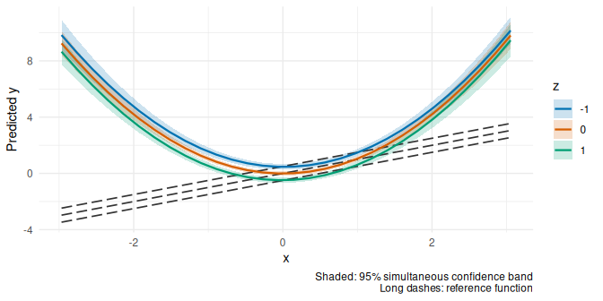
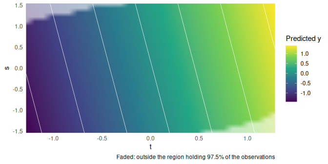
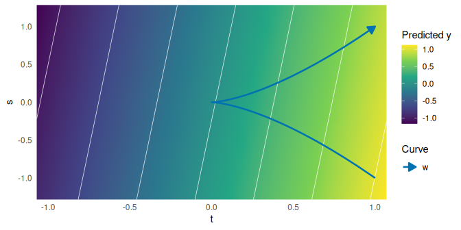
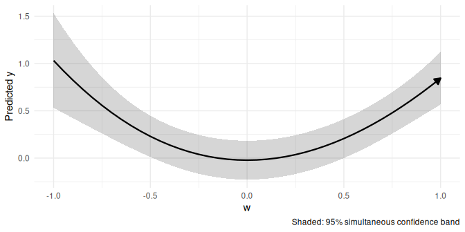

# termeffects: introduction

> **About this vignette.** Written by Lukas Bolsinger for p-ggeffects
> (original file `introduction_p_ggeffects.Rmd`) and ported to
> termeffects by Brigitte Mueller. His text is kept; the code now uses
> the termeffects functions (`ggpredict()` became `term_predictions()`,
> `plot(..., "heatmap")` became `term_heatmap()`, layers became
> `term_layer()`), and held covariates are at their median or most
> common value. Also changed: the description of the methods and of the
> differences from ggeffects, and one example that called
> `test_predictions()` (which failed on parameterized models) is
> removed. Natural splines (`ns()`) are replaced by restricted cubic
> splines (`rcs()`), as used in our team. The model with `%ia%` is now
> fitted with `ols()` instead of `lm()`: in `lm()`, `%ia%` recomputes
> the spline knots from the new data at prediction time, so the
> predictions (and the earlier figures) were wrong. Every change is
> marked in `validation/output/vignette_track_changes.html` (struck
> through: removed; underlined: added), or run
> `git diff 2de18bc -- vignettes/introduction.Rmd`.

# Adjusted predictions

After fitting a model, it is useful to generate model-based estimates
(expected values, or adjusted predictions) of the response variable for
different cobinations of predictor values. Such estimates can be used to
make inferences about relationships between variables–adjusted
precitions tell you: what is the expected outcome for certain values or
levels of my predictors? For complex models, visualizations of adjusted
predictions are often far easier to understand and intuititively
demonstrate associations of predictors and outcomes.

## Methods

`termeffects` computes adjusted predictions at representative values:
the predictors of interest vary over a grid, and all other predictors
are held at their median (numeric) or most common value (categorical),
or at values chosen with `at`. The result is returned as a data frame
with consistent structure, with a view towards ggplot plotting.

We call predictors of interest (ie. the non-marginalized terms) focal
terms.

# From p-ggeffects to termeffects

`termeffects` began as `p-ggeffects`, a ‘generalization’ of the
`ggeffects` package with a focus on non-linear interactions, and
non-trivial marginalizations. Particularly, the deviations from
`ggeffects` are focused on the introduction of `parameterized_model`
objects, regular grid generation for the purpose of 2d-heatmap plotting,
and simultaneous inference. `termeffects` keeps these features but no
longer depends on `ggeffects`: it computes the predictions and their
joint uncertainty itself.

## Parameterized models

A `parameterized_model` is a data structure consisting of a tuple of a
fitted regression model, a map into the variable space of the
model–particularly, it is viewed as a continuous parameterization of the
continuous predictor variables of the models. Moreover, the
`parameterized_model` structure tracks various auxiliary data.

We view parameterized models as a ‘generalization’ of generalized linear
models. Consider the example $`y \sim f_\beta(x) + \varepsilon`$, where
$`f_\beta`$ is the function $`x \mapsto \beta^T x`$. Call the domain of
interest of $`f_\beta`$, $`\Omega'`$. For a mapping
$`\phi: \Omega \to \Omega'`$, by composition, we obtain a ‘model’
$`y \sim f_\beta \circ \phi (z) + \varepsilon`$. This is the classical
example of a generalized additive model–the ‘pullback’ of the model
$`f_\beta`$ by the basis functions $`\phi`$. Notice however, that a data
set $`(Y, X)`$ in $`\Omega'`$ does not in general induce an estimate of
$`\beta`$ (viewed as the coefficients of $`f\circ \phi`$). Indeed, the
points of $`X`$ may not lie in $`\phi(\Omega)`$, and even if so, there
may not be a unique preimage.

In this light, rather than as a regression model, we view parameterized
models instead as generalizations of marginalization by taking
$`x_i = c`$. Indeed, taking $`f_\beta: \mathbb R^n \to \mathbb R`$ as
above, the describe marginalization is equivalent to the
parameterization $`\phi: \mathbb R^{n-1} \to \mathbb R^n`$ given by
$`\phi(x_1, \ldots, x_{n-1}) = (x_1, \ldots, x_{i-1}, c, x_i, \ldots, x_{n-1})`$.
Following the philosophy of the `ggeffects` package, for a more complex
model $`f_\beta`$, we may visualize and interpret the effect of a
(non-primary) variable of interest by plotting its marginalization at a
finite (\>1) set of values.

### Basic methods

We demonstrate some of the basic methods of `parameterized_model`
objects. Consider some non-linear regression model
$`y \sim f_\beta(w, h, \ldots) + \varepsilon`$ dependent on weight and
height mesurements. Consider the parameterization
$`(c, t, \ldots) \mapsto (w = ct^2, h = t, \ldots)`$. Fixing $`c`$ (and
the other variables, $`\ldots`$), we obtain a 1 parameteric family of
observations with fixed BMI and varying height. Doing similarly with
$`t`$, we parameterize the observations with varying weight/BMI and
fixed height.

``` r
w <- rnorm(500, mean = 70, sd = 4)
h <- rnorm(500, mean = 170, sd = 10)

a <- rnorm(500)

y <- a + w/h^2 + h + w + w^2 * h + rnorm(500)


# model example
model <- ols(y ~ rcs(w, 4) + rcs(h, 4) + rcs(w, 4) %ia% rcs(h, 4) + a)

# parameterize model
pmodel1 <- parameterize(model, parameterizations = list(w = \(t,c) c*t^2, h = \(t) t))

# parameterized model attributes
print(pmodel1, show_history = TRUE)
#> Parameterized model
#> 
#> Model:
#> Linear Regression Model
#> 
#> ols(formula = y ~ rcs(w, 4) + rcs(h, 4) + rcs(w, 4) %ia% rcs(h, 
#>     4) + a)
#> 
#>                    Model Likelihood    Discrimination    
#>                          Ratio Test           Indexes    
#> Obs       500    LR chi2    4855.25    R2       1.000    
#> sigma852.1883    d.f.            12    R2 adj   1.000    
#> d.f.      487    Pr(> chi2)  0.0000    g   121842.331    
#> 
#> Residuals
#> 
#>     Min      1Q  Median      3Q     Max 
#> -1837.9  -466.3   115.5   399.7 11939.9 
#> 
#> 
#>           Coef        S.E.       t      Pr(>|t|)
#> Intercept -75560.2643 54042.5454  -1.40 0.1627  
#> w           1204.8215   797.1092   1.51 0.1313  
#> w'         -4603.2097  1687.7076  -2.73 0.0066  
#> w''        14501.3071  6957.6954   2.08 0.0377  
#> h          -3714.6276   328.5908 -11.30 <0.0001 
#> h'           783.3025   649.9872   1.21 0.2287  
#> h''        -1581.1427  2846.9295  -0.56 0.5789  
#> w * h        121.9522     4.8321  25.24 <0.0001 
#> w * h'       -10.9187     9.2196  -1.18 0.2369  
#> w * h''       21.6046    40.4410   0.53 0.5934  
#> w' * h        42.7580     9.8579   4.34 <0.0001 
#> w'' * h      -95.9328    40.7459  -2.35 0.0189  
#> a             26.2106    38.1187   0.69 0.4920  
#> 
#> 
#> Parameters:
#> [1] "t" "c"
#> 
#> Parameterizations:
#> $w <- (c * t^2); (t, c)
#> $h <- (t); (t)
#> 
#> 
#> Parameterization history:
#> 
#> Stage 1        
#> ---------------
#> 
#> w [c * t^2] <── t, c
#> h [t] <── t

# underlying model
original_model(pmodel1)
#> Linear Regression Model
#> 
#> ols(formula = y ~ rcs(w, 4) + rcs(h, 4) + rcs(w, 4) %ia% rcs(h, 
#>     4) + a)
#> 
#>                    Model Likelihood    Discrimination    
#>                          Ratio Test           Indexes    
#> Obs       500    LR chi2    4855.25    R2       1.000    
#> sigma852.1883    d.f.            12    R2 adj   1.000    
#> d.f.      487    Pr(> chi2)  0.0000    g   121842.331    
#> 
#> Residuals
#> 
#>     Min      1Q  Median      3Q     Max 
#> -1837.9  -466.3   115.5   399.7 11939.9 
#> 
#> 
#>           Coef        S.E.       t      Pr(>|t|)
#> Intercept -75560.2643 54042.5454  -1.40 0.1627  
#> w           1204.8215   797.1092   1.51 0.1313  
#> w'         -4603.2097  1687.7076  -2.73 0.0066  
#> w''        14501.3071  6957.6954   2.08 0.0377  
#> h          -3714.6276   328.5908 -11.30 <0.0001 
#> h'           783.3025   649.9872   1.21 0.2287  
#> h''        -1581.1427  2846.9295  -0.56 0.5789  
#> w * h        121.9522     4.8321  25.24 <0.0001 
#> w * h'       -10.9187     9.2196  -1.18 0.2369  
#> w * h''       21.6046    40.4410   0.53 0.5934  
#> w' * h        42.7580     9.8579   4.34 <0.0001 
#> w'' * h      -95.9328    40.7459  -2.35 0.0189  
#> a             26.2106    38.1187   0.69 0.4920

# model parameterizations
parameterizations(pmodel1)
#> $w
#> function (t, c) 
#> (c * t^2)
#> <environment: 0x599aa4604ae8>
#> 
#> $h
#> function (t) 
#> (t)
#> <environment: 0x599aa4604ae8>

# new model variables
parameter_variables(pmodel1)
#> [1] "t" "c"
```

The methods are as follows:

- **`parameterize()`** — *Parameterize one or more predictor variables
  of a fitted model.* Takes a model and a named list of functions,
  expressions, or character strings defining the parameterizations.
  These are converted to functions and associated with predictor
  variables of the original model. When applied to an existing
  `parameterized_model`, the new parameterizations are composed with the
  existing ones and recorded in the parameterization history.

- **`parameterized_model()`** — *Construct a `parameterized_model`
  directly.* This is the low-level constructor underlying
  `parameterize()`. It takes an original model and a named list of
  parameterization functions, retains those corresponding to model
  predictors, determines the variables required by those functions, and
  stores the resulting parameterizations and their history alongside the
  original model.

- **`predict()`** — *Generate predictions from a parameterized model.*
  The `predict.parameterized_model()` method first transforms `newdata`
  according to the model’s parameterizations and then delegates
  prediction to the original model’s `predict()` method. Consequently,
  `newdata` is specified in terms of the parameter variables rather than
  the parameterized predictors.

- **`original_model()`** — *Extract the underlying fitted model.*
  Returns the original model stored inside a `parameterized_model`. If
  the supplied object is not a `parameterized_model`, it is returned
  unchanged.

- **`parameterizations()`** — *Extract the parameterization functions
  associated with a model.* By default, returns the model’s current
  parameterizations. The `level` argument can instead be used to
  retrieve and compose a specified number of the most recent
  parameterization steps from the model’s parameterization history.

- **`parameter_variables()`** — *Return the variables on which the
  parameterized model depends.* Extracts the unique variables appearing
  as arguments of the model’s current parameterization functions. These
  are the variables that must be supplied when constructing prediction
  data for the parameterized predictors.

- **`parameterize_data()`** — *Apply a model’s parameterizations to a
  data frame.* Evaluates each parameterization using the corresponding
  parameter variables in `newdata` and adds the resulting parameterized
  predictors to the data. The optional `level` argument controls how
  many levels of the parameterization history are applied.

- **`print()`** — *Display a summary of a `parameterized_model`.* The
  `print.parameterized_model()` method prints the underlying model, its
  parameter variables, and the current parameterization functions.
  Setting `show_history = TRUE` additionally displays the sequence of
  parameterizations previously applied to the model.

- **`is.parameterized_model()`** — *Test whether an object is a
  `parameterized_model`.* Returns a logical value indicating whether the
  object inherits from the `"parameterized_model"` class.

## Predictions for parameterized models

`term_predictions()` works for parameterized model objects as for fitted
models, with some additional features:

- Regular grids (for heatmap visualization); the ranges of new variables
  are found by a search, or given with `values`
- No support for offset terms
- Computation of critical values for ‘simultaneous’ confidence bands by
  simulation from the coefficients’ distribution, or by non-parametric
  bootstrap.

Additionally, implements simultaneous testing for parameterized models

``` r
x <- rnorm(500)
z <- rnorm(500)
y <- x + z + rnorm(500)

model <- lm(y ~ x + z)
pmodel <- parameterize(model, parameterizations = list(x = \(t, s) t^3 + s, z = \(t) t^2))

ggout <- term_predictions(pmodel, terms = c("t", "s"), values = list(s = c(-1, 0, 1)))

ggout
#> Predictions over t, s ( 90 grid points, response scale )
#> Critical values for 95% intervals (analytic): pointwise 1.965, simultaneous 2.595
#> 
#>        t  s estimate conf.low conf.high band.low band.high
#>  -1.2839 -1  -1.2724  -1.6084   -0.9364  -1.7161   -0.8287
#>  -1.1954 -1  -1.0975  -1.3930   -0.8021  -1.4877   -0.7074
#>  -1.1068 -1  -0.9617  -1.2221   -0.7013  -1.3055   -0.6179
#>  -1.0183 -1  -0.8608  -1.0913   -0.6303  -1.1651   -0.5564
#>  -0.9297 -1  -0.7907  -0.9962   -0.5853  -1.0620   -0.5194
#>  -0.8412 -1  -0.7474  -0.9323   -0.5625  -0.9916   -0.5032
#>  -0.7526 -1  -0.7268  -0.8954   -0.5582  -0.9494   -0.5042
#>  -0.6641 -1  -0.7248  -0.8807   -0.5688  -0.9307   -0.5188
#>  -0.5755 -1  -0.7373  -0.8838   -0.5907  -0.9308   -0.5437
#>  -0.4870 -1  -0.7602  -0.9001   -0.6202  -0.9450   -0.5754
#> ... with 80 more rows

ggout |> as.data.frame() |> head()
#>            t  s         x         z   estimate  std.error   conf.low  conf.high   band.low  band.high
#> 1 -1.2839185 -1 -3.116471 1.6484466 -1.2723746 0.17101219 -1.6083706 -0.9363787 -1.7160700 -0.8286793
#> 2 -1.1953724 -1 -2.708086 1.4289151 -1.0975276 0.15037291 -1.3929725 -0.8020826 -1.4876737 -0.7073814
#> 3 -1.1068263 -1 -2.355933 1.2250644 -0.9616892 0.13252379 -1.2220651 -0.7013133 -1.3055254 -0.6178530
#> 4 -1.0182802 -1 -2.055849 1.0368945 -0.8607777 0.11730818 -1.0912588 -0.6302966 -1.1651367 -0.5564188
#> 5 -0.9297341 -1 -1.803667 0.8644054 -0.7907114 0.10456570 -0.9961567 -0.5852661 -1.0620096 -0.5194131
#> 6 -0.8411880 -1 -1.595222 0.7075972 -0.7474083 0.09412547 -0.9323412 -0.5624754 -0.9916191 -0.5031974


### prediction testing
# requires function in original variables
test_simultaneous_predictions(ggout, f = \(x, z) x - z) |> as.data.frame() |> head()
#>            t  s         x         z   estimate  std.error   conf.low  conf.high   band.low  band.high reference difference inside
#> 1 -1.2839185 -1 -3.116471 1.6484466 -1.2723746 0.17101219 -1.6083706 -0.9363787 -1.7160700 -0.8286793 -4.764918   3.492543  FALSE
#> 2 -1.1953724 -1 -2.708086 1.4289151 -1.0975276 0.15037291 -1.3929725 -0.8020826 -1.4876737 -0.7073814 -4.137001   3.039473  FALSE
#> 3 -1.1068263 -1 -2.355933 1.2250644 -0.9616892 0.13252379 -1.2220651 -0.7013133 -1.3055254 -0.6178530 -3.580998   2.619309  FALSE
#> 4 -1.0182802 -1 -2.055849 1.0368945 -0.8607777 0.11730818 -1.0912588 -0.6302966 -1.1651367 -0.5564188 -3.092744   2.231966  FALSE
#> 5 -0.9297341 -1 -1.803667 0.8644054 -0.7907114 0.10456570 -0.9961567 -0.5852661 -1.0620096 -0.5194131 -2.668073   1.877361  FALSE
#> 6 -0.8411880 -1 -1.595222 0.7075972 -0.7474083 0.09412547 -0.9323412 -0.5624754 -0.9916191 -0.5031974 -2.302819   1.555411  FALSE
test_simultaneous_predictions(ggout, f = \(x, z) x  +  z) -> test

attr(test, "all_inside")
#> [1] TRUE
test |> as.data.frame() |> head()
#>            t  s         x         z   estimate  std.error   conf.low  conf.high   band.low  band.high  reference difference inside
#> 1 -1.2839185 -1 -3.116471 1.6484466 -1.2723746 0.17101219 -1.6083706 -0.9363787 -1.7160700 -0.8286793 -1.4680244  0.1956498   TRUE
#> 2 -1.1953724 -1 -2.708086 1.4289151 -1.0975276 0.15037291 -1.3929725 -0.8020826 -1.4876737 -0.7073814 -1.2791705  0.1816430   TRUE
#> 3 -1.1068263 -1 -2.355933 1.2250644 -0.9616892 0.13252379 -1.2220651 -0.7013133 -1.3055254 -0.6178530 -1.1308690  0.1691799   TRUE
#> 4 -1.0182802 -1 -2.055849 1.0368945 -0.8607777 0.11730818 -1.0912588 -0.6302966 -1.1651367 -0.5564188 -1.0189546  0.1581769   TRUE
#> 5 -0.9297341 -1 -1.803667 0.8644054 -0.7907114 0.10456570 -0.9961567 -0.5852661 -1.0620096 -0.5194131 -0.9392617  0.1485504   TRUE
#> 6 -0.8411880 -1 -1.595222 0.7075972 -0.7474083 0.09412547 -0.9323412 -0.5624754 -0.9916191 -0.5031974 -0.8876250  0.1402168   TRUE
```

Remark that the obtained critical value and respective (hyperbolic)
simultaneous confidence interval are simultaneous over only the
generated grid. In particular, non-focal terms are marginalized to
constants.

### Simultaneous confidence bands

#### Definition and Motivation:

For a regression model of the form $`y \sim f_\beta(x) + \varepsilon`$,
the standard confidence band for predictions, $`f_{\hat\beta}(x_0)`$ is
the set:
``` math
  C_{\beta}(x_0) = [\hat f_\beta(x_0) - t_{1-\alpha/2, n-p} SE(\hat f_\beta)(x_0), \hat f_\beta(x_0) + t_{1-\alpha/2, n-p} SE(\hat f_\beta)(x_0)]
```

The set-valued function $`C_\beta: \Omega \to 2^\mathbb{R}`$ is the
pointwise confidence interval. In particular, one only draws pointwise
inferences about $`f_\beta`$, effectively, by means of hypothesis tests
of the for $`H_0: f_\beta(x) = f_0`$, which we reject iff
$`f_\beta(x) \not\in C_\beta(x)`$. One may naively attempt to extend
this pointwise test to a global test by means of multiple joint
hypothesis tests, $`H_0`$ & $`H_1`$ & $`\cdots`$ & $`H_n`$–corrected
with multiple hypothesis corrections. In the case where we correct
uniformly accros the domain of interest, $`\Omega`$, we obtain the
standard hyperbolic simultaneous confidence band: the set-valued
function $`C_\beta: \Omega \to 2^{\mathbb R}`$ given by

``` math
  C_\beta(x_0) = [\hat f_\beta(x_0) - c_\alpha SE(\hat f_\beta)(x_0), \hat f_\beta(x_0) + c_\alpha SE(\hat f_\beta)(x_0)]
```
where $`c_\alpha`$ is chosen such that is the 95-percent quantile of
$`\sup_{x\in \Omega}\frac{\lVert f_\beta(x) - \hat f_\beta(x)\rVert}{SE \hat f_\beta(x)}`$.
By construction, particulary, the supremum, we observe that this
confidence band “considers” the covariance structure of the regression
model.

Observe that there is not an elementary closed form for the
distribution, in general. Hence, we compute it via simulation or
bootstrap based methods. For nice models (ie. generlized linear models)
we can sample from the distribution of the regression coefficients, for
less nice models, we must refit several models, then estimate. In
particular, in termeffects, we implement two methods (in addition to the
pointwise confidence band). For generalized linear models the band is
computed on the scale of the linear predictor and then transformed, so
it respects the range of the outcome (e.g. probabilities stay within 0
and 1).

``` r

x <- rnorm(500)
z <- rnorm(500)
y <- rnorm(500) + x^2 - 0.5 * z

model <- lm(y ~ x + I(x^2) + I(x * z) + z)

out2 <- term_predictions(model, terms = c("x", "z"), values = list(z = c(-1, 0, 1)), ci_level = 0.95, ci_method = "bootstrap", nboot = 500)
out3 <- term_predictions(model, terms = c("x", "z"), values = list(z = c(-1, 0, 1)), ci_level = 0.95, ci_method = "analytic")


head(out3)
#> Predictions over x, z ( 6 grid points, response scale )
#> Critical values for 95% intervals (analytic): pointwise 1.965, simultaneous 2.893
#> 
#>       x  z estimate conf.low conf.high band.low band.high
#>  -3.283 -1   10.990   10.266    11.714    9.924    12.056
#>  -3.052 -1    9.582    8.941    10.224    8.638    10.527
#>  -2.821 -1    8.277    7.712     8.842    7.445     9.109
#>  -2.590 -1    7.074    6.580     7.568    6.347     7.801
#>  -2.359 -1    5.973    5.544     6.402    5.341     6.605
#>  -2.128 -1    4.974    4.604     5.345    4.429     5.520

term_curves(out3, band = "pointwise")
```

<!-- -->

``` r
term_curves(out3, band = "simultaneous")
```

<!-- -->

``` r


sim1 <- test_simultaneous_predictions(out3, f = \(x, z) x - 0.5 * z)
head(sim1)
#> Simultaneous test: does the reference function fit inside the 95% band?
#> max |t| = 47.78, p = <1e-04
#> The reference lies inside the band at 0 of 6 grid points.
#> 
#>       x  z estimate reference band.low band.high inside
#>  -3.283 -1   10.990    -2.783    9.924    12.056  FALSE
#>  -3.052 -1    9.582    -2.552    8.638    10.527  FALSE
#>  -2.821 -1    8.277    -2.321    7.445     9.109  FALSE
#>  -2.590 -1    7.074    -2.090    6.347     7.801  FALSE
#>  -2.359 -1    5.973    -1.859    5.341     6.605  FALSE
#>  -2.128 -1    4.974    -1.628    4.429     5.520  FALSE
plot(sim1)
```

<!-- -->
In addition, by specifying `ci_scope = c("global", "faceted", "curve")`,
one may impose further marginalization (with respect to the uncertainty
estimation). for the purpose of inference:

    out <- term_predictions(model, terms = c("x", "z", "a", "b"), values = list(a = c(-1, 0, 1), b = c(-1, 0, 1)), ci_scope = "faceted")

provides simultaneous confidence bands
$`C^\alpha_{a, b}: \Omega|_{a, b} \to 2^{\mathbb R}`$ for
$`(a,b) \in \{-1, 0, 1\}^2`$.

#### Utility

In the case of regression models with more than 4 variables, the
simultaneous confidence band based inference implemented in termeffects
allows far more restricted inferences. Indeed, the underlying
foundational object, the `term_predictions` object, is a marginalized
data grid, together with its respective prediction. The coefficient
based inference is determined from the observations, whereas (still
essentially coefficient based) simultaneous confidence testing requires
the additional specification of the domain (which can be lost).

## term_layer objects and plotting

Given some base `term_predictions` object (an adjusted prediction grid
over two continuous focal terms), a `term_layer` object holds
predictions along curves through it, where the underlying model is a
‘parameterization’ of the base object’s underlying model subject to some
restrictions: - the held-constant variables are all equal to those of
the base - only the two primary variables were parameterized - the total
number of new parameters is at most two In particular, each layer either
induces a 1-parametric curve or 2-parameteric curve (which induces a set
of 1-parametric curves) in the domain of the base model.

`term_layer` objects were introduced due to the additional difficulty of
interpreting heatmap visualizations. The main difficulties are two fold
(but both the result of colour scale usage): difficulty of
distinguishing color values, and diffiliculty contrasting values between
points. `term_layer` objects track data for plotting, allowing the
generatation of ‘anotated’ heatmaps–heatmaps with overlays of discrete
families of 1-parameteric curves, and plots of prediction data
variability along the curves.

Note: marginalizations of predictions are parameteric. For example, in
the case of standard marginalization $`x_i = c`$, this method
(`term_layer()`) requires parameterizations:
`list(x1 = "t1", ..., xn = "tn")`.

### Plotting

As described, `termeffects` provides *two* plot types for surfaces, and
various subfeatures, namely:

- Heatmaps (`term_heatmap()`)
  - standard error or band-width plotting (on seperate heatmap,
    `fill = "std.error"` or `"band_width"`)
  - kernel smoothing density estimation (`show_support = TRUE`)
- Heatmaps with overlays (`layers =`)
- Difference plotting for predicted value vs estimated function
  (`plot(test, "difference")`)
- directional plotting (`show_direction = TRUE`)

Ex:

``` r
x <- rnorm(500)
z <- rnorm(500)

y <- x - z + rnorm(500, sd = 2)


model <- lm(y ~ x + z)
pmodel <- parameterize(model, list(x = "s", z = "s - t"))

pout <- term_predictions(pmodel, terms = c("t", "s"))


term_heatmap(pout, show_support = TRUE)
```

<!-- -->

``` r

ppout1 <- term_layer(pout,
                     parameterization = list(t = "w^2",
                                             s = "w^3"),
                     terms = "w",
                     values = list(w = seq(-1, 1, by = 0.05)))

ppout2 <- term_layer(pout,
                     parameterization = list(t = "r + w^2",
                                             s = "r + w^3"),
                     terms = c("w", "r"),
                     values = list(w = seq(-1, 1, by = 0.05), r = c(-1, 0, 1)))


ppout1 |> head()
#> Predictions over w ( 6 grid points, response scale )
#> Critical values for 95% intervals (analytic): pointwise 1.965, simultaneous 2.413
#> 
#>      w estimate conf.low conf.high band.low band.high
#>  -1.00   1.0309   0.6243    1.4375   0.5316    1.5302
#>  -0.95   0.9240   0.5595    1.2886   0.4764    1.3717
#>  -0.90   0.8233   0.4962    1.1504   0.4217    1.2249
#>  -0.85   0.7286   0.4344    1.0228   0.3673    1.0899
#>  -0.80   0.6399   0.3741    0.9057   0.3135    0.9663
#>  -0.75   0.5571   0.3153    0.7989   0.2602    0.8540

ppout2 |> head()
#> Predictions over w, r ( 6 grid points, response scale )
#> Critical values for 95% intervals (analytic): pointwise 1.965, simultaneous 2.562
#> 
#>      w  r estimate conf.low conf.high band.low band.high
#>  -1.00 -1  0.16438  -0.3275   0.65629  -0.4772    0.8059
#>  -0.95 -1  0.05751  -0.3924   0.50747  -0.5293    0.6443
#>  -0.90 -1 -0.04324  -0.4558   0.36935  -0.5813    0.4949
#>  -0.85 -1 -0.13793  -0.5176   0.24174  -0.6331    0.3572
#>  -0.80 -1 -0.22663  -0.5777   0.12439  -0.6844    0.2312
#>  -0.75 -1 -0.30942  -0.6359   0.01705  -0.7352    0.1164

term_heatmap(pout, layers = ppout1)
```

<!-- -->

``` r
term_curves(ppout1, show_direction = TRUE)
```

<!-- -->

``` r

term_heatmap(pout, layers = ppout2, show_direction = FALSE)
```

<!-- -->
