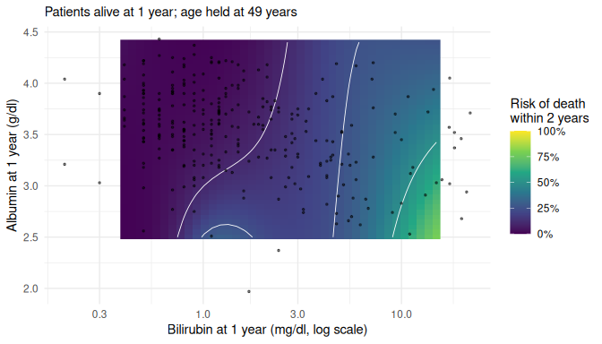
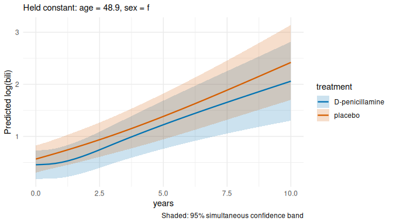
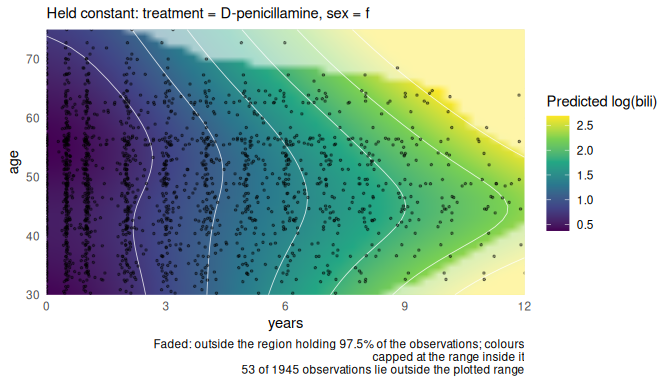
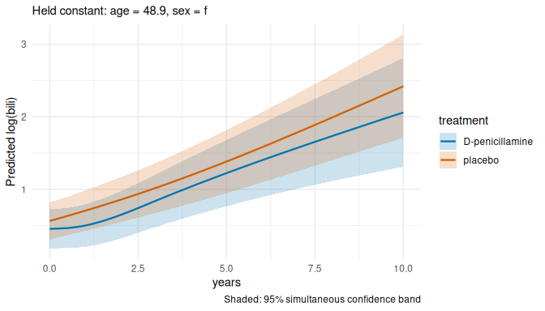
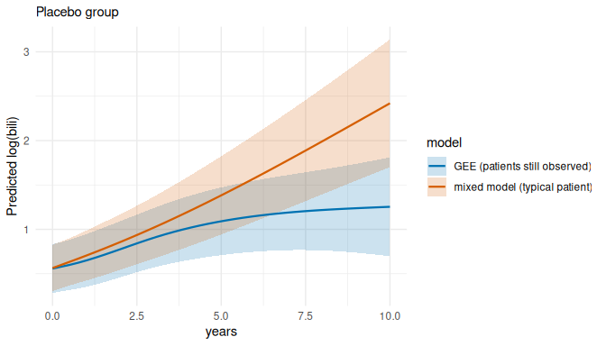
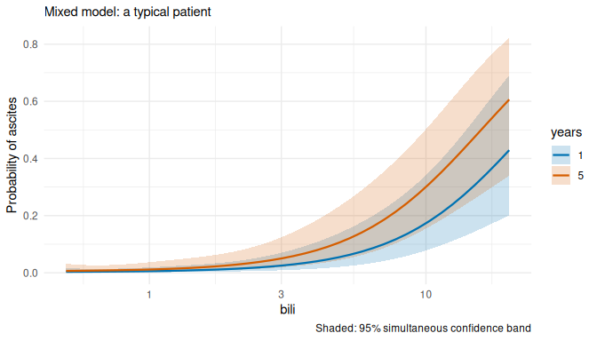
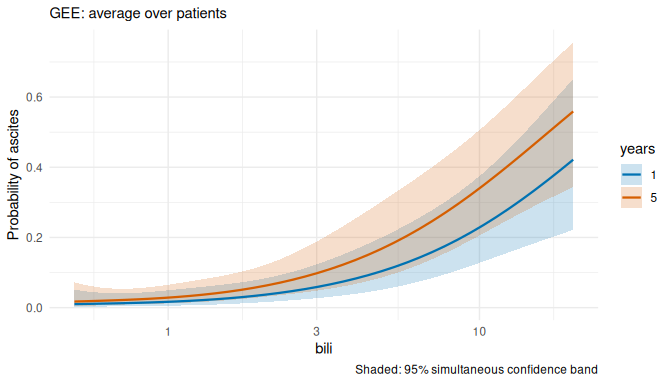

# Supported model types, with examples

termeffects works with models fitted in several packages. The functions
are always the same: `term_predictions()` for the predictions and bands,
`term_heatmap()` and `term_curves()` for the plots, `term_figure()` for
a figure with caption. Only what is predicted differs, and termeffects
chooses it from the model:

| Model | What is shown |
|:---|:---|
| linear regression: `lm()`, `rms::ols()` | predicted outcome |
| logistic regression: `glm(family = binomial)`, `rms::lrm()` | probability |
| Firth logistic regression: `logistf::logistf()`, `glm(method = brglm2::brglmFit)` | probability |
| other GLMs, e.g. Poisson, Gamma | outcome on its own scale, e.g. a count or rate |
| proportional odds: `rms::orm()` | mean outcome |
| Cox regression: `survival::coxph()`, `rms::cph()`, also stratified, and with time-dependent covariates (`tmerge()` data) | hazard ratio vs. an average patient |
| linear mixed models: `lme4::lmer()`, `nlme::lme()`; GLMMs: `lme4::glmer()` | population-level prediction (random effects at 0) |
| GEE: `geepack::geeglm()` | population-averaged prediction |
| GAM: `mgcv::gam()` | outcome on its own scale |

The examples with one measurement per patient use the `heartfailure`
data and the same question: how does the outcome depend on creatinine,
at three sodium values? The examples with repeated measurements
(time-dependent covariates, mixed models, GEE) use the primary biliary
cirrhosis data from the survival package. Each section ends with
**Check:**, saying what you should see.

``` r
library(termeffects)
library(survival)
library(rms)

hf <- heartfailure
hf$died <- as.numeric(hf$death_event == "Yes")
hf$id <- seq_len(nrow(hf))
cuts <- list(creatinine = seq(0.6, 3.5, length.out = 30), sodium = c(130, 137, 142))
```

## Logistic regression

The outcome is death during follow-up (yes/no). A logistic model
describes the log-odds of death; termeffects shows the **probability**
of death, with bands computed on the log-odds scale and then
transformed, so they stay between 0 and 1. The same model can be fitted
with `glm()` or with rms’s `lrm()`:

``` r
fit_glm <- glm(died ~ rcs(creatinine, 4) * rcs(sodium, 4) + age + sex, family = binomial, data = hf)
fit_lrm <- lrm(died ~ rcs(creatinine, 4) * rcs(sodium, 4) + age + sex, data = hf)

term_curves(term_predictions(fit_glm, c("creatinine", "sodium"), values = cuts))
```

<!-- -->

``` r
term_curves(term_predictions(fit_lrm, c("creatinine", "sodium"), values = cuts))
```

<!-- -->

**Check:** the y-axis is “Probability of died”, and all bands lie
between 0 and 1. Both models use the same restricted cubic splines, so
the two plots are identical.

## Firth logistic regression

With few events, or when some combination of predictors perfectly
separates patients who died from those who did not, ordinary logistic
regression gives estimates that are biased away from zero, or infinite.
**Firth’s method** adds a small penalty that removes most of this bias
and always gives finite estimates. It is available in the logistf
package, and as a `glm()` fitting method in brglm2.

``` r
# logistf stops after 25 iterations by default, too few for this model;
# pl = FALSE skips its profile-likelihood intervals, which termeffects does not use
fit_firth <- logistf::logistf(died ~ rcs(creatinine, 4) * sodium + age + sex, data = hf, pl = FALSE,
                              control = logistf::logistf.control(maxit = 1000))
fit_firth$iter  # iterations used: below 1000, so it converged
#> full null 
#>  485    3
term_curves(term_predictions(fit_firth, c("creatinine", "sodium"), values = cuts))
```

<!-- -->

``` r
fit_br <- glm(died ~ rcs(creatinine, 4) * sodium + age + sex, family = binomial, data = hf,
              method = brglm2::brglmFit)
term_curves(term_predictions(fit_br, c("creatinine", "sodium"), values = cuts))
```

<!-- -->

**Check:** the two plots are practically identical: both packages fit
Firth’s method. With 96 deaths among 299 patients the correction is
small; it matters most in small samples. termeffects uses Wald-type
intervals from the penalized fit; logistf’s own default intervals
(profile penalized likelihood) can differ, mainly for extreme estimates.

## Other generalized linear models: a death rate

A Poisson model with an offset describes a **rate**: here deaths per
person-time. The offset `log(time)` makes the expected number of deaths
proportional to each patient’s follow-up time. termeffects holds the
offset’s variable like any other covariate, so by default it predicts
the number of deaths during the median follow-up; with
`at = list(time = 365)` the prediction is the death **rate per
patient-year**.

``` r
fit_rate <- glm(died ~ rcs(creatinine, 4) + sodium + age + sex + offset(log(time)),
                family = poisson, data = hf)
rate <- term_predictions(fit_rate, c("creatinine", "sodium"), values = cuts, at = list(time = 365))
term_curves(rate) + ggplot2::labs(y = "Deaths per patient-year")
```

<!-- -->

**Check:** the header of `rate` (print it) says
`time = 365 (set by user)`. Any other family works the same way,
e.g. `Gamma(link = "log")` for a skewed positive outcome such as CPK.

## Proportional odds model

`rms::orm()` is the main model of the other vignettes (see “Seeing
non-linear interactions”); termeffects shows the mean outcome.

``` r
fit_orm <- orm(ejection_fraction ~ rcs(creatinine, 4) * rcs(sodium, 4) + rcs(age, 4) + sex,
               data = hf)
term_curves(term_predictions(fit_orm, c("creatinine", "sodium"), values = cuts))
```

<!-- -->

## Cox regression

A Cox model describes the hazard of death. termeffects shows the
**hazard ratio** relative to an average patient, on a log axis. The
model can be fitted with `coxph()` or rms’s `cph()`, and may be
**stratified**: `strata()` gives each stratum its own baseline hazard,
which leaves the hazard ratios unchanged.

``` r
fit_cox <- coxph(Surv(time, died) ~ rcs(creatinine, 4) * sodium + age + strata(sex), data = hf)
term_curves(term_predictions(fit_cox, c("creatinine", "sodium"), values = cuts))
```

<!-- -->

``` r

fit_cph <- cph(Surv(time, died) ~ rcs(creatinine, 4) * sodium + age + sex, data = hf)
term_curves(term_predictions(fit_cph, c("creatinine", "sodium"), values = cuts))
```

<!-- -->

**Check:** the y-axis is logarithmic, with a dotted line at a hazard
ratio of 1.

## Extended Cox model with time-dependent covariates

When a covariate is measured repeatedly during follow-up, each patient’s
follow-up is split into intervals `(tstart, tstop]`, with one row per
interval holding the most recent measurement. The model then relates the
hazard at each time to the **current** value of the covariate. The
survival package builds such data with `tmerge()`, as described in T.
Therneau’s “Using time dependent covariates and time dependent
coefficients in the Cox model”
(`vignette("timedep", package = "survival")`).

We follow its example: the `pbc` data hold 312 patients with primary
biliary cirrhosis (one row each, with follow-up time and status), and
`pbcseq` their repeated laboratory measurements during follow-up. The
first `tmerge()` call sets up each patient’s follow-up and the event
(death, status 2); the second adds the lab values as time-dependent
covariates (`tdc()`), each changing on the day it was measured:

``` r
base <- subset(pbc, id <= 312, select = c(id:sex, stage))
pbc2 <- tmerge(base, base, id = id, death = event(time, status))
pbc2 <- tmerge(pbc2, pbcseq, id = id, ascites = tdc(day, ascites),
               bili = tdc(day, bili), albumin = tdc(day, albumin),
               protime = tdc(day, protime), alk.phos = tdc(day, alk.phos))
head(pbc2[c("id", "tstart", "tstop", "death", "bili", "albumin")])
#>   id tstart tstop death bili albumin
#> 1  1      0   192     0 14.5    2.60
#> 2  1    192   400     2 21.3    2.94
#> 3  2      0   182     0  1.1    4.14
#> 4  2    182   365     0  0.8    3.60
#> 5  2    365   768     0  1.0    3.55
#> 6  2    768  1790     0  1.9    3.92
```

Both bilirubin and albumin change over time, and their effect on the
hazard of death need not be linear or additive. We allow a non-linear
interaction between the current (log) bilirubin and the current albumin,
and adjust for age at entry. `cluster(id)` tells the model that rows of
the same patient belong together; it then reports robust standard
errors, which termeffects uses.

``` r
fit_td <- coxph(Surv(tstart, tstop, death == 2) ~ rcs(log(bili), 4) * rcs(albumin, 4) + age +
                  cluster(id), data = pbc2)
bili_values <- exp(seq(log(0.5), log(15), length.out = 40))

surface_td <- term_predictions(fit_td, c("bili", "albumin"),
                               values = list(bili = bili_values, albumin = seq(2, 4.6, length.out = 40)))
term_heatmap(surface_td, show_data = TRUE, show_support = TRUE) + ggplot2::scale_x_log10()
```

<!-- -->

``` r

term_curves(term_predictions(fit_td, c("bili", "albumin"),
                             values = list(bili = bili_values, albumin = c(3, 3.5, 4)))) +
  ggplot2::scale_x_log10()
```

<!-- -->

**Check:** where there are measurements, the hazard ratio rises steeply
with the current bilirubin, and at the same bilirubin a higher albumin
goes with a lower hazard. Below a bilirubin of about 1 with low albumin
there are few measurements (too many to be faded, but still few), the
curves cross and the bands are very wide: do not interpret that region.
The dots in the heatmap are the measurements (rows of `pbc2`), not
patients. The held value of age is the median over these rows, i.e. over
person-time intervals rather than over patients. Bootstrap intervals are
refused for these data, because rows of the same patient are not
independent.

### Absolute risk at a landmark (without bands)

A hazard ratio is relative: it says how much higher the hazard is than
for an average patient, not how likely death is. For a publication, the
absolute risk is often more useful, e.g. *“a patient alive at 1 year,
with these lab values, has a 25% risk of dying within the next 2
years”*.

The model above cannot give this directly. Its hazard depends on the
**current** lab values, so a risk over the next 2 years would need the
lab values over those 2 years, which are not known yet. The usual
solution is a **landmark analysis** (van Houwelingen, *Scand J Stat*
2007): choose a time point (the landmark, here 1 year), keep the
patients still alive and in follow-up at that time, take their most
recent lab values, and fit an ordinary Cox model for the time **from the
landmark** onwards. From that model, the predicted 2-year risk for given
lab values is 1 minus the predicted survival at 2 years.

termeffects does not compute absolute risks (yet), so here we predict
with survival’s `survfit()` and draw the heatmap with ggplot2. The
interaction is simpler than above (albumin linear), because the landmark
data have fewer events.

``` r
landmark <- 365.25  # days
lm_data <- subset(pbc2, tstart <= landmark & tstop > landmark)  # the row in effect at 1 year
lm_data <- merge(lm_data[c("id", "age", "bili", "albumin")], base[c("id", "time", "status")])
lm_data$years <- (lm_data$time - landmark) / 365.25              # time since the landmark
lm_data$died <- lm_data$status == 2
c(patients = nrow(lm_data), deaths = sum(lm_data$died))
#> patients   deaths 
#>      290      103

fit_lm <- coxph(Surv(years, died) ~ rcs(log(bili), 4) * albumin + age, data = lm_data)

grid <- expand.grid(bili = exp(seq(log(0.4), log(15), length.out = 40)),
                    albumin = seq(2.5, 4.4, length.out = 40),
                    age = median(lm_data$age))
grid$risk <- 1 - summary(survfit(fit_lm, newdata = grid), times = 2)$surv[1, ]

library(ggplot2)
ggplot(grid, aes(bili, albumin)) +
  geom_raster(aes(fill = risk)) +
  geom_contour(aes(z = risk), breaks = c(0.1, 0.25, 0.5), colour = "white", linewidth = 0.3) +
  geom_point(data = lm_data, size = 0.6, alpha = 0.5) +
  scale_x_log10() +
  scale_fill_viridis_c(labels = scales::percent, limits = c(0, 1)) +
  labs(x = "Bilirubin at 1 year (mg/dl, log scale)", y = "Albumin at 1 year (g/dl)",
       fill = "Risk of death\nwithin 2 years",
       subtitle = paste0("Patients alive at 1 year; age held at ", round(median(lm_data$age)), " years")) +
  theme_minimal()
```

<!-- -->

**Check:** 290 patients were alive and in follow-up at 1 year, and 103
of them died later. The 2-year risk is a few percent for a low bilirubin
and rises to over 50% for a bilirubin above about 10 when albumin is low
(below about 3.4); at the same bilirubin, a lower albumin goes with a
higher risk. The white lines mark 10%, 25% and 50% risk. The small
island at the bottom edge (bilirubin 1-2, albumin about 2.5) lies where
there are almost no patients; there, as at the edges, the surface is not
reliable.

Some points for a publication:

- The figure shows estimates only. `summary(survfit(...))` also gives
  pointwise standard errors of the survival (`std.err`), which could be
  shown as a second heatmap, but there is no simultaneous band as
  termeffects gives for hazard ratios.
- The risk depends on the held covariates (here age) and on the landmark
  and horizon chosen; say so in the caption. Several landmarks (e.g. 1,
  2 and 3 years) can be shown side by side.
- Patients included are those alive at the landmark, so the risks apply
  to such patients, not to patients at diagnosis.

## Repeated measurements: mixed models and GEE

### The data: bilirubin over time in primary biliary cirrhosis

The `pbcseq` data (survival package) come from the Mayo Clinic trial of
D-penicillamine against placebo in primary biliary cirrhosis, the trial
whose data were used for the extended Cox model above. Laboratory values
were measured repeatedly during follow-up: 1945 visits of 312 patients,
between 1 and 16 visits per patient (median 5), over up to 14 years.

Bilirubin rises as the disease progresses, so a natural question is:
**did D-penicillamine slow the rise of bilirubin?** And, as a second
question, does the rise depend on age at entry?

``` r
pbcv <- pbcseq
pbcv$years <- pbcv$day / 365.25
# in pbcseq, trt is coded 1 = D-penicillamine, 0 = placebo (checked against pbc,
# where the same patients are coded 1 and 2)
pbcv$treatment <- factor(pbcv$trt, c(1, 0), c("D-penicillamine", "placebo"))
pbcv <- pbcv[order(pbcv$id, pbcv$day), ]
head(pbcv[c("id", "years", "treatment", "age", "sex", "bili", "ascites")])
#>   id     years       treatment      age sex bili ascites
#> 1  1 0.0000000 D-penicillamine 58.76523   f 14.5       1
#> 2  1 0.5256674 D-penicillamine 58.76523   f 21.3       1
#> 3  2 0.0000000 D-penicillamine 56.44627   f  1.1       0
#> 4  2 0.4982888 D-penicillamine 56.44627   f  0.8       0
#> 5  2 0.9993155 D-penicillamine 56.44627   f  1.0       0
#> 6  2 2.1026694 D-penicillamine 56.44627   f  1.9       0
```

Bilirubin is very skewed (0.1 to 41 mg/dL) and changes multiplicatively,
so we model its logarithm.

**Why not ordinary regression?** Visits of the same patient are
correlated: a patient with high bilirubin at one visit tends to have
high bilirubin at the next. Ordinary regression treats the 1945 visits
as 1945 independent patients, so its standard errors are too small and
its bands too narrow. Mixed models and GEE are the two common ways to
account for this, and they answer slightly different questions.

### Linear mixed model

A mixed model gives every patient their own starting level and their own
rate of change (a **random intercept and random slope**,
`(1 + years | id)`), drawn from a distribution whose spread is
estimated. The fixed part, which termeffects shows, is the trajectory of
a **typical patient** (random effects at zero). We let the trajectory
over time, `rcs(years, 4)`, differ by treatment and by age at entry:

``` r
fit_lmer <- lme4::lmer(log(bili) ~ rcs(years, 4) * (treatment + rcs(age, 4)) + sex +
                         (1 + years | id), data = pbcv)
by_treatment <- term_predictions(fit_lmer, c("years", "treatment"),
                                 values = list(years = seq(0, 10, length.out = 40)))
term_curves(by_treatment)
```

<!-- -->

**Check:** log bilirubin rises from about 0.5 (1.6 mg/dL) to about
2.1-2.4 (8-11 mg/dL) after 10 years, and the two treatment curves lie
within each other’s bands throughout. The figure answers “how different
could the trajectories be”; a formal test of “do they differ at all”
compares the model with one in which time does not interact with
treatment (a likelihood-ratio test, fitted by maximum likelihood):

``` r
fit_same <- update(fit_lmer, . ~ . - rcs(years, 4):treatment, REML = FALSE)
anova(fit_same, update(fit_lmer, REML = FALSE))
#> Data: pbcv
#> Models:
#> fit_same: log(bili) ~ rcs(years, 4) + treatment + rcs(age, 4) + sex + (1 + years | id) + rcs(years, 4):rcs(age, 4)
#> update(fit_lmer, REML = FALSE): log(bili) ~ rcs(years, 4) * (treatment + rcs(age, 4)) + sex + (1 + years | id)
#>                                npar    AIC    BIC  logLik -2*log(L)  Chisq Df Pr(>Chisq)
#> fit_same                         22 3069.8 3192.5 -1512.9    3025.8                     
#> update(fit_lmer, REML = FALSE)   25 3070.3 3209.6 -1510.1    3020.3 5.5954  3      0.133
```

The p-value of about 0.13 agrees with the trial’s conclusion:
D-penicillamine did not slow the disease.

The second question, age at entry, is a surface over two continuous
variables. Each dot in the heatmap is one visit:

``` r
by_age <- term_predictions(fit_lmer, c("years", "age"),
                           values = list(years = seq(0, 12, length.out = 40),
                                         age = seq(30, 75, length.out = 40)))
term_heatmap(by_age, show_data = TRUE, show_support = TRUE)
```

<!-- -->

**Check:** for the first 5-6 years the contours are almost vertical:
bilirubin rises with time at a similar pace whatever the age at entry.
Later they bend, suggesting a faster rise in older patients (and, less
clearly, in the youngest), but there are few visits there, and beyond
about 9 years at older ages the surface is faded.

The same model in nlme gives the same estimates:

``` r
fit_lme <- nlme::lme(log(bili) ~ rcs(years, 4) * (treatment + rcs(age, 4)) + sex,
                     random = ~ 1 + years | id, data = pbcv)
term_curves(term_predictions(fit_lme, c("years", "treatment"),
                             values = list(years = seq(0, 10, length.out = 40))))
```

<!-- -->

### Generalized estimating equations (GEE)

GEE fits the same regression model as if the visits were independent,
but corrects the standard errors for the correlation within patients
(**robust**, or “sandwich”, standard errors). The working correlation,
here `"exchangeable"` (the same correlation between any two visits of a
patient), only needs to be roughly right. GEE describes the **population
average**: the mean log bilirubin among patients still under observation
at each time. The data must be sorted by patient.

``` r
fit_gee <- geepack::geeglm(log(bili) ~ rcs(years, 4) * (treatment + rcs(age, 4)) + sex,
                           id = id, data = pbcv, corstr = "exchangeable")
gee_by_treatment <- term_predictions(fit_gee, c("years", "treatment"),
                                     values = list(years = seq(0, 10, length.out = 40)))
term_curves(gee_by_treatment)
```

<!-- -->

**Check:** for the first few years the curves are like those of the
mixed model; later they level off, at about 1.3 instead of 2.1-2.4 after
10 years.

### Why the two differ: patients who leave the study

In a linear model, the typical-patient and population-average
trajectories are the same, so the difference has another cause:
**dropout**. Of the 312 patients, 140 died and 29 had a liver
transplant, and these were the sicker patients: at entry their median
bilirubin was about 3 mg/dL (0.9 in the others), and their log bilirubin
rose about ten times as fast (by 0.25-0.33 per year, against 0.03).
After some years mainly the healthier patients are still being seen.

- GEE averages over the patients still observed, so its curve flattens
  as the sicker patients leave. Its results are valid if dropout is
  unrelated to the outcome (“missing completely at random”), which is
  clearly not the case here.
- The mixed model follows each patient’s own trajectory and uses what
  was measured before they left. It is valid if dropout depends only on
  values already observed (“missing at random”), which is more plausible
  here, because rising bilirubin was measured before death or
  transplant.

``` r
both <- rbind(
  transform(as.data.frame(by_treatment), model = "mixed model (typical patient)"),
  transform(as.data.frame(gee_by_treatment), model = "GEE (patients still observed)")
)
ggplot2::ggplot(subset(both, treatment == "placebo"),
                ggplot2::aes(years, estimate, colour = model, fill = model)) +
  ggplot2::geom_ribbon(ggplot2::aes(ymin = band.low, ymax = band.high), alpha = 0.2, colour = NA) +
  ggplot2::geom_line(linewidth = 0.8) +
  ggplot2::scale_colour_manual(values = c("#0072B2", "#D55E00"), aesthetics = c("colour", "fill")) +
  ggplot2::labs(y = "Predicted log(bili)", subtitle = "Placebo group") +
  ggplot2::theme_minimal()
```

<!-- -->

If dropout depends on values never observed (e.g. on a sudden
deterioration between visits), neither is valid, and a joint model of
the measurements and the time to dropout would be needed. In practice:
use a mixed model when patients leave because of how they are doing, and
report GEE results only with this caveat.

### A binary outcome at each visit: ascites

Ascites (fluid in the abdomen, a sign of advanced disease) was recorded
at each visit. How does its probability depend on the current bilirubin?
`glmer()` and `geeglm()` both fit logistic models for repeated binary
outcomes, but here the two kinds of prediction really differ:

- the **mixed model** gives the probability for a typical patient
  (random effect zero);
- **GEE** gives the proportion of all patients with ascites, averaged
  over patients who differ in their own risk.

Averaging S-shaped curves of individual patients gives a flatter curve,
so the GEE probabilities are higher where ascites is rare and lower
where it is common.

``` r
fit_glmer <- lme4::glmer(ascites ~ rcs(log(bili), 4) + rcs(years, 4) + rcs(age, 4) + (1 | id),
                         data = pbcv, family = binomial,
                         control = lme4::glmerControl(optimizer = "bobyqa"))
fit_gee_bin <- geepack::geeglm(ascites ~ rcs(log(bili), 4) + rcs(years, 4) + rcs(age, 4),
                               id = id, data = pbcv, family = binomial, corstr = "exchangeable")
at_bili <- list(bili = exp(seq(log(0.5), log(20), length.out = 40)), years = c(1, 5))
term_curves(term_predictions(fit_glmer, c("bili", "years"), values = at_bili)) +
  ggplot2::scale_x_log10() + ggplot2::labs(subtitle = "Mixed model: a typical patient")
```

<!-- -->

``` r
term_curves(term_predictions(fit_gee_bin, c("bili", "years"), values = at_bili)) +
  ggplot2::scale_x_log10() + ggplot2::labs(subtitle = "GEE: average over patients")
```

<!-- -->

**Check:** in both, the probability of ascites rises steeply with
bilirubin. At a bilirubin of 1 mg/dL the mixed model gives about 1% for
a typical patient and GEE about 2-3% for the population; at 20 mg/dL
both are around 40-60%. Which one to report depends on the question: the
risk of an individual patient (mixed model) or the proportion in a
population (GEE). (`ascites` is missing at 60 visits, which are left
out.)

## A figure caption for any model

`term_figure()` describes each of these models in its caption, e.g. for
the extended Cox model:

``` r
fig <- term_figure(surface_td, cuts = list(albumin = c(3, 3.5, 4)))
cat(fig$caption)
```

Hazard ratio (vs. average subject) over bili and albumin, from a Cox
proportional hazards model (survival::coxph, (start, stop\] data with
time-dependent covariates, robust standard errors), n = 1807 rows, 125
events: Surv(tstart, tstop, death == 2) ~ rcs(log(bili), 4) +
rcs(albumin, 4) + age + rcs(log(bili), 4):rcs(albumin, 4). In the model,
bili enters as rcs(log(bili), 4) and albumin as rcs(albumin, 4). They
interact in the model (rcs(log(bili), 4):rcs(albumin, 4)). All other
covariates are held constant: age = 48.9 (median). Curves: cuts through
the surface at albumin = 3.0, 3.5, 4.0. Shaded: 95% simultaneous
confidence band, covering all curves at once (critical value 2.99).
