# Supported model types, with examples

termeffects works with models fitted in several packages. The functions
are always the same: `term_predictions()` for the predictions and bands,
`term_heatmap()` and `term_curves()` for the plots, `term_figure()` for
a figure with caption. Only what is predicted differs, and termeffects
chooses it from the model:

| Model | What is shown |
|:---|:---|
| linear regression: `lm()`, `rms::ols()` | predicted outcome |
| logistic regression: `glm(family = binomial)`, `rms::lrm()` | probability |
| Firth logistic regression: `logistf::logistf()`, `glm(method = brglm2::brglmFit)` | probability |
| other GLMs, e.g. Poisson, Gamma | outcome on its own scale, e.g. a count or rate |
| proportional odds: `rms::orm()` | mean outcome |
| Cox regression: `survival::coxph()`, `rms::cph()`, also stratified, and with time-dependent covariates (`tmerge()` data) | hazard ratio vs. an average patient |
| linear mixed models: `lme4::lmer()`, `nlme::lme()`; GLMMs: `lme4::glmer()` | population-level prediction (random effects at 0) |
| GEE: `geepack::geeglm()` | population-averaged prediction |
| GAM: `mgcv::gam()` | outcome on its own scale |

Every example below uses the same question: how does the outcome depend
on creatinine, at three sodium values? Each section ends with
**Check:**, saying what you should see.

``` r
library(termeffects)
library(splines)
library(survival)
library(rms)

hf <- heartfailure
hf$died <- as.numeric(hf$death_event == "Yes")
hf$id <- seq_len(nrow(hf))
cuts <- list(creatinine = seq(0.6, 3.5, length.out = 30), sodium = c(130, 137, 142))
```

## Logistic regression

The outcome is death during follow-up (yes/no). A logistic model
describes the log-odds of death; termeffects shows the **probability**
of death, with bands computed on the log-odds scale and then
transformed, so they stay between 0 and 1. The same model can be fitted
with `glm()` or with rms’s `lrm()`:

``` r
fit_glm <- glm(died ~ ns(creatinine, 3) * ns(sodium, 3) + age + sex, family = binomial, data = hf)
fit_lrm <- lrm(died ~ rcs(creatinine, 4) * rcs(sodium, 4) + age + sex, data = hf)

term_curves(term_predictions(fit_glm, c("creatinine", "sodium"), values = cuts))
```

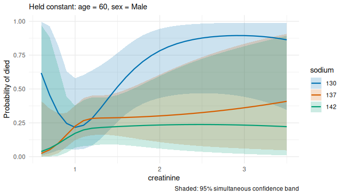<!-- -->

``` r
term_curves(term_predictions(fit_lrm, c("creatinine", "sodium"), values = cuts))
```

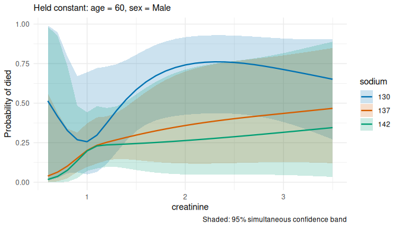<!-- -->

**Check:** the y-axis is “Probability of died”, and all bands lie
between 0 and 1. The two models use different splines (natural splines
and restricted cubic splines with different knots), so the curves are
similar but not identical.

## Firth logistic regression

With few events, or when some combination of predictors perfectly
separates patients who died from those who did not, ordinary logistic
regression gives estimates that are biased away from zero, or infinite.
**Firth’s method** adds a small penalty that removes most of this bias
and always gives finite estimates. It is available in the logistf
package, and as a `glm()` fitting method in brglm2.

``` r
fit_firth <- logistf::logistf(died ~ ns(creatinine, 3) * sodium + age + sex, data = hf)
term_curves(term_predictions(fit_firth, c("creatinine", "sodium"), values = cuts))
```

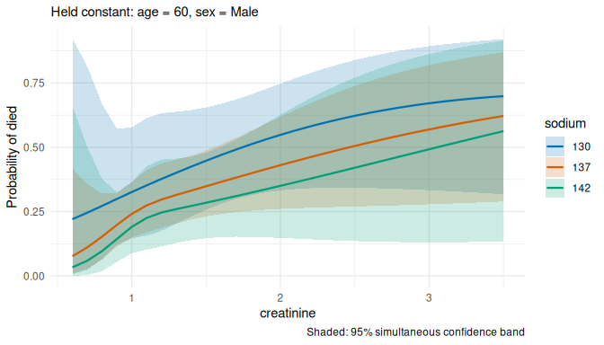<!-- -->

``` r
fit_br <- glm(died ~ ns(creatinine, 3) * sodium + age + sex, family = binomial, data = hf,
              method = brglm2::brglmFit)
term_curves(term_predictions(fit_br, c("creatinine", "sodium"), values = cuts))
```

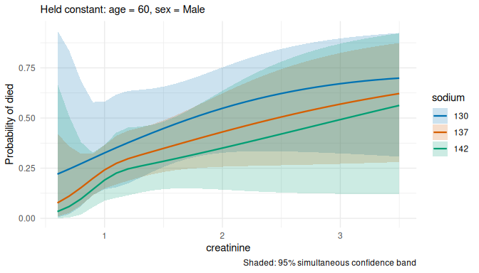<!-- -->

**Check:** the two plots are practically identical: both packages fit
Firth’s method. With 96 deaths among 299 patients the correction is
small; it matters most in small samples. termeffects uses Wald-type
intervals from the penalized fit; logistf’s own default intervals
(profile penalized likelihood) can differ, mainly for extreme estimates.

## Other generalized linear models: a death rate

A Poisson model with an offset describes a **rate**: here deaths per
person-time. The offset `log(time)` makes the expected number of deaths
proportional to each patient’s follow-up time. termeffects holds the
offset’s variable like any other covariate, so by default it predicts
the number of deaths during the median follow-up; with
`at = list(time = 365)` the prediction is the death **rate per
patient-year**.

``` r
fit_rate <- glm(died ~ ns(creatinine, 3) + sodium + age + sex + offset(log(time)),
                family = poisson, data = hf)
rate <- term_predictions(fit_rate, c("creatinine", "sodium"), values = cuts, at = list(time = 365))
term_curves(rate) + ggplot2::labs(y = "Deaths per patient-year")
```

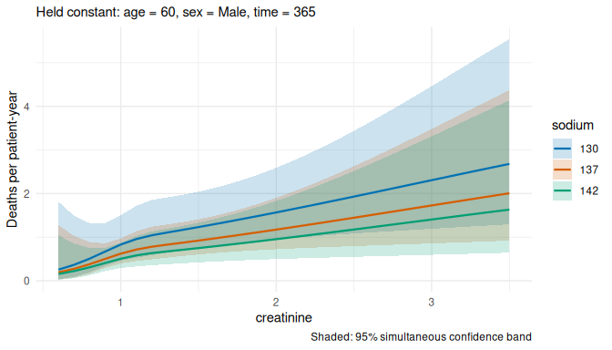<!-- -->

**Check:** the header of `rate` (print it) says
`time = 365 (set by user)`. Any other family works the same way,
e.g. `Gamma(link = "log")` for a skewed positive outcome such as CPK.

## Proportional odds model

`rms::orm()` is the main model of the other vignettes (see “Seeing
non-linear interactions”); termeffects shows the mean outcome.

``` r
fit_orm <- orm(ejection_fraction ~ rcs(creatinine, 4) * rcs(sodium, 4) + rcs(age, 4) + sex,
               data = hf)
term_curves(term_predictions(fit_orm, c("creatinine", "sodium"), values = cuts))
```

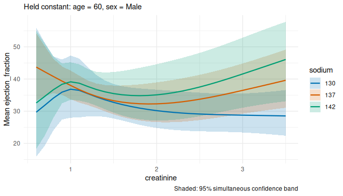<!-- -->

## Cox regression

A Cox model describes the hazard of death. termeffects shows the
**hazard ratio** relative to an average patient, on a log axis. The
model can be fitted with `coxph()` or rms’s `cph()`, and may be
**stratified**: `strata()` gives each stratum its own baseline hazard,
which leaves the hazard ratios unchanged.

``` r
fit_cox <- coxph(Surv(time, died) ~ ns(creatinine, 3) * sodium + age + strata(sex), data = hf)
term_curves(term_predictions(fit_cox, c("creatinine", "sodium"), values = cuts))
```

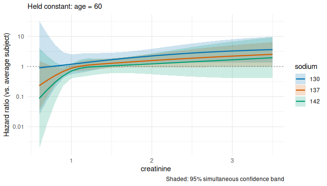<!-- -->

``` r

fit_cph <- cph(Surv(time, died) ~ rcs(creatinine, 4) * sodium + age + sex, data = hf)
term_curves(term_predictions(fit_cph, c("creatinine", "sodium"), values = cuts))
```

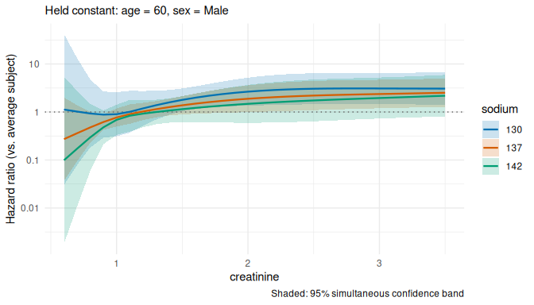<!-- -->

**Check:** the y-axis is logarithmic, with a dotted line at a hazard
ratio of 1.

## Extended Cox model with time-dependent covariates

When a covariate is measured repeatedly during follow-up, each patient’s
follow-up is split into intervals `(tstart, tstop]`, with one row per
interval holding the most recent measurement. The model then relates the
hazard at each time to the **current** value of the covariate. The
survival package builds such data with `tmerge()`, as described in T.
Therneau’s “Using time dependent covariates and time dependent
coefficients in the Cox model”
(`vignette("timedep", package = "survival")`).

We follow its example: the `pbc` data hold 312 patients with primary
biliary cirrhosis (one row each, with follow-up time and status), and
`pbcseq` their repeated laboratory measurements during follow-up. The
first `tmerge()` call sets up each patient’s follow-up and the event
(death, status 2); the second adds the lab values as time-dependent
covariates (`tdc()`), each changing on the day it was measured:

``` r
base <- subset(pbc, id <= 312, select = c(id:sex, stage))
pbc2 <- tmerge(base, base, id = id, death = event(time, status))
pbc2 <- tmerge(pbc2, pbcseq, id = id, ascites = tdc(day, ascites),
               bili = tdc(day, bili), albumin = tdc(day, albumin),
               protime = tdc(day, protime), alk.phos = tdc(day, alk.phos))
head(pbc2[c("id", "tstart", "tstop", "death", "bili", "albumin")])
#>   id tstart tstop death bili albumin
#> 1  1      0   192     0 14.5    2.60
#> 2  1    192   400     2 21.3    2.94
#> 3  2      0   182     0  1.1    4.14
#> 4  2    182   365     0  0.8    3.60
#> 5  2    365   768     0  1.0    3.55
#> 6  2    768  1790     0  1.9    3.92
```

Both bilirubin and albumin change over time, and their effect on the
hazard of death need not be linear or additive. We allow a non-linear
interaction between the current (log) bilirubin and the current albumin,
and adjust for age at entry. `cluster(id)` tells the model that rows of
the same patient belong together; it then reports robust standard
errors, which termeffects uses.

``` r
fit_td <- coxph(Surv(tstart, tstop, death == 2) ~ ns(log(bili), 3) * ns(albumin, 3) + age +
                  cluster(id), data = pbc2)
bili_values <- exp(seq(log(0.5), log(15), length.out = 40))

surface_td <- term_predictions(fit_td, c("bili", "albumin"),
                               values = list(bili = bili_values, albumin = seq(2, 4.6, length.out = 40)))
term_heatmap(surface_td, show_data = TRUE, show_support = TRUE) + ggplot2::scale_x_log10()
```

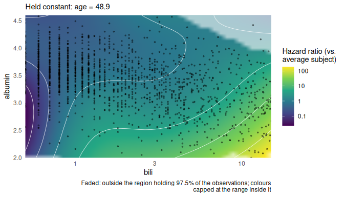<!-- -->

``` r

term_curves(term_predictions(fit_td, c("bili", "albumin"),
                             values = list(bili = bili_values, albumin = c(3, 3.5, 4)))) +
  ggplot2::scale_x_log10()
```

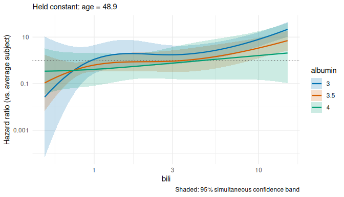<!-- -->

**Check:** where there are measurements, the hazard ratio rises steeply
with the current bilirubin, and at the same bilirubin a higher albumin
goes with a lower hazard. Below a bilirubin of about 1 with low albumin
(the faded corner of the heatmap) there are few measurements, the curves
cross and the bands are very wide: do not interpret that region. The
dots in the heatmap are the measurements (rows of `pbc2`), not patients.
The held value of age is the median over these rows, i.e. over
person-time intervals rather than over patients. Bootstrap intervals are
refused for these data, because rows of the same patient are not
independent.

## Mixed models

A mixed model is for **clustered or repeated data**, e.g. several visits
per patient or several patients per hospital. A random effect per
cluster (here: per patient) accounts for the correlation within
clusters. termeffects shows the **population-level** prediction: for a
typical patient, with the random effect at zero.

For this example we again **simulate** data: three visits per patient,
with LVEF, creatinine and sodium varying a little around each patient’s
recorded values.

``` r
set.seed(2)
visits <- hf[rep(seq_len(nrow(hf)), each = 3), c("id", "ejection_fraction", "creatinine", "sodium",
                                                   "age", "sex", "died")]
visits$visit <- rep(1:3, nrow(hf))
visits$creatinine <- visits$creatinine * exp(rnorm(nrow(visits), sd = 0.1))
visits$sodium <- visits$sodium + rnorm(nrow(visits), sd = 2)
visits$lvef <- visits$ejection_fraction + rnorm(nrow(visits), sd = 4)
```

The same linear mixed model fitted with lme4 and with nlme:

``` r
fit_lmer <- lme4::lmer(lvef ~ ns(creatinine, 3) * sodium + age + sex + (1 | id), data = visits)
fit_lme <- nlme::lme(lvef ~ ns(creatinine, 3) * sodium + age + sex, random = ~ 1 | id, data = visits)
term_curves(term_predictions(fit_lmer, c("creatinine", "sodium"), values = cuts))
```

<!-- -->

``` r
term_curves(term_predictions(fit_lme, c("creatinine", "sodium"), values = cuts))
```

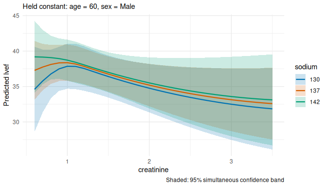<!-- -->

A generalized linear mixed model (`lme4::glmer()`) works the same way,
e.g. for a binary outcome measured at each visit.

**Check:** the two plots are practically identical; lme4 and nlme fit
the same model.

## Generalized estimating equations (GEE)

GEE is another way to analyse clustered or repeated data. Instead of a
random effect, it fits an ordinary regression model and corrects the
standard errors for the correlation within clusters (robust or
“sandwich” standard errors). The predictions are
**population-averaged**. The data must be sorted by cluster.

``` r
visits <- visits[order(visits$id, visits$visit), ]
fit_gee <- geepack::geeglm(lvef ~ ns(creatinine, 3) * sodium + age + sex, id = id, data = visits,
                           corstr = "exchangeable")
term_curves(term_predictions(fit_gee, c("creatinine", "sodium"), values = cuts))
```

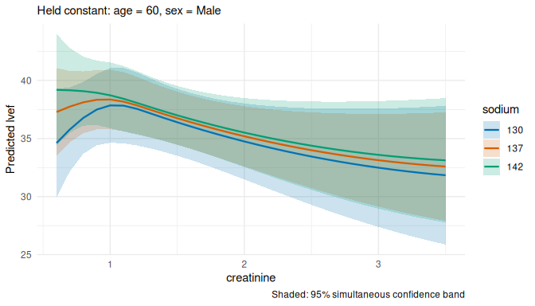<!-- -->

For a binary outcome, use `family = binomial` as in `glm()`.

**Check:** the curves resemble the mixed-model curves (for a linear
model, population-averaged and population-level predictions coincide).

## A figure caption for any model

`term_figure()` describes each of these models in its caption, e.g. for
the extended Cox model:

``` r
fig <- term_figure(surface_td, cuts = list(albumin = c(3, 3.5, 4)))
cat(fig$caption)
```

Hazard ratio (vs. average subject) over bili and albumin, from a Cox
proportional hazards model (survival::coxph, (start, stop\] data with
time-dependent covariates, robust standard errors), n = 125:
Surv(tstart, tstop, death == 2) ~ ns(log(bili), 3) + ns(albumin, 3) +
age + ns(log(bili), 3):ns(albumin, 3). In the model, bili enters as
ns(log(bili), 3) and albumin as ns(albumin, 3). They interact in the
model (ns(log(bili), 3):ns(albumin, 3)). All other covariates are held
constant: age = 48.9 (median). Curves: cuts through the surface at
albumin = 3.0, 3.5, 4.0. Shaded: 95% simultaneous confidence band,
covering all curves at once (critical value 2.97).
