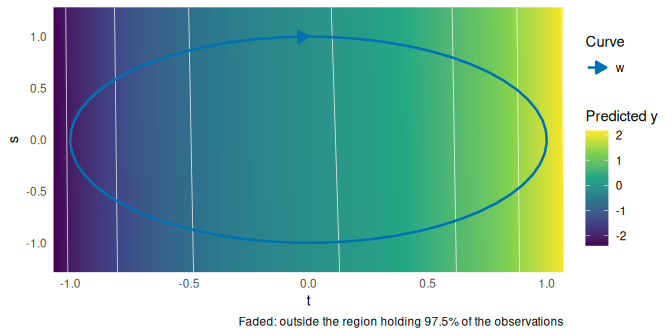
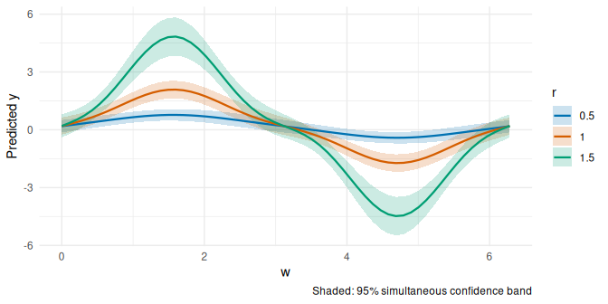
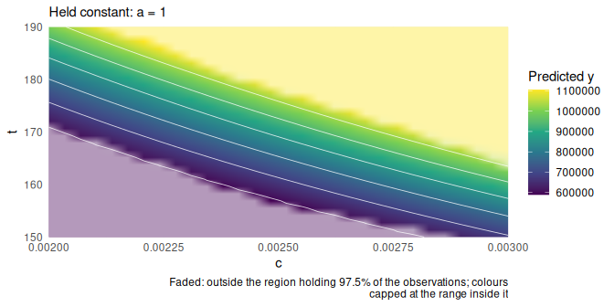

# Parameterized models

> **About this vignette.** Written by Lukas Bolsinger for p-ggeffects
> (original file `introduction_parameterized_model.Rmd`) and ported to
> termeffects by Brigitte Mueller. His text is kept; the code now uses
> the termeffects functions (`ggpredict()` became `term_predictions()`,
> `plot(..., "heatmap")` became `term_heatmap()`, layers became
> `term_layer()`), and held covariates are at their median or most
> common value. Also corrected: a typo (`pmodel`) that stopped two
> chunks from running, and simulated weights with mean 7000 instead of
> 70. Every change is marked in
> `validation/output/vignette_track_changes.html` (struck through:
> removed; underlined: added), or run
> `git diff 2de18bc -- vignettes/parameterized_models.Rmd`.

# parameterized_model objects

## Overview

A `parameterized_model` is a data structure consiting of a tuple of a
fitted regression model, and a collection of maps that parameterize the
continuous predictive variables of the model. Moreover, there exists
some auxiliary tracked information, ie. new parameters, and a
parameterization history.

The primary objective of parameterized models is the visualization of
higher order data in terms of lower order parameteric families via
marginalization. As an example, consider the fitted regression model:
``` math
y = f(x_1, \ldots, x_n; \beta)\quad\text{ with parameterizations}\quad x_i = h_i(z_1, \ldots, z_m)
```
Viewing the regression model as a function, notice that the data of the
parameterized model determines the data of a model by pulling back by
the $`h_i`$. We do note however, that the observed data for which
$`f_\beta = f(-; \beta)`$ was fitted may not be contained in the image
of $`h = (h_i)_i`$, and so the parameterized model $`f_\beta \circ h`$
is almost never determined by the initial observations. For this reason,
this parameterization is primarily a tool for developing intuitions and
visualizations.

Indeed, in sufficiently nice scenarios (for instance if $`h`$ is
smooth), the rank of the parameterized model (viewed as the composition
$`f_\beta \circ h`$) is less than or equal to the rank of $`f_\beta`$.
Particularly, by fixing arguments in $`z`$ (to obtain planes), we obtain
more varied marginalizations of $`f_\beta`$.

## Simple Example

Suppose we have some regression model
$`y \sim f_\beta(\operatorname{weight}, \operatorname{height}, \ldots)`$.
With parameterizations
$`(t, c, \ldots) \mapsto (ct^2, t, \ldots) = (\operatorname{weight}(t), \operatorname{height}(t), \ldots)`$
(where the other function are the identity), we obtain co-level sets in
c and $`\ldots`$ of subsets with fixed BMI, and co-level sets in $`t`$
and $`\ldots`$ of subsets with fixed height, but variable weight and
BMI.

``` r

w <- rnorm(500, mean = 70, sd = 4)
h <- rnorm(500, mean = 170, sd = 10)

a <- rnorm(500)

y <- a + w/h^2 + h + w + w^2 * h + rnorm(500)


# model example
model <- lm(y ~ splines::ns(w,3) + splines::ns(h, 3) + splines::ns(w,3) %ia% splines::ns(h,4) + a)

# parameterize model
pmodel1 <- parameterize(model, parameterizations = list(w = \(t,c) c*t^2, h = \(t) t))

# parameterized model attributes
print(pmodel1, show_history = TRUE)
#> Parameterized model
#> 
#> Model:
#> 
#> Call:
#> lm(formula = y ~ splines::ns(w, 3) + splines::ns(h, 3) + splines::ns(w, 
#>     3) %ia% splines::ns(h, 4) + a)
#> 
#> Coefficients:
#>                                   (Intercept)                             splines::ns(w, 3)1                             splines::ns(w, 3)2                             splines::ns(w, 3)3                             splines::ns(h, 3)1                             splines::ns(h, 3)2                             splines::ns(h, 3)3  splines::ns(w, 3) %ia% splines::ns(h, 4)1 * 1  splines::ns(w, 3) %ia% splines::ns(h, 4)1 * 2  splines::ns(w, 3) %ia% splines::ns(h, 4)1 * 3  splines::ns(w, 3) %ia% splines::ns(h, 4)1 * 4  splines::ns(w, 3) %ia% splines::ns(h, 4)2 * 1  splines::ns(w, 3) %ia% splines::ns(h, 4)2 * 2  splines::ns(w, 3) %ia% splines::ns(h, 4)2 * 3  splines::ns(w, 3) %ia% splines::ns(h, 4)2 * 4  splines::ns(w, 3) %ia% splines::ns(h, 4)3 * 1  splines::ns(w, 3) %ia% splines::ns(h, 4)3 * 2  
#>                                     4.700e+05                                      2.624e+05                                      5.661e+05                                      4.754e+05                                      1.114e+05                                      2.271e+05                                      1.685e+05                                      5.601e+04                                      6.810e+04                                      1.321e+05                                      9.638e+04                                      1.268e+05                                      1.392e+05                                      2.835e+05                                      2.143e+05                                      1.047e+05                                      1.166e+05  
#> splines::ns(w, 3) %ia% splines::ns(h, 4)3 * 3  splines::ns(w, 3) %ia% splines::ns(h, 4)3 * 4                                              a  
#>                                     2.267e+05                                      1.797e+05                                      8.228e+00  
#> 
#> 
#> Parameters:
#> [1] "t" "c"
#> 
#> Parameterizations:
#> $w <- (c * t^2); (t, c)
#> $h <- (t); (t)
#> 
#> 
#> Parameterization history:
#> 
#> Stage 1        
#> ---------------
#> 
#> w [c * t^2] <── t, c
#> h [t] <── t

# underlying model
original_model(pmodel1)
#> 
#> Call:
#> lm(formula = y ~ splines::ns(w, 3) + splines::ns(h, 3) + splines::ns(w, 
#>     3) %ia% splines::ns(h, 4) + a)
#> 
#> Coefficients:
#>                                   (Intercept)                             splines::ns(w, 3)1                             splines::ns(w, 3)2                             splines::ns(w, 3)3                             splines::ns(h, 3)1                             splines::ns(h, 3)2                             splines::ns(h, 3)3  splines::ns(w, 3) %ia% splines::ns(h, 4)1 * 1  splines::ns(w, 3) %ia% splines::ns(h, 4)1 * 2  splines::ns(w, 3) %ia% splines::ns(h, 4)1 * 3  splines::ns(w, 3) %ia% splines::ns(h, 4)1 * 4  splines::ns(w, 3) %ia% splines::ns(h, 4)2 * 1  splines::ns(w, 3) %ia% splines::ns(h, 4)2 * 2  splines::ns(w, 3) %ia% splines::ns(h, 4)2 * 3  splines::ns(w, 3) %ia% splines::ns(h, 4)2 * 4  splines::ns(w, 3) %ia% splines::ns(h, 4)3 * 1  splines::ns(w, 3) %ia% splines::ns(h, 4)3 * 2  
#>                                     4.700e+05                                      2.624e+05                                      5.661e+05                                      4.754e+05                                      1.114e+05                                      2.271e+05                                      1.685e+05                                      5.601e+04                                      6.810e+04                                      1.321e+05                                      9.638e+04                                      1.268e+05                                      1.392e+05                                      2.835e+05                                      2.143e+05                                      1.047e+05                                      1.166e+05  
#> splines::ns(w, 3) %ia% splines::ns(h, 4)3 * 3  splines::ns(w, 3) %ia% splines::ns(h, 4)3 * 4                                              a  
#>                                     2.267e+05                                      1.797e+05                                      8.228e+00

# model parameterizations
parameterizations(pmodel1)
#> $w
#> function (t, c) 
#> (c * t^2)
#> <environment: 0x616dc33426c8>
#> 
#> $h
#> function (t) 
#> (t)
#> <environment: 0x616dc33426c8>

# new model variables
parameter_variables(pmodel1)
#> [1] "t" "c"
```

Furthermore, for a data grid
`data = data.frame(t = ..., c = ..., a = ...)`, with
`predict(pmodel, newdata = data)`, we obtain predictions from the
mechanism:

``` r
# predict.parameterized_model <- function(object, newdata, ...) {
#  ...
#
#  newdata <- parameterize_data(object, newdata)
#
#  predict(object$model, newdata = newdata, ...)
#}

# t is height in cm, so c is BMI in kg/cm^2 (BMI 18-22 kg/m^2 = 0.0018-0.0022)
df <- as.data.frame(
    expand.grid(t = 150:200, c = c(18, 20, 22) / 1e4, a = 0)
  )

head(parameterize_data(pmodel1, newdata = df))
#>     t      c a       w   h
#> 1 150 0.0018 0 40.5000 150
#> 2 151 0.0018 0 41.0418 151
#> 3 152 0.0018 0 41.5872 152
#> 4 153 0.0018 0 42.1362 153
#> 5 154 0.0018 0 42.6888 154
#> 6 155 0.0018 0 43.2450 155

head(predict(pmodel1, newdata = df))
#>        1        2        3        4        5        6 
#> 202516.1 215018.2 227724.3 240635.5 253752.1 267073.5
```

where `parameterize_data` evaluates the parameterization on the new
data.

## term_predictions with parameterized_models.

`term_predictions()` and `term_grid()` are implemented for
parameterized_model objects. As with fitted regression models, the user
specifies their primary terms of interest
`term_predictions(model, terms, ...)` together with auxiliary options.
These terms are variables of the parameterizations, or those
untransformed variables:

    term_predictions(pmodel, terms = c("t", "c"), values = list(c = c(1, 2, 3)), ...)

For standard regression models, for unconstrained terms–such as
“t”–bounds, and regularly spaced sample points are determined by the
data (the extrema of the observations). As discussed above, such a
method does not extend to parameterized_models. Rather, for all new
parameter variables, the largest box (centred at the origin in the
parameter space) whose image stays within the extrema of the
observations is computed. Where this is not possible (consider a
parameterized point or circle), a warning asks for the range to be given
with `values`.

## term_layer objects

Given some base `term_predictions` object (an adjusted prediction grid
over two continuous focal terms, as drawn by `term_heatmap()`), a
`term_layer` object holds predictions along curves through it, where the
underlying model is a ‘parameterization’ of the base object’s underlying
model subject to some restrictions: - the held-constant variables are
all equal to those of the base - only the two primary variables were
parameterized - the total number of new parameters is at most two In
particular, each layer either induces a 1-parametric curve or
2-parameteric curve (which induces a set of 1-parametric curves) in the
domain of the base model.

Ex:

``` r
x <- rnorm(500)
z <- rnorm(500)

y <- x - z + rnorm(500, sd = 2)


model <- lm(y ~ x + z)
pmodel <- parameterize(model, list(x = "t^3 + s", z = "s - t"))

pout <- term_predictions(pmodel, terms = c("t", "s"))

ppout1 <- term_layer(pout,
                     parameterization = list(t = "sin(w)",
                                             s = "cos(w)"),
                     terms = "w",
                     values = list(w = seq(0, 2 * pi, length.out = 60)))

ppout2 <- term_layer(pout,
                     parameterization = list(t = "r * sin(w)",
                                             s = "r * cos(w)"),
                     terms = c("w", "r"),
                     values = list(w = seq(0, 2 * pi, length.out = 60), r = c(0.5, 1, 1.5)))


ppout1
#> Predictions over w ( 60 grid points, response scale )
#> Critical values for 95% intervals (analytic): pointwise 1.965, simultaneous 2.619
#> 
#>       w estimate  conf.low conf.high band.low band.high
#>  0.0000   0.1917 -0.120374    0.5038 -0.22436    0.6078
#>  0.1065   0.2935 -0.007225    0.5942 -0.10741    0.6943
#>  0.2130   0.4007  0.111701    0.6897  0.01542    0.7860
#>  0.3195   0.5183  0.240045    0.7965  0.14735    0.8892
#>  0.4260   0.6496  0.380061    0.9192  0.29024    1.0090
#>  0.5325   0.7963  0.532224    1.0604  0.44423    1.1484
#>  0.6390   0.9576  0.695082    1.2201  0.60762    1.3076
#>  0.7455   1.1303  0.865331    1.3953  0.77705    1.4836
#>  0.8520   1.3092  1.038073    1.5804  0.94774    1.6707
#>  0.9585   1.4872  1.207169    1.7673  1.11386    1.8606
#> ... with 50 more rows

ppout2
#> Predictions over w, r ( 180 grid points, response scale )
#> Critical values for 95% intervals (analytic): pointwise 1.965, simultaneous 2.790
#> 
#>       w   r estimate conf.low conf.high band.low band.high
#>  0.0000 0.5   0.1853 -0.03864    0.4093 -0.13272    0.5034
#>  0.1065 0.5   0.2358  0.01568    0.4559 -0.07678    0.5483
#>  0.2130 0.5   0.2864  0.07039    0.5024 -0.02035    0.5932
#>  0.3195 0.5   0.3375  0.12546    0.5494  0.03641    0.6385
#>  0.4260 0.5   0.3889  0.18066    0.5971  0.09319    0.6846
#>  0.5325 0.5   0.4405  0.23558    0.6455  0.14948    0.7316
#>  0.6390 0.5   0.4919  0.28957    0.6943  0.20456    0.7793
#>  0.7455 0.5   0.5423  0.34176    0.7428  0.25753    0.8270
#>  0.8520 0.5   0.5907  0.39112    0.7902  0.30731    0.8740
#>  0.9585 0.5   0.6359  0.43646    0.8353  0.35270    0.9190
#> ... with 170 more rows

term_heatmap(pout, layers = ppout1, show_support = TRUE, support_prob = 0.975)
```

<!-- -->

``` r

term_curves(ppout2)
```

<!-- -->

# Plotting

termeffects provides *two* plot types for surfaces: heatmaps, and
heatmaps with overlays of 1-parametric curves. Additionally, as a
substitute for plotting observed data, it estimates the density of the
initial observations using kernel smoothing, and fades the regions where
it is low.

Heatmaps are drawn on regular grids, which `term_predictions()`
generates.

``` r

w <- rnorm(500, mean = 70, sd = 4)
h <- rnorm(500, mean = 170, sd = 10)

a <- rnorm(500)

y <- a + w/h^2 + h + w + w^2 * h + rnorm(500)


# model example
model <- lm(y ~ splines::ns(w,3) + splines::ns(h, 3) + splines::ns(w,3) %ia% splines::ns(h,4) + a)

# parameterize model
pmodel1 <- parameterize(model, parameterizations = list(w = \(t,c) c*t^2, h = \(t) t))

pout <- term_predictions(pmodel1, terms = c("c", "t"),
                         values = list(c = seq(0.0020, 0.0030, length.out = 30),
                                       t = seq(150, 190, length.out = 30)),
                         at = list(a = 1))

term_heatmap(pout, show_support = TRUE)
```

<!-- -->

# Simultaneous confidence bands

Every `term_predictions()` result also contains a simultaneous
confidence band (`band.low`, `band.high`), which covers the predictions
at all grid points at once. For parameterized models it is simultaneous
over the grid of the new variables. The vignette “termeffects:
introduction” explains how the band is computed and how to test a
reference function against it.
