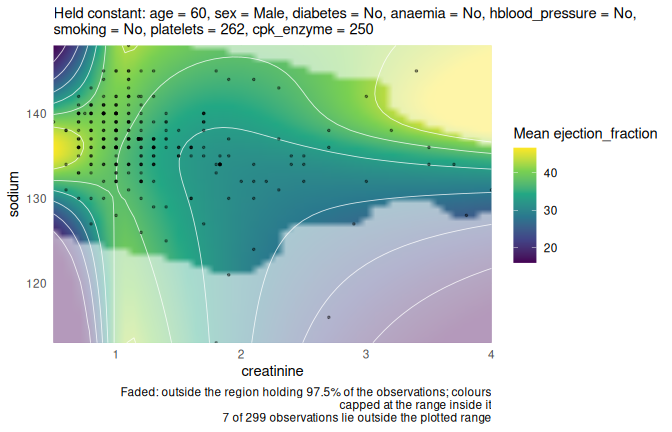
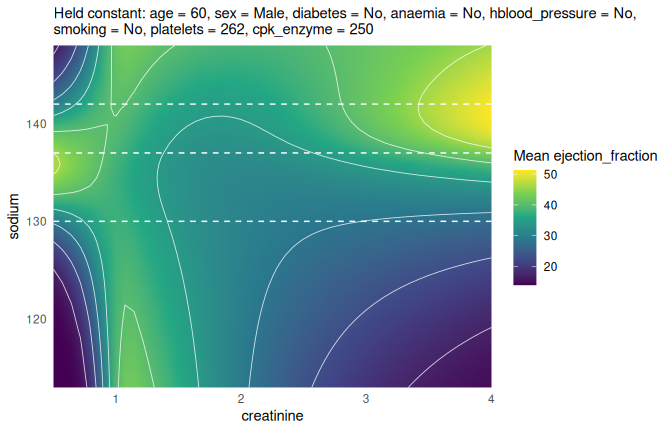
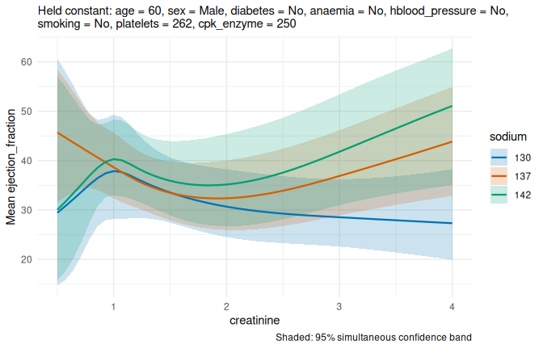
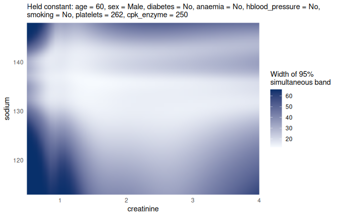
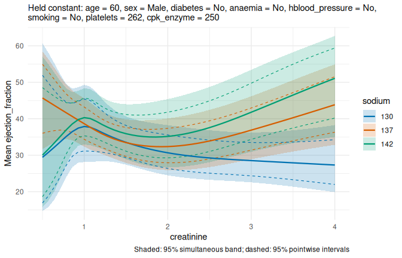
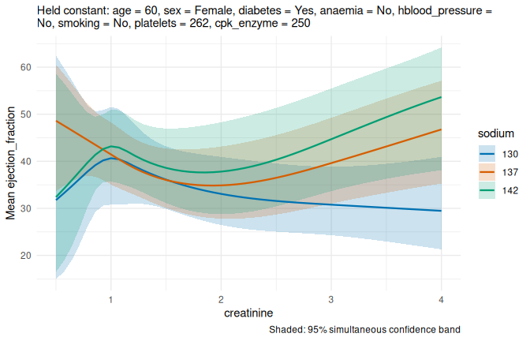
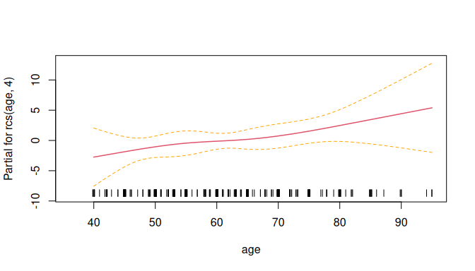
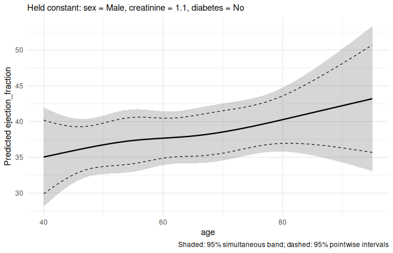
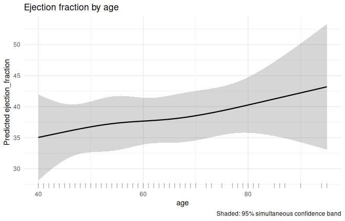
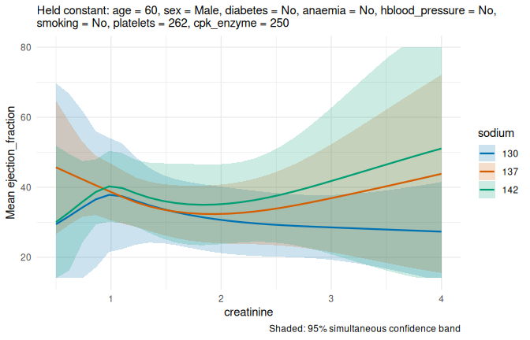

# Seeing non-linear interactions: heatmaps and cuts

## Why this package

Splines let a model follow curved relationships, and interactions let
the effect of one variable depend on another. Together they fit real
data well, but their coefficients are almost impossible to read: a
spline interaction between creatinine and sodium can have a dozen
coefficients, none of which means much on its own.

The way to understand such a model is to **look at its predictions**:

1.  A **heatmap** shows the predicted outcome over two variables at
    once.
2.  **Cuts** through the heatmap show a few curves, each with an
    uncertainty band, which are easier to compare and present.

termeffects does this for models you have already fitted with `rms`,
`stats`, `survival`, `lme4` or `mgcv`. You fit the model as usual;
termeffects only works with the fitted model.

## An example: ejection fraction in heart failure

The `heartfailure` data hold clinical records of 299 patients with heart
failure. The outcome is the left ventricular **ejection fraction**
(LVEF), a percentage between 14 and 80 that takes only 17 different
values. A proportional odds model (`rms::orm`) suits an outcome like
this: it makes no assumption about the shape of its distribution, and
its predicted means always stay within the observed range.

We let the association with serum creatinine depend on serum sodium
through a spline interaction, and adjust for eight other covariates.

``` r
library(termeffects)
library(rms)

hf <- heartfailure
hf$platelets <- hf$platelets / 1000   # thousands per microlitre

fit <- orm(ejection_fraction ~ rcs(creatinine, 4) * rcs(sodium, 4) + rcs(age, 4) +
             sex + diabetes + anaemia + hblood_pressure + smoking +
             rcs(platelets, 3) + rcs(log(cpk_enzyme), 3),
           data = hf, x = TRUE, y = TRUE)
```

(Predictors measured in the hundreds of thousands, such as platelets per
microlitre, can make an orm model numerically unstable; rescaling them,
or using the log of a skewed lab value such as CPK, avoids that.)

## Step 1: the heatmap

`term_predictions()` predicts the outcome over a grid of the two
**focal** variables. Everything else in the model is **held constant**:
numeric variables at their median, categorical variables at their most
common value. Creatinine is very skewed, so we look at 0.5 to 4 mg/dL,
where almost all patients are.

``` r
set.seed(1)
surface <- term_predictions(fit, c("creatinine", "sodium"),
                            values = list(creatinine = seq(0.5, 4, length.out = 50)), n = 50)
term_heatmap(surface, show_data = TRUE, show_support = TRUE)
```

<!-- -->

Colour shows the predicted mean LVEF, and the white contour lines join
points with the same prediction. The dots are the patients. The faded
areas lie outside the region holding 97.5% of the patients: there the
surface is an extrapolation and should not be over-interpreted.

## Step 2: cuts through the surface

To present this, or to judge how certain it is, take a few **cuts**: fix
sodium at some values and plot LVEF against creatinine. First mark the
cuts on the heatmap, then compute and plot the curves along those lines:

``` r
cut_values <- list(sodium = c(130, 137, 142))
term_heatmap(surface, cuts = cut_values)
```

<!-- -->

``` r

cuts <- term_predictions(fit, c("creatinine", "sodium"),
                         values = list(creatinine = seq(0.5, 4, length.out = 50), sodium = c(130, 137, 142)))
term_curves(cuts)
```

<!-- -->

## Step 3: uncertainty map, covariate table and caption

The plots above list the held covariates in their subtitle. For a
manuscript you also need to show where the surface is precise, a table
of the covariate values and a figure legend. `term_figure()` returns all
of these together:

``` r
fig <- term_figure(surface, cuts = cut_values, show_data = TRUE)
names(fig)
#> [1] "heatmap"     "curves"      "uncertainty" "covariates"  "caption"     "model"
```

`fig$heatmap` and `fig$curves` are ordinary ggplot2 plots, and
`fig$uncertainty` shows where the surface is estimated precisely:

``` r
fig$curves
```

<!-- -->

``` r
fig$uncertainty
```

<!-- -->

`fig$covariates` lists every covariate that is held constant, its value
and why that value was chosen:

``` r
fig$covariates
#>         covariate value   chosen_as
#> 1             age    60      median
#> 2             sex  Male most common
#> 3        diabetes    No most common
#> 4         anaemia    No most common
#> 5 hblood_pressure    No most common
#> 6         smoking    No most common
#> 7       platelets   262      median
#> 8      cpk_enzyme   250      median
```

and `fig$caption` is a figure legend in words: what is predicted, from
which model, how the two focal variables enter it, the values of all
other covariates and which intervals are shown.

``` r
cat(fig$caption)
```

Mean ejection_fraction over creatinine and sodium, from a proportional
odds model (rms::orm), n = 299: ejection_fraction ~ rcs(creatinine, 4)
\* rcs(sodium, 4) + rcs(age, 4) + sex + diabetes + anaemia +
hblood_pressure + smoking + rcs(platelets, 3) + rcs(log(cpk_enzyme), 3).
In the model, creatinine enters as rcs(creatinine, 4) and sodium as
rcs(sodium, 4). They interact in the model (rcs(creatinine,
4):rcs(sodium, 4)). All other covariates are held constant: age = 60
(median), sex = Male (most common), diabetes = No (most common), anaemia
= No (most common), hblood_pressure = No (most common), smoking = No
(most common), platelets = 262 (median), cpk_enzyme = 250 (median).
Curves: cuts through the surface at sodium = 130, 137, 142. Shaded: 95%
simultaneous confidence band, covering all curves at once (critical
value 2.95).

## Pointwise or simultaneous?

Each curve has a shaded **simultaneous confidence band**. It is built so
that, with 95% confidence, *all three true curves lie entirely inside
their bands at the same time*. That makes it the right tool for
questions about the **shape** of the curves: for example, whether the
curve for sodium 142 could be flat (a horizontal line fits inside its
band) or whether the curves for different sodium levels really differ.

The familiar **pointwise** interval only makes a statement about *one*
creatinine value at a time. Using it to judge a whole curve is like
doing dozens of tests without correcting for multiple testing: it finds
patterns that are not there too often. `band = "both"` shows the two
together; the simultaneous band is always the wider one.

``` r
term_curves(cuts, band = "both")
```

<!-- -->

The numbers behind the plots are in an ordinary data frame:

``` r
cuts
#> Predictions over creatinine, sodium ( 150 grid points, response scale )
#> Held constant: age = 60 (median), sex = Male (most common), diabetes = No (most common), anaemia = No (most common), hblood_pressure = No (most common), smoking = No (most common), platelets = 262 (median), cpk_enzyme = 250 (median)
#> Critical values for 95% intervals (analytic): pointwise 1.960, simultaneous 2.953
#> 
#>  creatinine sodium estimate conf.low conf.high band.low band.high
#>      0.5000    130    29.42    16.91     51.91    14.68     60.67
#>      0.5714    130    30.79    18.85     49.80    15.80     58.06
#>      0.6429    130    32.21    21.30     47.71    17.86     55.18
#>      0.7143    130    33.68    24.20     45.84    20.75     52.11
#>      0.7857    130    35.15    27.27     44.52    24.03     49.47
#>      0.8571    130    36.47    29.69     44.18    26.71     48.25
#>      0.9286    130    37.44    30.88     44.79    27.95     48.62
#>      1.0000    130    37.87    31.15     45.40    28.14     49.28
#>      1.0714    130    37.66    31.10     45.00    28.16     48.81
#>      1.1429    130    37.01    30.99     43.73    28.27     47.27
#> ... with 140 more rows
```

The *critical values* in the header are the multipliers of the standard
error: 1.96 for a pointwise 95% interval, and a larger value for the
simultaneous band.

To test a specific curve, for example a published reference, against the
band, see `test_simultaneous_predictions()` and the vignette
“termeffects: introduction”.

## Holding other variables at chosen values

The predictions above are for a 60-year-old man without diabetes and so
on, the median and most common values. Use `at` to choose other values,
e.g. for women with diabetes:

``` r
women <- term_predictions(fit, c("creatinine", "sodium"),
                          values = list(creatinine = seq(0.5, 4, length.out = 50), sodium = c(130, 137, 142)),
                          at = list(sex = "Female", diabetes = "Yes"))
term_curves(women)
```

<!-- -->

## One variable: a termplot with bands

termeffects also works for a single spline variable, like base R’s
`termplot()`. Here is age in a linear model for ejection fraction:

``` r
fit_age <- lm(ejection_fraction ~ rcs(age, 4) + sex + rcs(creatinine, 4) + diabetes,
              data = hf)
```

`termplot()` shows the spline term for age, centred to average zero,
with pointwise ±2 standard error lines:

``` r
termplot(fit_age, terms = "rcs(age, 4)", se = TRUE, rug = TRUE)
```

<!-- -->

termeffects shows the predicted ejection fraction over age, for a
patient with the other covariates at their median or most common values,
with both kinds of interval:

``` r
set.seed(3)
age_curve <- term_predictions(fit_age, "age", n = 50)
term_curves(age_curve, band = "both")
```

<!-- -->

The plots are ordinary ggplot2 objects, so anything else is added with
`+`: here a rug of the observed ages, and a title in place of the
subtitle. The default grid spans the whole observed range, so no
observations are cut off.

``` r
library(ggplot2)
term_curves(age_curve) +
  geom_rug(aes(x = age), data = hf, inherit.aes = FALSE, alpha = 0.3) +
  labs(title = "Ejection fraction by age", subtitle = NULL)
```

<!-- -->

The two plots look the same in shape, but they differ in three ways:

- **The y-axis.** `termplot()` shows the term’s contribution, centred at
  zero; termeffects shows the predicted outcome itself, here in percent
  LVEF. In a linear model the two curves differ only by a constant (the
  intercept plus the contributions of the other covariates at their held
  values), so their shape is exactly the same.
- **The pointwise intervals.** `termplot()` uses only the uncertainty of
  the age coefficients, so its interval is narrowest near the average
  age. termeffects’ pointwise interval is for the prediction and also
  includes the uncertainty of the intercept and of the other covariates’
  coefficients, so it is wider, most of all in the middle of the age
  range (here about twice as wide at age 64) and much less at the ends.
  (`termplot()` draws ±2 standard errors; termeffects uses the exact
  t-quantile.)
- **The simultaneous band.** termeffects adds a band that holds for the
  whole curve at once. It is the right interval for the questions people
  usually ask of such a plot: *is the association non-linear?* (a
  straight line fits inside the band) or *does the outcome change with
  age at all?* (a horizontal line fits inside the band).

For a logistic or Cox model, termeffects shows probabilities or hazard
ratios by default, so the curve’s shape also differs from `termplot()`,
which works on the log-odds or log-hazard scale; `scale = "link"` gives
the same scale as `termplot()`. `termplot()` does not work with `rms`
fits such as `orm`; termeffects does.

## How the intervals for an orm model are computed

For `orm` models, the default intervals are computed for the model’s
linear predictor and then transformed to the mean, as
`rms::Predict(fit, fun = Mean(fit))` does. Two alternatives are
available:

- `ci_method = "bootstrap"`: the model is refitted on resampled data
  with `rms::bootcov()` (the model must be fitted with
  `x = TRUE, y = TRUE`),
- `ci_method = "delta"`: the delta method on the mean scale, including
  the uncertainty of all intercepts (as
  `rms::Mean(fit)(X = , conf.int = )`).

Is the bootstrap needed? We compared the three in simulations in which
the true mean is known (`validation/08_orm_interval_methods.R` and
`validation/10_orm_intervals_complex_model.R` in the package sources),
with 300 simulated data sets each and 95% simultaneous bands over three
curves:

| Setting | Default | Bootstrap (1000 refits) | Delta |
|:---|:---|:---|:---|
| 10-level outcome, n = 200, small model | 94.3% | 92.7% | 87.7% |
| continuous outcome, n = 300, small model | 95.0% | 94.3% | 93.0% |
| 10-level outcome, n = 300, spline interaction, 24 coefficients | 93.7% | 93.3% | 63.3% |

The default covers the true curves as often as it should. The bootstrap
does so too, but in the model as complex as ours its bands were 30%
wider, so it is not needed; it remains useful as a check. The delta
method is too narrow and is not recommended.

``` r
set.seed(2)
cuts_boot <- term_predictions(fit, c("creatinine", "sodium"),
                              values = list(creatinine = seq(0.5, 4, length.out = 30), sodium = c(130, 137, 142)),
                              ci_method = "bootstrap", nboot = 300)
term_curves(cuts_boot)
```

<!-- -->

## Other models

The same functions work for:

| Model                           | Outcome scale (default)                |
|:--------------------------------|:---------------------------------------|
| `lm()`                          | predicted outcome                      |
| `glm()`                         | e.g. probability for logistic models   |
| `rms::orm()`                    | mean outcome                           |
| `survival::coxph()`             | hazard ratio versus an average subject |
| `lme4::lmer()`, `lme4::glmer()` | population-level prediction            |
| `mgcv::gam()`                   | predicted outcome                      |

Use `scale = "link"` to see the linear predictor (e.g. log-odds)
instead.

## What the bands do and do not cover

- Bands are simultaneous **over the grid of points that is plotted**,
  with the other variables held at the stated values. A finer grid makes
  the band closer to one for the whole continuous range.
- Bands are computed on the scale of the linear predictor and then
  transformed, so they stay within the possible range of the outcome
  (0–1 for probabilities, the observed range for `orm`).
- The simultaneous critical value is found by simulation. Use
  `set.seed()` before `term_predictions()` for exactly reproducible
  bands.
- The data are observational and the sample is small; the surfaces show
  associations, not effects.
